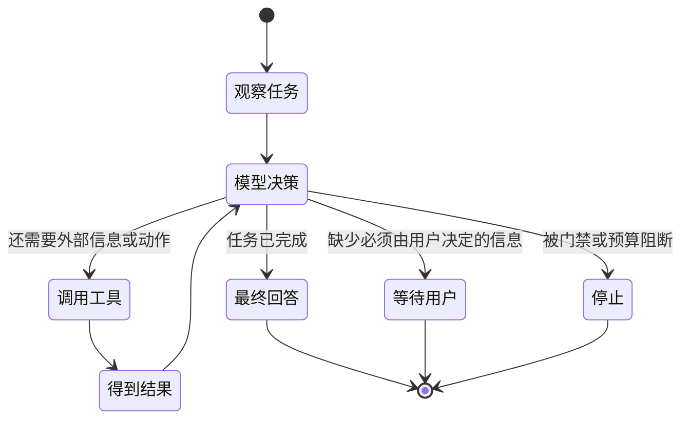
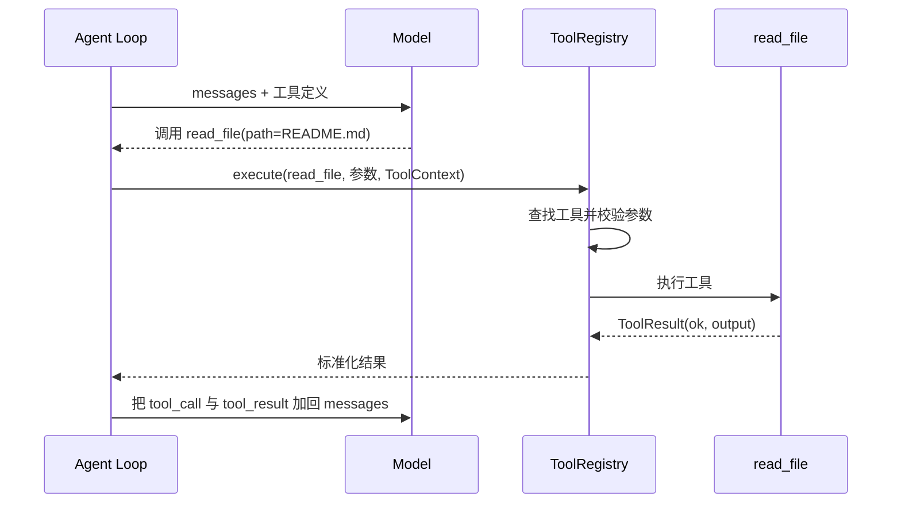

# 01. 从零理解 Agent

## 1. 先别把 Agent 想得太神秘

大语言模型本质上做的是：根据已有文本，预测下一段最合适的文本。它可以分析代码、规划步骤，但单独的大模型通常不能直接看到你的硬盘，也不能真的执行 `pytest`。

Agent 是在大模型外面加了一层运行时，让模型可以反复观察环境、选择动作、得到结果，再决定下一步。

可以用一个简单比喻：

| 角色 | 类比 |
| --- | --- |
| 大模型 | 会思考、会表达的大脑 |
| System Prompt | 岗位说明书和行为规则 |
| Context | 当前放在桌面上的资料 |
| Tool | 手、眼睛和终端 |
| Agent Loop | “看一下、想一下、做一下、再检查”的工作节奏 |
| Memory | 跨任务保留的笔记 |
| Session | 一次工作过程的完整档案 |
| Permission | 动手前的门禁 |
| Verification | 交付前的验收 |

所以，Agent 不是另一个神秘模型。它通常是“模型 + 工具 + 循环 + 状态 + 安全约束”的组合。

## 2. Chatbot、Workflow 和 Agent 的区别

| 类型 | 谁决定下一步 | 能否根据结果临时改计划 | 典型例子 |
| --- | --- | --- | --- |
| Chatbot | 用户每轮决定 | 很弱 | 问答机器人 |
| 固定 Workflow | 程序提前写死 | 通常不能 | 固定的 CI 流水线 |
| Agent | 模型在边界内动态决定 | 可以 | Coding Agent |

固定 Workflow 可能是：

```text
读取 A 文件 -> 运行 B 脚本 -> 生成 C 报告
```

Agent 则更像：

```text
先搜索相关代码
如果定位到实现，就阅读实现和测试
如果信息不足，再扩大搜索范围
修改后运行最相关测试
失败则根据错误选择修复或换方案
验证充分后才结束
```

它的路径不是完全预先写死的，但也不是毫无限制。工具白名单、权限、步数预算和验证规则构成了边界。

## 3. MiniCode Python 里的 Agent 公式

可以把本项目抽象成下面的公式：

```text
MiniCode Agent
= ModelAdapter
+ System Prompt / Instructions
+ ToolRegistry
+ Agent Loop
+ PermissionManager
+ Session / Memory / Context
+ Runtime Controllers
+ TUI / Headless 产品界面
```

每一项都能在仓库中找到对应实现：

| 概念 | 主要代码 |
| --- | --- |
| 模型适配 | `minicode/anthropic_adapter.py`、`minicode/openai_adapter.py`、`minicode/model_registry.py` |
| System Prompt | `minicode/prompt.py`、`minicode/prompt_pipeline.py` |
| 工具 | `minicode/tooling.py`、`minicode/tools/` |
| 主循环 | `minicode/agent_loop.py` |
| 每步策略 | `minicode/turn_kernel.py` |
| 权限 | `minicode/permissions.py` |
| 会话与回退 | `minicode/session.py`、`minicode/file_review.py` |
| 记忆 | `minicode/memory.py`、`minicode/memory_pipeline.py` |
| 上下文控制 | `minicode/context_manager.py`、`minicode/context_compactor.py` |
| 控制器 | `minicode/cybernetic_orchestrator.py` 及相关 controller 文件 |
| 终端界面 | `minicode/tty_app.py`、`minicode/tui/` |

## 4. 最小 Agent 循环

MiniCode 的真实代码比下面复杂很多，但核心思想可以压缩成这段伪代码：

```python
messages = [system_prompt, user_message]

while steps_remain:
    step = model.next(messages, tools=tool_schemas)

    if step.is_final_answer:
        return step.answer

    for tool_call in step.tool_calls:
        check_permission(tool_call)
        result = execute_tool(tool_call)
        messages.append(tool_call)
        messages.append(result)

return "达到本轮步数上限"
```

关键点是：工具结果会被再次放进 `messages`。模型下一次决策不靠猜，而是能看到刚才的读取结果、命令输出或错误信息。



## 5. 模型如何“知道”有哪些工具

每个工具都不是只注册一个 Python 函数，还会提供三类元数据：

1. `name`：工具名，例如 `read_file`；
2. `description`：告诉模型工具做什么；
3. `input_schema`：告诉模型参数必须长什么样。

例如一个读文件工具，在模型看来大致是：

```json
{
  "name": "read_file",
  "description": "读取工作区内的文本文件",
  "input_schema": {
    "type": "object",
    "properties": {
      "path": {"type": "string"}
    },
    "required": ["path"]
  }
}
```

模型返回的不是“我想读文件”这句话，而是结构化的 tool call。Provider adapter 将不同厂商的响应统一为项目内部的 `AgentStep` 和 `ToolCall`。

## 6. 一次 tool call 里发生了什么

以读取 `README.md` 为例：



这样做有两个重要好处：

- 模型厂商与具体工具实现解耦；
- 所有工具共享校验、错误保护、输出截断、权限上下文和日志能力。

## 7. Context、Session 和 Memory 不是一回事

这是最容易在面试中混淆的三个词。

### Context

当前一次模型请求真正携带的消息和资料。它受模型上下文窗口限制，太长时需要压缩。

### Session

一次完整工作会话的持久档案，包括消息、终端 transcript、工具调用、checkpoint、运行摘要等。程序重启后可以 resume、inspect 或 replay。

### Memory

从过去会话中提炼出来、可能在未来任务继续有价值的知识，例如项目约定、架构决策、用户偏好。它会按查询相关性选择性注入 prompt，而不是把所有旧会话全部塞回来。

可以这样记：

```text
Context = 此刻模型桌面上放着什么
Session = 这次工作的录像与档案
Memory  = 从多次工作中沉淀的长期笔记
```

## 8. Provider 和 ModelAdapter

Provider 是模型服务提供方或兼容接口，例如 Anthropic、OpenAI、OpenRouter 或自定义 OpenAI-compatible endpoint。

不同 Provider 的请求格式不同：

- Anthropic 使用 content blocks 和 `tool_use`；
- OpenAI-compatible API 使用 `tool_calls`；
- 流式响应的事件格式也不同。

MiniCode 用 Adapter 模式把它们统一为：

```python
AgentStep(
    type="tool_calls" or "assistant",
    calls=[...],
    content="...",
    diagnostics=...
)
```

上层 `agent_loop.py` 因此不用为每个厂商写一套循环。

## 9. MCP 是什么

MCP 可以理解成“外部工具服务的统一协议”。本地内置工具直接写在 `minicode/tools/`；MCP 工具可能来自另一个进程或服务。

MiniCode 会把 MCP 工具包装成统一名称：

```text
mcp__<server>__<tool>
```

包装后，它们也进入同一个 `ToolRegistry`，对 Agent Loop 来说和内置工具使用同一种调用方式。

本项目使用 stdio 启动 MCP server，并采用懒加载：服务器在第一次真正使用时才启动。这样可以缩短启动时间，也避免一个坏掉的 MCP server 拖垮全部工具。

## 10. Skill 是什么

Skill 不是可执行工具本身，更像一份可加载的专业工作说明。它通常保存在某个技能目录里的 `SKILL.md`。

MiniCode 会发现项目级、用户级以及 Claude 兼容目录中的技能，在 prompt 中告诉模型有哪些 Skill；需要时再用 `load_skill` 读取完整内容。

可以这样区分：

```text
Tool  = 能执行动作的函数
Skill = 告诉 Agent 如何完成某类任务的操作手册
MCP   = 从外部系统接入 Tool/Resource/Prompt 的协议
```

## 11. 子 Agent 是什么

本项目默认工具中有一个 `task` 工具，可以启动隔离的子 Agent 循环。当前定义了三种类型：

| 类型 | 权限和用途 | 最大轮数 |
| --- | --- | ---: |
| `explore` | 只读，快速搜索代码 | 5 |
| `plan` | 只读，深入分析与规划 | 8 |
| `general` | 完整工具，处理复杂多步任务 | 15 |

子 Agent 有独立消息上下文，最后只把结果摘要返回主 Agent。这样能隔离上下文，但也带来额外模型调用、结果丢失细节和权限管理成本，所以简单任务不应该滥用。

## 12. 为什么需要 Permission、Checkpoint 和 Verification

Agent 能动手后，风险也随之出现：

- 模型可能选择错误文件；
- 命令可能有破坏性；
- 一次替换可能改错位置；
- 模型可能看到一次成功输出就过早宣布完成。

MiniCode 对应增加了三层机制：

| 风险 | 机制 |
| --- | --- |
| 不该执行的操作 | PermissionManager 审批与 allow/deny 规则 |
| 修改后想恢复 | 写入前 checkpoint 与 rewind |
| 没验证就宣布完成 | turn kernel 的 verify phase 和 evidence guard |

这说明一个成熟 Agent 的难点不只是“让模型会调用工具”，更重要的是让它可控、可恢复、可解释。

## 13. 什么是 Widening

模型可能一直沿着同一条错误路线尝试，例如反复读同一个文件或重复一个失败命令。MiniCode 会根据步数、工具错误、空响应和已有证据判断“窄路径是否已经停滞”。

一旦允许 widening，系统会提示模型：

- 不要继续重复同一路径；
- 比较至少两个替代方案；
- 使用已经获得的证据；
- 必要时增加少量步数预算。

它不是无限扩张任务范围，而是一个有条件、有证据、有预算的换路机制。

## 14. MiniCode Python 的真正卖点

如果只看“模型 + 工具调用”，这个项目和许多 Agent Demo 类似。它更有辨识度的部分是：

- durable session：会话可保存、恢复、检查和回放；
- safe recovery：编辑前 checkpoint，支持 preview 和 rewind；
- memory continuity：分层长期记忆与按查询检索；
- context control：微压缩、自动压缩、熔断与稳定任务包；
- explicit runtime：explore/execute/verify phase、stop reason、widening；
- readiness：区分本地运行时问题与 provider 可用性问题。

## 15. 这一章的自测题

不看上文，尝试回答：

1. Agent 和聊天机器人的核心区别是什么？
2. 为什么工具结果必须回填到 messages？
3. Tool、Skill、MCP 分别是什么？
4. Context、Session、Memory 有什么区别？
5. 为什么 provider adapter 能降低主循环复杂度？
6. Permission、Checkpoint、Verification 分别防什么问题？
7. Widening 在什么情况下有价值？

如果你能用自己的话回答，继续阅读架构篇。

