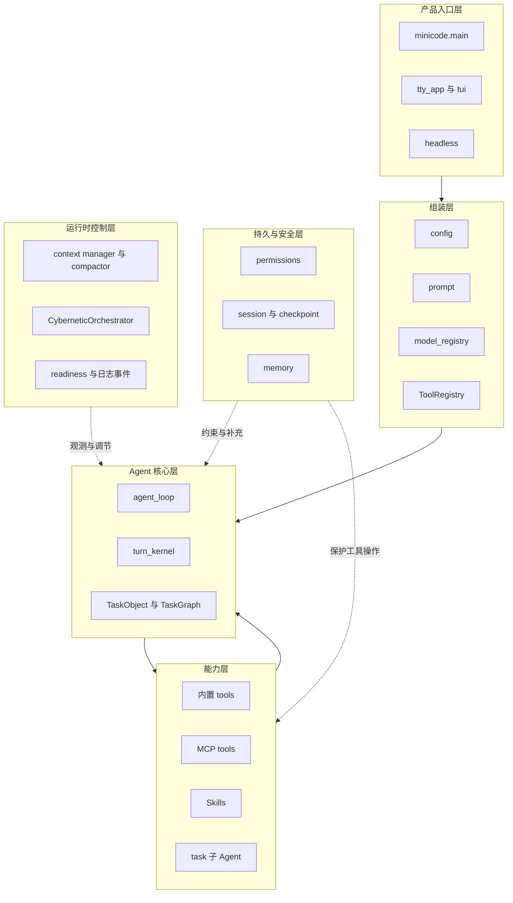
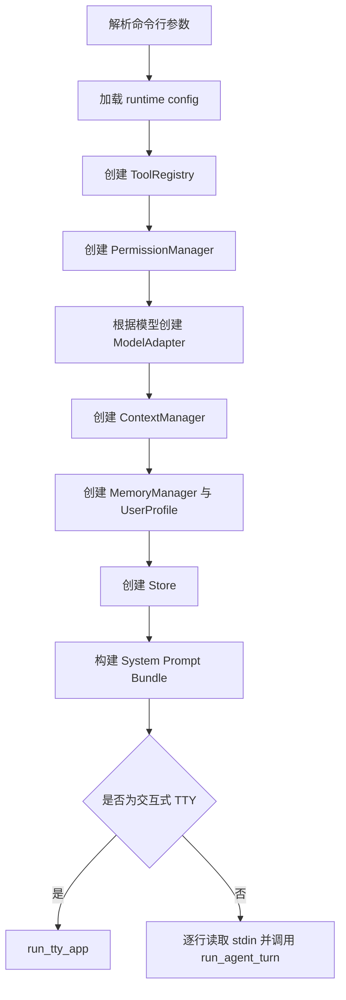
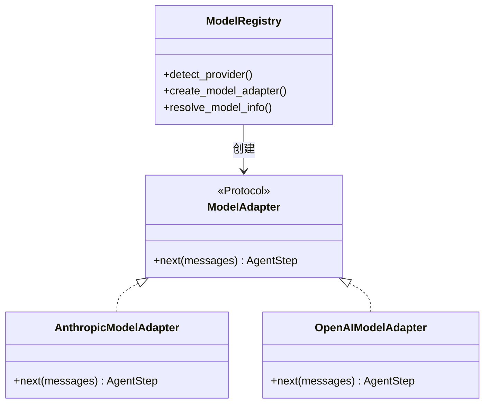
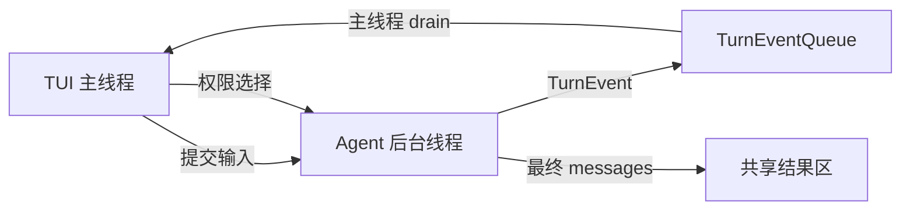
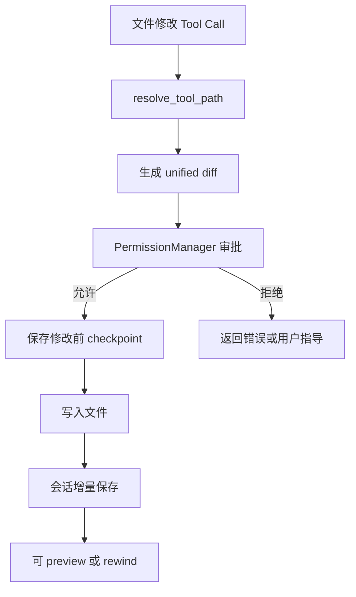
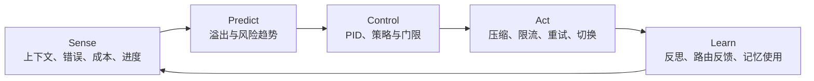

# 02. 项目架构与模块结构

## 1. 先看全局，不要先陷进文件细节

MiniCode Python 可以分成六层：

1. 产品入口层：CLI、TUI、headless；
2. 组装层：配置、prompt、工具、模型、状态管理器；
3. Agent 核心层：循环、每步策略、任务状态；
4. 能力层：本地工具、MCP、Skill、子 Agent；
5. 持久与安全层：权限、会话、checkpoint、memory；
6. 运行时控制层：上下文、成本、错误恢复、控制论与 readiness。



## 2. 仓库顶层目录怎么读

| 路径 | 作用 | 初学阶段是否必读 |
| --- | --- | --- |
| `minicode/` | 当前安装、运行和测试使用的规范 Python 包 | 是 |
| `tests/` | 活跃测试套件 | 选读，跟源码配套看 |
| `benchmarks/` | 性能、记忆、continuity、readiness 等评估脚本与结果 | 后读 |
| `Docs/Documentation/` | 架构、理论、优化和报告文档 | 选读 |
| `Main/`、`Package/` | 按仓库工程结构规范建立的公开表面与结构合规模块 | 了解 |
| `ts-src/` | TypeScript 版本和较早 Python 迁移材料 | 不作为当前 Python 主入口 |
| `openspec/` | 规格、变更与验证计划材料 | 后读 |
| `experiments/` | 实验记录 | 后读 |
| `.mini-code-memory*` | 当前工作区的持久记忆数据 | 理解 memory 时看 |
| `outputs/` | 已有评估产物 | 非主运行链 |

最重要的事实是：`pyproject.toml` 将根目录 `minicode/` 注册为安装包，README 也明确说明它是当前生效主包。不要误把 `ts-src/py-src/minicode/` 当成 Python 运行入口。

## 3. 五个控制台入口

`pyproject.toml` 定义了以下命令：

| 命令 | Python 入口 | 用途 |
| --- | --- | --- |
| `minicode-py` | `minicode.main:main` | 交互式 CLI/TUI 主程序 |
| `minicode-headless` | `minicode.headless:main` | 无交互、单次任务，适合 CI |
| `minicode-readiness` | `minicode.readiness:main` | 检查运行时和 provider 是否就绪 |
| `minicode-structure-check` | `minicode.structure_check:main` | 检查仓库结构规范 |
| `minicode-provider-smoke` | `minicode.provider_smoke:main` | 显式运行 provider smoke |

面试介绍时，先讲 `minicode-py` 和 `minicode-headless`；另外三个属于工程门禁和诊断面。

## 4. 主程序如何组装系统

`minicode/main.py` 的核心责任不是完成具体 Agent 推理，而是依赖组装：



这种做法接近“composition root”：对象在最外层创建，核心循环只接收已经组装好的依赖。

## 5. Agent 核心层

### `agent_loop.py`

这是运行时主循环，主要完成：

- 为一轮任务建立状态；
- 初始化工作链与增强控制器；
- 调用模型获得 `AgentStep`；
- 并行或串行执行工具；
- 把 tool call/result 加回消息；
- 处理空响应、provider 错误、fallback、上下文溢出；
- 根据决策继续、等待用户、完成或停止；
- 在 finally/coda 中写入审计、自省和运行摘要。

### `turn_kernel.py`

它把一部分“每一步怎么决定”的纯逻辑从大循环中抽出来：

- `TurnRecurrentState`：当前轮次的可变状态；
- `derive_turn_step_policy`：计算 explore/execute/verify phase；
- `decide_assistant_turn`：处理模型文本、空响应、验证门禁；
- `decide_tool_turn`：处理普通工具结果或等待用户；
- `StableTaskPack`：在压缩压力下保护任务目标和进度；
- coda summary：统一结束原因和任务状态。

这是一种重要的重构方向：把状态机决策做成较纯的函数，便于单元测试；把 IO、provider、线程和工具执行保留在 loop。

### `types.py`

这里定义了模型与循环之间的统一数据合同：

```text
ChatMessage
ToolCall
AgentStep
StepDiagnostics
RuntimeEvent
ModelAdapter Protocol
```

这组类型是跨模块边界。模型 adapter、Agent Loop 和 TUI 都围绕它们协作。

## 6. 模型适配层



Adapter 负责的事情包括：

- 把内部 `ChatMessage` 转成 provider 格式；
- 把工具元数据转成 Anthropic 或 OpenAI schema；
- 发送 HTTP 请求、流式解析、重试；
- 统计 token/cost；
- 把文本与 tool call 统一转换为 `AgentStep`。

主循环不关心返回数据原来叫 `tool_use` 还是 `tool_calls`。

## 7. 工具体系

`minicode/tooling.py` 是工具框架，`minicode/tools/` 是具体实现。

### ToolDefinition

一个工具定义主要包含：

```text
name
description
input_schema
validator
run
metadata
```

### ToolRegistry

负责：

- O(1) 按名字查工具；
- 先验证输入；
- 捕获工具异常并转换为 `ToolResult`；
- 对超大输出智能截断；
- 统一记录执行日志；
- 关闭 MCP 等外部资源。

### 默认 23 个核心工具

按用途可分为：

| 类别 | 工具示例 |
| --- | --- |
| 用户交互 | `ask_user` |
| 文件读写 | `list_files`、`grep_files`、`read_file`、`write_file`、`edit_file`、`patch_file` |
| 批量文件 | `batch_copy`、`batch_move`、`batch_delete` |
| 执行 | `run_command`、`test_runner` |
| Web | `web_fetch`、`web_search` |
| 任务 | `todo_write`、`task` |
| Git | `git` |
| 代码理解 | `find_symbols`、`find_references`、`get_ast_info`、`code_review` |
| 可视化 | `file_tree`、`diff_viewer` |

配置 full/utility tool profile 时，还会延迟加载 JSON、正则、编码、压缩、CSV、哈希等工具。MCP 工具也会追加到同一 Registry。

## 8. TUI 架构为什么使用事件队列

如果模型请求和工具执行直接运行在 TUI 主线程，终端会卡住，不能及时刷新流式文字、spinner 或权限框。

当前结构是：



事件类型包括：

- tool start/result；
- assistant/progress；
- runtime event；
- stream/thinking chunk；
- done。

后台线程只产生事件，TUI 主线程负责把事件归并进 transcript 并渲染。这减少了跨线程直接修改界面状态的竞态。

## 9. 状态并不是一份

项目里同时存在多种状态，它们解决不同问题：

| 状态 | 生命周期 | 代表实现 |
| --- | --- | --- |
| 当前一步状态 | 单个 step | `AgentStep`、`ToolResult` |
| 当前一轮状态 | 一次用户请求 | `TurnRecurrentState` |
| TUI 画面状态 | 当前进程 | `ScreenState`、`Store[AppState]` |
| 会话状态 | 跨进程 | `SessionData` |
| 工作记忆 | 当前任务且可跨压缩 | `working_memory.py` |
| 长期记忆 | 跨会话 | `MemoryManager` |
| 产品诊断状态 | 当前环境快照 | readiness/product surfaces |

把所有状态都塞进一个全局 dict 会很难测试和恢复；这里按生命周期拆分，是一个可以在面试中讲的架构点。

## 10. 持久化与安全层



值得注意的是，checkpoint 记录的是写入前内容，不依赖 Git commit。rewind 前还会为当前文件状态再创建 reverse checkpoint，使“撤销回退”也有恢复路径。

## 11. 记忆与上下文层

### MemoryManager

三种 scope：

- user：跨项目；
- project：项目共享；
- local：项目本地。

检索使用 BM25，加上子串、标签、使用次数、时间新鲜度和 domain 等加权，然后按 token 预算注入 system prompt。

### ContextManager / ContextCompactor

主要处理：

- 估算消息 token；
- 判断上下文占用率；
- 微压缩重复或低价值内容；
- 把工具结果持久化或压缩；
- 在接近上限时自动压缩；
- 用 circuit breaker 避免压缩连续失败导致死循环；
- 用 StableTaskPack 保留目标、进度和最近证据。

## 12. 运行时控制层

`CyberneticOrchestrator` 是一层 facade，集中初始化和调用多个 controller。它的意义不是代替 Agent Loop，而是观测循环并调节运行参数，例如：

- 最大步数；
- 工具并发数；
- 工具超时；
- token budget；
- 是否压缩；
- 是否尝试模型 fallback；
- 是否加强 nudge、恢复或自省。



这一层要诚实描述：不少输入是启发式信号，部分异常被降级吞掉，以保证主循环可用。它更像运行时控制实验平台，而不是高精度工业控制系统。

## 13. `Main/` 和 `Package/` 为什么又出现一套结构

仓库的 `AGENTS.md` 定义了一套严格工程结构：

```text
Workspace -> project -> Module
```

当前根项目中：

- `Main/MinicodeFrontline` 提供产品公开投影和查询表面；
- `Package/EngineeringStructure` 提供工程结构投影与合规查询。

它们遵循 `Src/Application/...` 与镜像 `Test/...` 规则。它们不是 `minicode/` 主包的重复实现，而是结构化的公开面/合规面。当前 Python CLI 的真实实现仍在 `minicode/`。

面试时如果对方只问 Agent 架构，不必先讲这套工程结构；如果对方追问仓库为什么有两种目录体系，再解释“规范 Python 包 + 结构投影模块”的关系。

## 14. 核心路径和增强路径

| 路径 | 是否应该优先掌握 | 原因 |
| --- | --- | --- |
| `main -> TUI/headless -> run_agent_turn -> adapter/tools` | 必须 | Agent 能工作的最小闭环 |
| permissions/session/checkpoint | 必须 | 项目最有辨识度的安全恢复能力 |
| memory/context | 必须 | 长会话与跨会话连续性 |
| turn kernel phase/verification/widening | 必须 | 解释为何不会只做一次模型调用 |
| MCP/skills/sub-agent | 第二层 | 扩展能力面 |
| 全部控制论 controller | 第三层 | 数量多，先理解输入与输出，不要逐类背实现 |
| benchmarks/release readiness | 第三层 | 工程验证和发布面 |

## 15. 架构优点与当前技术债

### 优点

- Provider adapter 隔离模型协议差异；
- Tool Registry 统一工具合同与错误保护；
- 事件队列隔离 Agent 后台线程和 TUI；
- 会话、记忆、上下文按生命周期拆开；
- checkpoint/rewind 提供 Git 之外的即时恢复；
- turn kernel 把 phase 和停止决策显式化；
- readiness 将本地逻辑与 provider 风险分开诊断。

### 当前技术债

- `agent_loop.py` 仍然很大，既做核心循环也做许多增强控制器集成；
- 部分控制器输入是估算值，精度和闭环收益需要更多实验；
- 多处增强逻辑用宽泛异常捕获降级，可靠但可能降低可诊断性；
- prompt 中存在一套内置 governance 文本，仓库同时又有新的 `AGENTS.md` 结构规范，需要持续避免规则漂移；
- 核心包几乎不依赖第三方库，便于部署，但也意味着 HTTP、终端和协议解析有较多自研维护成本。

能主动讲出这些边界，通常比只说“架构很完善”更有说服力。

## 16. 这一章的自测题

1. `main.py` 为什么更像 composition root？
2. 为什么 `turn_kernel.py` 适合放纯决策逻辑？
3. ModelAdapter 和 ToolRegistry 分别隔离了什么变化？
4. TUI 为什么不用 Agent 后台线程直接改画面？
5. Session、Memory、Turn State 的生命周期如何不同？
6. `Main/Package` 和根 `minicode/` 是什么关系？
7. 如果要继续重构 `agent_loop.py`，你会先拆出哪三部分？

