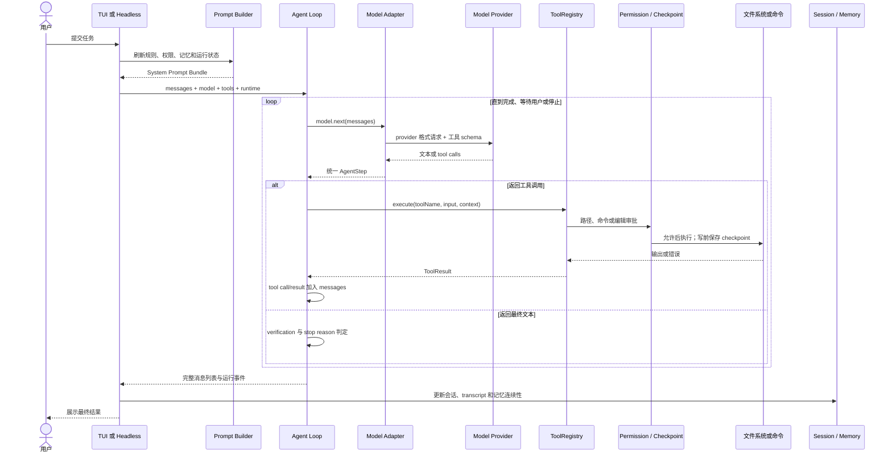
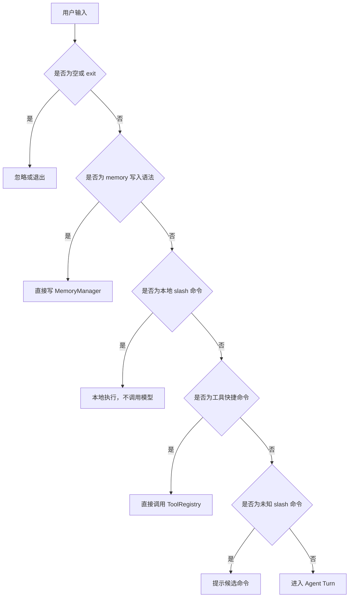
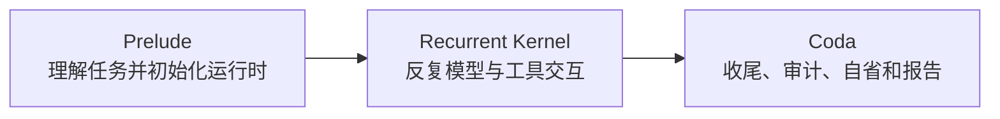
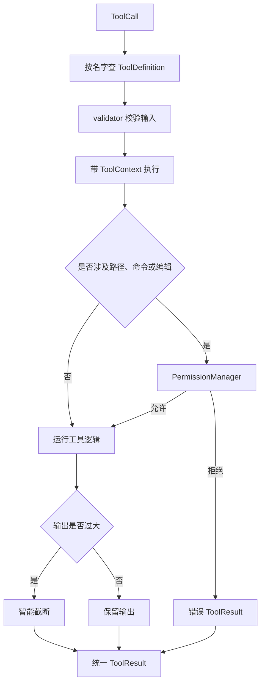
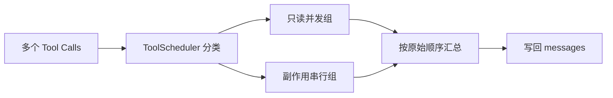
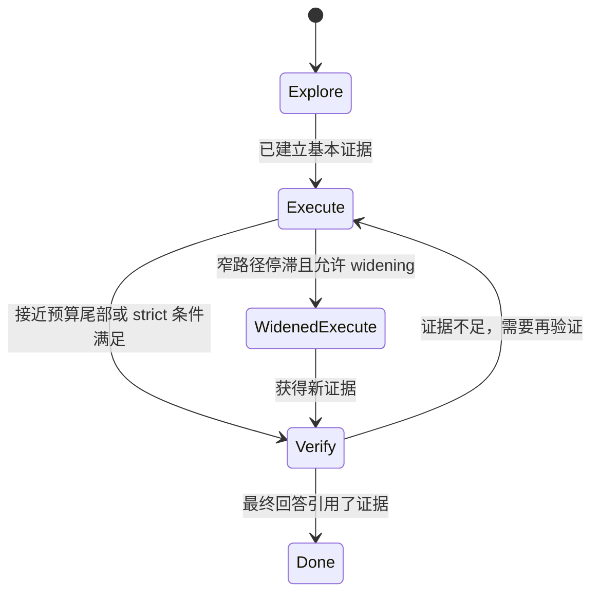

# 03. 一条请求的完整执行流程

这一章用“请分析登录失败的原因并修复”作为例子，沿着真实代码解释请求从终端输入到最终回答经历了什么。

## 1. 总流程先行



## 2. 程序启动阶段

### 第一步：解析命令行参数

`minicode.main:main` 处理两类参数：

- 直接执行管理动作，例如 `--readiness`、`--list-sessions`、`--rewind`；
- 启动交互 Agent 所需的参数，例如 `--resume`、`--trust-project-mcp`、日志选项。

如果请求只是查看会话或 readiness，程序会直接执行并退出，不必创建模型和工具循环。

### 第二步：加载 runtime config

`load_runtime_config` 会合并设置文件与环境变量，解析：

- 当前模型；
- Anthropic/OpenAI/OpenRouter/custom endpoint 凭据；
- fallback models；
- MCP servers；
- runtime profile；
- tool profile；
- token 等运行参数。

交互式主程序配置失败时会警告并退回 mock model，方便查看界面；`headless` 模式配置失败则返回非零结果，因为 CI 不应该在不知情的情况下使用 mock。

### 第三步：创建核心对象

主程序依次创建：

```text
ToolRegistry
PermissionManager
ModelAdapter
ContextManager
MemoryManager
UserProfileManager
Store[AppState]
System Prompt Bundle
```

这一步决定本次运行“能调用什么、由谁调用、在哪个目录工作、如何审批、有哪些历史知识”。

## 3. 用户输入进入 TUI 后的分流

`minicode/tui/input_handler.py::_handle_input` 不会把所有输入都发给模型，而是按顺序分流：



例如 `/session`、`/memory`、`/readiness` 主要是本地产品命令，不需要花费模型 token。普通自然语言任务才进入 Agent Loop。

## 4. 进入 Agent Turn 前做了什么

对普通任务，TUI 会：

1. 将用户输入加入 transcript；
2. 标记 UI 为 busy；
3. 触发 `USER_INPUT` hook；
4. 检测 prompt injection 模式；
5. 重新构建 system prompt；
6. 用当前 query 检索相关 memory；
7. 把用户消息加入 `args.messages`；
8. 为本轮开启权限状态；
9. 启动后台 Agent 线程；
10. 用 `TurnEventQueue` 把后台事件交给 UI 主线程。

输入层的 prompt injection 检测当前是“警告并增加 system message”，不是绝对阻断。这一点不能描述成完整防注入沙箱。

## 5. System Prompt 是如何拼出来的

`build_system_prompt_bundle` 使用 `PromptPipeline` 将内容分成静态和动态两部分。

### 静态部分

- Agent 角色和默认行为；
- 工具优先、需要时实际修改与验证；
- `<progress>` / `<final>` 协议；
- 子 Agent 使用说明；
- 内置 engineering governance 文本。

### 动态部分

- 当前 cwd 与权限摘要；
- 已发现的 Skills；
- MCP server 状态；
- 与当前问题相关的 Memory；
- instruction layers；
- hooks、delegation、extensions；
- readiness 摘要；
- 全局或项目 `CLAUDE.md`。

静态段可跨轮缓存，动态段按不同 TTL 刷新。这样既减少重复组装成本，又能让权限、memory 和 MCP 状态及时变化。

## 6. Agent Turn 的三段式结构

`run_agent_turn` 可以按概念拆成 Prelude、Recurrent Kernel、Coda。



### Prelude：进入循环前

主要工作包括：

- 复制消息，避免直接污染调用者列表；
- 解析 `single` 或 `single-deep` runtime profile；
- 创建 `TurnRecurrentState`；
- 从最后一个用户消息解析 intent 和 task；
- 创建 TaskGraph 和当前 slot；
- 构建 layered context；
- 把工具注册成 capability；
- 初始化 `CyberneticOrchestrator`；
- 可选进行模型路由、前馈风险评估和 memory 注入；
- 创建 context compactor、micro compactor、circuit breaker 和 cost control；
- 在第一轮请求前做一次上下文检查与压缩。

### Recurrent Kernel：反复执行

每个 step 做以下事情：

1. 增加 step 计数；
2. 推导 explore/execute/verify 策略；
3. 必要时压缩上下文；
4. 生成 StableTaskPack 并放入 system message；
5. 触发 step start hooks 与控制器；
6. 检查上下文是否已经到 blocking limit；
7. 调用模型；
8. 处理模型文本或工具调用；
9. 执行工具并回填结果；
10. 让控制器观察结果并调整下一步；
11. 回到下一轮。

### Coda：无论如何都执行

`finally` 中会：

- 发布 exactly-one done event；
- 触发 `AGENT_STOP` hook；
- 结束 metrics 计时；
- 生成统一 coda summary；
- 更新 TaskObject 与 TaskGraph；
- 记录决策审计；
- 做任务后 reflection；
- 更新 memory 使用反馈与模型路由学习；
- 保存稳定性、成本、上下文和 supervisor 报告。

## 7. 一次模型调用返回什么

Provider adapter 最终只向 Agent Loop 返回两类 `AgentStep`。

### 类型一：工具调用

```python
AgentStep(
    type="tool_calls",
    content="我先查看相关实现",
    calls=[
        {
            "id": "call_123",
            "toolName": "grep_files",
            "input": {"pattern": "login failed"},
        }
    ],
)
```

### 类型二：Assistant 文本

```python
AgentStep(
    type="assistant",
    content="问题已修复，并通过相关测试。",
    kind="final",
)
```

还会附带 diagnostics，例如 provider 的 stop reason、block types 和被忽略的 thinking block 类型。循环用这些信息区分正常结束、空响应、暂停、max tokens 等情况。

## 8. `<progress>` 与 `<final>` 为什么存在

模型输出纯文本时，运行时需要知道它是：

- “我正在做，还会继续调用工具”；
- 还是“我已经完成，可以结束本轮”。

因此 prompt 要求模型使用：

```text
<progress> 仍在工作
<final> 最终交付
```

Adapter 会移除标签并把语义放到 `AgentStep.kind`。如果模型发 progress，循环会把它记录为 `assistant_progress`，再追加一条系统 nudge，让模型继续具体行动，而不是把进度播报误当成完成。

## 9. 工具调用的内部流水线

一次工具调用会经过多层保护：



`ToolRegistry.execute` 将验证失败、未知工具和普通异常都转为 `ToolResult(ok=False)`。这样单个工具崩溃通常不会直接带崩整个 Agent Turn。

外层 `_execute_single_tool` 又加了一层超时和异常保护。默认工具超时由 `MINICODE_TOOL_TIMEOUT` 控制，控制器也可以动态缩短。

## 10. 多工具为什么有时并行、有时串行

模型一次可以返回多个 tool call。循环使用 `ToolScheduler` 分组：

- 并发安全的只读工具进入线程池；
- 写文件、命令等有副作用工具按原顺序串行；
- 最终结果仍按原始 call id 顺序放回消息。



这避免了两个写操作互相覆盖，也让多个独立搜索/读取减少等待时间。

## 11. 工具结果如何成为下一轮证据

每个结果会生成两条内部消息：

```python
{
    "role": "assistant_tool_call",
    "toolUseId": "call_123",
    "toolName": "read_file",
    "input": {"path": "..."},
}

{
    "role": "tool_result",
    "toolUseId": "call_123",
    "toolName": "read_file",
    "content": "文件内容或错误",
    "isError": False,
}
```

这两条消息有三个用途：

1. provider 下一次调用时可恢复完整 tool call 协议；
2. 模型能根据真实结果继续判断；
3. session/replay 可以解释发生过什么。

同时 `TurnRecurrentState` 会保存最近结果摘要、错误数量和 evidence 状态，用于 verification 与 widening。

## 12. 具体例子：修复一个配置读取问题

假设用户说：

```text
配置文件存在，但程序总说没有 model，请找出原因并修复。
```

一条合理运行轨迹可能是：

1. 模型调用 `grep_files` 搜索错误文本；
2. 找到 `load_runtime_config` 后调用 `read_file`；
3. 阅读相关测试；
4. 推断设置合并优先级或字段名有误；
5. 调用 `edit_file`；
6. `file_review.py` 生成 unified diff；
7. TUI 显示审批框；
8. 用户允许后，session 先保存旧内容 checkpoint；
9. 写入新内容；
10. 模型调用 `test_runner` 或 `run_command` 执行相关测试；
11. 如果测试失败，错误作为 tool result 回填；
12. 模型再修一次或换方案；
13. verify phase 检查最终回答是否提到验证证据；
14. 输出修改内容、验证结果和仍存在的限制；
15. TUI 将 messages、transcript 和 checkpoint 写入 session。

这里最关键的不是模型“第一次就猜对”，而是循环允许它根据证据纠错。

## 13. 文件修改为什么可回退

`write_file`、`edit_file`、`patch_file` 最后都会走 `apply_reviewed_file_change`：

```text
读取原文件
-> 新旧相同则直接返回
-> 生成 diff
-> 请求编辑权限
-> create_file_checkpoint 保存原内容
-> 真正写入
```

checkpoint 包含：

```text
checkpoint_id
created_at
file_path
existed
previous_content
kind
group_id
```

如果原文件原本不存在，rewind 会删除这个新文件；如果原本存在，rewind 会写回旧内容。

## 14. Explore、Execute、Verify 三阶段

每个 step 的 phase 不是模型自己随口说，而由 `derive_turn_step_policy` 根据 step、profile、剩余预算、工具结果和严格验证状态推导。



默认 profile：

| Profile | 最大步数 | 空响应重试 | 严格验证 | Widening |
| --- | ---: | ---: | --- | --- |
| `single` | 50 | 2 | 否 | 默认关闭 |
| `single-deep` | 80 | 3 | 是 | 第 6 步后满足停滞条件可开启，并可增加 6 步 |

严格 verify phase 中，如果系统已有工具证据，而最终文本完全没有提到验证、测试或相关证据，guard 会先扣住最终回答，要求模型补充证据或说明 blocker。

## 15. 什么时候结束一轮

`TurnStopReason` 包含：

| 原因 | 含义 |
| --- | --- |
| `done` | 正常完成 |
| `await_user` | 工具要求用户输入或审批 |
| `blocked` | provider、上下文或其他硬阻塞 |
| `max_steps` | 达到步数预算 |
| `verification_failed` | 已进入验证阶段但无法形成可靠结论 |
| `widen_needed` | 旧路径停滞，需要扩大搜索后再继续 |

显式 stop reason 比“模型突然不说话”更容易在 TUI、session replay 和 readiness 中解释。

## 16. Provider 和上下文错误如何恢复

### Provider 请求错误

处理顺序大致是：

1. Connection/Timeout 直接生成安全错误文本；
2. 其他异常先分类；
3. 如果像 context too long，尝试 reactive compaction；
4. 如果像临时服务不可用，且不是认证/参数错误，尝试 ModelSwitcher fallback；
5. fallback 成功则继续循环；
6. 否则以 `blocked` 结束并给出 provider channel/fallback 指导。

认证失败、工具 schema 错误、context length 等不会盲目切模型，因为换模型通常不能解决根因。

### 上下文接近极限

防线从轻到重包括：

- MicroCompactor；
- ContextCompactor / ContextCybernetics；
- read dedup；
- StableTaskPack；
- circuit breaker；
- preemptive blocking limit。

如果压缩后仍接近上限，系统会停止本轮，避免直接发送一个大概率被 provider 拒绝的请求。

## 17. TUI 如何显示进度而不阻塞

Agent 在 daemon worker thread 中运行。每次模型流、thinking、工具开始、工具结束、phase 变化都会变成 `TurnEvent` 放入队列。

TUI 主循环持续 drain 队列并更新 `ScreenState`：

- 工具开始时显示 running；
- 完成后标 success/error；
- 相同文件的多次编辑可以聚合；
- 长工具输出会自动折叠；
- runtime event 展示 phase、verification 和 stop reason；
- worker 完成后用 done snapshot 和共享 messages 做最终交接。

## 18. Session 如何在轮次结束后保存

TUI 会把以下内容同步到 `SessionData`：

- messages；
- transcript entries；
- history；
- permissions summary；
- skills 与 MCP server 摘要；
- memory continuity；
- instruction/hook/delegation/extension/readiness 快照；
- checkpoints。

Session 默认位于用户目录下的 `.mini-code/sessions`，支持增量 delta 保存，并周期性合并成完整文件。TUI 退出时强制保存。

## 19. 用代码实际跟一遍

建议按这个顺序设置断点：

1. `minicode/main.py::main`
2. `minicode/tui/input_handler.py::_handle_input`
3. `minicode/agent_loop.py::run_agent_turn`
4. `minicode/agent_loop.py::_model_next`
5. `minicode/anthropic_adapter.py::next` 或 `openai_adapter.py::next`
6. `minicode/tooling.py::ToolRegistry.execute`
7. 某个具体工具的 `_run`
8. `minicode/turn_kernel.py::decide_assistant_turn`
9. `minicode/tui/session_flow.py::refresh_tty_session_snapshot`

断点里重点观察：

```text
current_messages
next_step
next_step.calls
turn_state.step_policy
turn_state.latest_tool_result_summary
ToolContext
ToolResult
session.checkpoints
```

## 20. 这一章的自测题

1. 为什么 slash 命令不一定调用模型？
2. Prompt 的静态段和动态段为什么要分开？
3. 一条工具结果会以什么 message role 回填？
4. 多个工具调用如何保证只读并行、写入串行？
5. 什么情况下最终回答会被 verification guard 扣住？
6. Provider 暂时不可用和 API key 错误的 fallback 策略为什么不同？
7. checkpoint 在权限审批之前还是之后创建？为什么？

