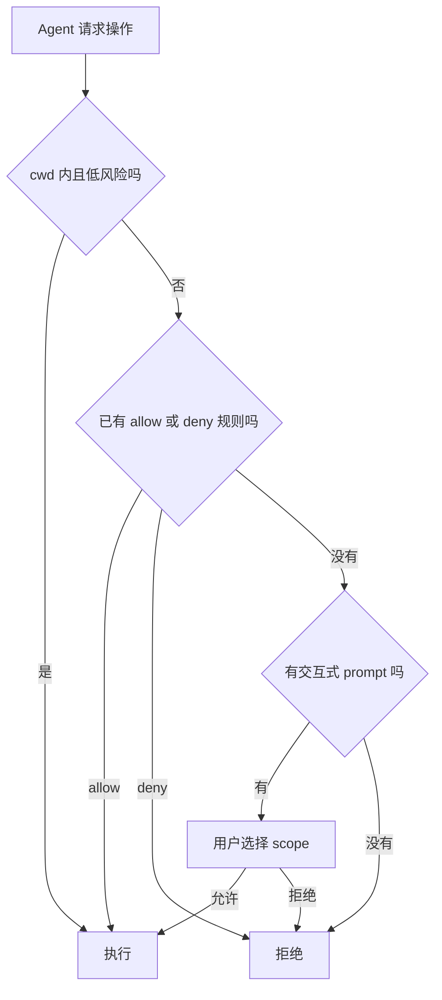
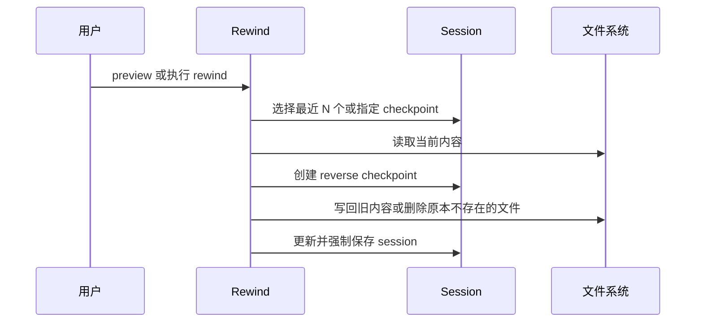
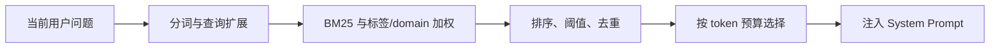
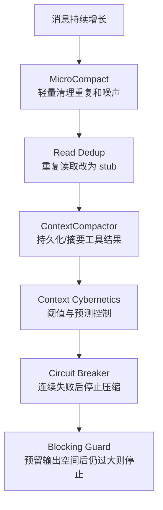
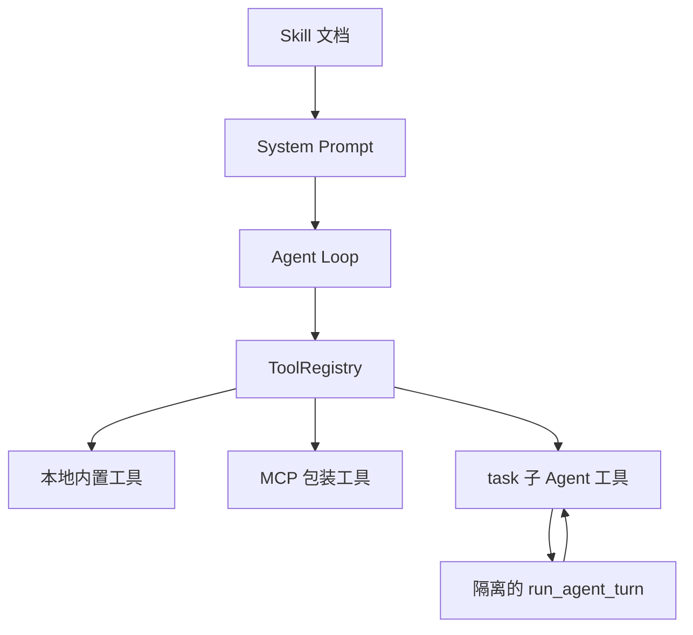
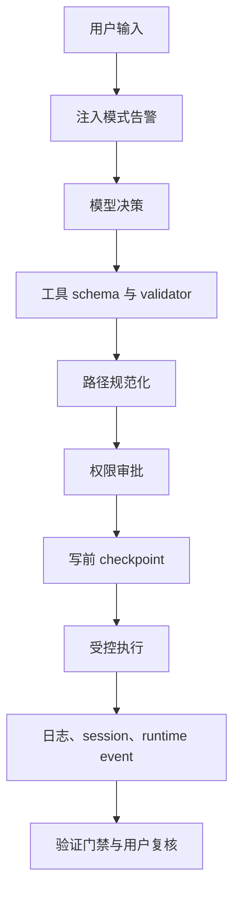

# 04. 核心机制详解

这一章不再按请求时间顺序，而是按子系统解释项目为什么“可控、可恢复、可持续”。

## 1. 工具体系：把模型意图变成受控动作

### 1.1 为什么不能让模型直接执行任意 Python

如果模型随意生成并执行 Python：

- 参数没有固定 schema；
- 权限难以统一检查；
- 错误格式各不相同；
- 无法判断哪些操作可并发；
- 会话也难以准确记录动作。

ToolDefinition 把每个动作收口成明确合同：

```text
结构化输入 -> validator -> run -> ToolResult
```

### 1.2 三层错误保护

| 层 | 负责什么 |
| --- | --- |
| 具体 Tool | 业务校验，例如搜索文本必须存在 |
| ToolRegistry | 未知工具、输入验证、异常转换、输出截断 |
| Agent Loop executor | 超时、状态复位、最终异常安全网 |

工具失败后通常不会直接结束任务。错误文本会回填给模型，并附加 `ErrorClassifier` 和 `NudgeGenerator` 生成的下一步建议。

### 1.3 工具能力元数据

工具还能标记只读和并发安全性。没有明确 metadata 时，系统会按已知工具名做保守判断。这个元数据既服务调度器，也为未来权限策略提供统一入口。

## 2. 权限体系：Agent 有手，但不是无限权限

`PermissionManager` 分三种主要风险：

### 路径访问

- cwd 内路径默认允许；
- cwd 外路径需要已保存规则、session 允许或用户审批；
- 可以允许一次、允许目录、拒绝一次或永久拒绝。

### 命令执行

- 先确认 command cwd 的路径权限；
- 普通命令通过 risk checker 判断；
- 危险命令或强制提示命令需要审批；
- allow/deny 规则可按 session 或持久化保存。

### 文件编辑

- 修改前展示 unified diff；
- 可允许一次、当前文件/当前 turn、当前 turn 所有编辑、永久允许；
- 可拒绝并把用户反馈传回模型；
- 拒绝不会被工具静默绕过。



### Headless 的特殊边界

无交互环境无法弹审批框，所以默认不能静默改文件。只有显式 `--allow-edits` 或 `MINI_CODE_ALLOW_EDITS` 才会为本次运行自动审批，并且决定是 session-scoped，不写入永久权限库。

## 3. Checkpoint 与 Rewind：不是 Git 的替代品

### 3.1 为什么还需要 checkpoint

Git 适合版本管理，但 Agent 的一次 turn 可能连续修改多个尚未 commit 的文件。用户需要在不构造 Git commit 的情况下快速恢复到某次写入前。

checkpoint 在每次真实写入前保存：

- 文件路径；
- 文件原来是否存在；
- 写入前完整文本；
- 时间、id、kind 和 group。

### 3.2 Rewind 的过程



reverse checkpoint 很关键：执行 rewind 本身也是一次有风险的状态变化，所以系统先记录“回退前的当前状态”，让用户有机会撤销这次回退。

### 3.3 与 Git 的关系

```text
Checkpoint/Rewind = 会话内、写入粒度、即时恢复
Git                = 仓库级、提交粒度、协作与历史版本
```

两者互补。生产使用仍应该保留 Git 工作流。

## 4. Session：保存完整工作过程

### 4.1 Session 保存什么

`SessionData` 不只保存聊天文本，还包含：

- 规范 messages；
- TUI transcript；
- turn records；
- 输入历史；
- 权限摘要；
- skills/MCP；
- instruction、hook、delegation、extension、readiness 快照；
- memory continuity；
- file checkpoints；
- 轻量 metadata。

### 4.2 增量保存

如果每 30 秒都重写整个长会话，会越来越慢。项目使用 delta：

```text
完整 session 文件
+ delta_0000.json
+ delta_0001.json
+ ...
-> 达到条件后 consolidation
```

只把新增 messages、transcript 和 checkpoints 写进 delta；每 10 次 delta 或过多文件时再做完整合并。

### 4.3 Inspect、Replay、Resume 的区别

| 能力 | 用途 |
| --- | --- |
| resume | 恢复消息和界面状态，继续工作 |
| inspect | 查看模型、工具数、checkpoint、readiness 等摘要 |
| replay | 按时间线回看用户、Agent、工具与 runtime event |
| list | 快速浏览历史会话元数据 |

## 5. Memory：跨会话保留有价值的知识

### 5.1 三个 Scope

| Scope | 路径 | 用途 |
| --- | --- | --- |
| user | `~/.mini-code/memory/` | 跨项目的个人偏好 |
| project | `<workspace>/.mini-code-memory/` | 可以随项目共享的知识 |
| local | `<workspace>/.mini-code-memory-local/` | 本地且不希望共享的信息 |

### 5.2 四个 Tier

| Tier | 语义 |
| --- | --- |
| working | 当前会话最活跃信息 |
| short_term | 最近使用的完整记忆 |
| long_term | 多次使用、已经巩固的记忆 |
| archival | 长期不用、被压缩的永久记录 |

Tier 会根据使用次数、更新时间和访问时间调整。长期未使用的条目会降低排名或进入 archival；重新命中后可以再激活。

### 5.3 一条记忆的数据结构

```text
id
scope
category
content
created_at / updated_at
tags
usage_count
domains
tier
last_accessed
related_to
```

这比只保存一段 Markdown 更适合检索、去重、关联和衰减。

### 5.4 检索怎么做

检索不是单纯 `if query in text`。大致评分为：

```text
BM25 相关性
+ 完整/部分子串分
+ 标签和分类匹配分
+ 使用次数 bonus
+ 时间新鲜度 bonus
+ domain 相关性
```

所有 scope 可在统一 corpus 上比较，避免 user scope 的弱命中压过 project scope 的强命中。注入时优先级是 local、project、user，并遵守 token 预算。



### 5.5 Memory 的维护

实现还包括：

- JSON/Markdown 双格式加载；
- 数据完整性检查与自动恢复；
- 原子写入；
- 最大条目和大小限制；
- 精确重复与 Jaccard 相似合并；
- 冲突检测；
- 时间衰减；
- 记忆 tier 升降；
- `related_to` 图关联和 spreading activation；
- reflection 结果写回与 usage feedback。

### 5.6 Memory 不等于“模型真的记住了”

Memory 是外部检索增强：系统先从本地存储找到相关条目，再把文本放进 prompt。模型参数没有被训练或永久改变。

## 6. Working Memory 与 StableTaskPack

长任务中，完整历史可能被压缩，但当前目标、约束、最近证据不能一起丢掉。

`StableTaskPack` 保存：

- task title/goal/description；
- intent/action；
- task graph 摘要；
- protected context；
- 最近工具结果；
- 当前进度；
- verification 状态；
- 剩余预算。

每个 step 都会更新这一小段稳定文本，并以 system message 形式放进当前 messages。`single-deep` 还会把它保护进 working memory。

这是“摘要可以丢细节，但不能丢任务身份”的设计。

## 7. Context Management：上下文窗口不是无限的

### 7.1 问题来源

每次模型请求都可能携带：

- system prompt；
- 用户/助手历史；
- tool call 和大量输出；
- memory；
- runtime 提示。

随着 step 增长，token 会接近模型上限，导致 provider 拒绝请求或成本飙升。

### 7.2 分层防线



### 7.3 为什么需要 Circuit Breaker

如果压缩函数本身持续失败，而循环每步都重试，会形成新的故障循环。熔断器记录连续失败，达到阈值后暂时禁止压缩，让系统用明确 blocker 结束，而不是无限重试。

### 7.4 预留输出空间

blocking limit 不是等到上下文恰好等于模型上限才触发。实现用上下文窗口的一部分作为有效窗口，并预留至少一段输出 token，提前阻止高概率失败的请求。

## 8. Turn Kernel：显式阶段与完成门禁

### 8.1 为什么需要 phase

没有阶段时，模型容易：

- 一开始就修改，没充分查看；
- 修改后继续漫无目的搜索；
- 没运行验证就宣布完成。

三阶段给每步一个主要目标：

| Phase | 指导 |
| --- | --- |
| explore | 查看、分解、建立证据 |
| execute | 做具体工具调用和增量修改 |
| verify | 运行验证、总结证据后再结束 |

### 8.2 Verification Guard 的能力边界

Guard 会检查最终文本是否包含验证语义或最近证据关键词重叠。如果不满足，会要求模型补充。

它能降低“完全无证据的完成”，但不是形式化证明：

- 模型可以说“tests passed”却未必真的可靠；
- 最强保障仍然是执行真实测试并保存 ToolResult；
- evidence marker 是启发式文本判断。

面试时可以说“验证门禁 + 真实工具证据”，不要说“保证模型绝不撒谎”。

## 9. Widening：有界地换一条路

`single-deep` 在第 6 步后才可能允许 widening，并且需要看到停滞证据，例如：

- 工具错误让窄路径不稳定；
- 已有证据但后续空响应/暂停；
- 连续空响应且没有新证据；
- 多次 recoverable thinking stop。

开启后会：

- 将 phase 拉回 execute；
- 清空部分重试计数；
- 最多增加配置的 step bonus；
- 明确要求比较替代方案，不重复旧路线。

所以 widening 不是“无限搜索”，而是停滞后的有界升级。

## 10. 控制论层：用运行信号调节 Agent

### 10.1 用汽车巡航理解

巡航控制的结构是：

```text
目标速度 -> 测量当前速度 -> 计算偏差 -> 调油门/刹车 -> 再测量
```

在 MiniCode 中可以类比为：

```text
目标：稳定完成任务
测量：错误率、上下文占用、成本、进度、延迟
控制：并发、步数、token、压缩、模型等级、工具超时
执行：调整下一 step
反馈：观察工具结果与任务结局
```

### 10.2 主要 Controller 的通俗解释

| Controller | 通俗作用 |
| --- | --- |
| Feedforward | 开始前根据任务复杂度预估风险和预算 |
| Feedback | 根据实际错误和稳定性调整参数 |
| StateObserver | 从可见指标估计内部负载与隐藏错误 |
| Predictive | 预测上下文或错误趋势，提前动作 |
| ContextCybernetics | 动态选择压缩时机和强度 |
| CostControl | 根据成本压力调整 token budget |
| ProgressController | 判断是否卡住、继续或需要确认 |
| SelfHealing | 根据故障类型触发恢复策略 |
| ModelSelection / SmartRouter | 根据任务和失败选择模型或 fallback |
| StabilityMonitor | 汇总错误、延迟和上下文健康 |
| Reflection | 任务后提炼经验 |
| CyberneticSupervisor | 聚合多个局部控制器形成统一风险报告 |

### 10.3 什么是 PID

PID 常用三个部分：

```text
P：当前偏差有多大
I：偏差累积了多久
D：偏差变化得多快
```

项目里 PID 用于上下文、成本和外层反馈调节。面试不需要推导公式，但要说明它不是大模型推理，而是围绕可测指标的传统控制逻辑。

### 10.4 必须诚实说明的限制

- 某些延迟值用 step 数近似，并非全部来自真实 wall-clock 观测；
- 一些 controller 只记录建议或设置运行时私有字段；
- 多处异常采用 best-effort 降级；
- 是否显著提高任务成功率，要靠对照实验而不是架构图证明；
- 控制器数量较多，也增加调参、可解释性和集成复杂度。

适合的面试表达是：

> 我们把 Agent 运行时看成动态系统，尝试用上下文占用、错误率和成本等信号调节步数、并发和压缩。当前是一套有测试和评估脚本的工程实验层，其中部分信号仍是启发式，后续要通过消融实验验证各控制器的真实增益。

## 11. Model Fallback：什么错误值得换模型

适合 fallback 的错误包括：

- 临时不可用；
- 5xx；
- overload/capacity；
- connection reset/timeout。

不适合盲目 fallback 的错误包括：

- 认证失败；
- bad request；
- tool schema 错误；
- 明确 context length 错误。

因为后者通常是配置或请求本身有问题，换一个模型只会浪费调用。

ModelSwitcher 还会记录最近失败，并使用 configured/default fallback。readiness 会提前告诉用户 fallback 是否真正有可用通道。

## 12. MCP、Skill 和子 Agent 的扩展边界



### MCP

扩展可执行能力，外部工具被包装成统一 ToolDefinition。

### Skill

扩展做事方法，先注入摘要，需要时加载完整 `SKILL.md`。

### 子 Agent

扩展上下文与工作分工，内部再次运行同一个 `run_agent_turn`。read-only 类型过滤工具；general 类型可继承父权限 prompt。

## 13. Readiness 与 Observability

Agent 失败不一定是 Agent 逻辑问题，也可能是：

- 没配模型；
- key 缺失；
- endpoint 无效；
- primary provider 不可用；
- fallback 不可用；
- 本地工具或产品面未就绪。

readiness 将这些状态做成显式报告，并提供 repair plan、doctor markdown、脱敏 patch preview、bundle 和 release 校验。

运行时事件则将单轮过程显式化：

```text
phase
compaction
guard
widening
recovery
stop
```

它们被 TUI 展示、被 session 保存，也能用于后续 benchmark 和故障分析。

## 14. 安全模型总结



这是一套 defense-in-depth，但不是绝对安全：

- prompt injection 当前主要告警；
- 允许执行命令始终带来系统风险；
- 用户一旦永久授权，后续门禁会减少；
- 自定义 MCP server 也属于供应链和权限边界；
- secrets 仍应通过环境和脱敏机制管理，不能写进仓库。

## 15. 最值得面试展开的四个技术点

如果面试时间有限，优先选下面四个：

1. Provider-independent Agent Loop：统一 `AgentStep` 和 Tool contract；
2. Safe editing：diff 审批、checkpoint、rewind 和 reverse checkpoint；
3. Session/Memory/Context 分层：不同生命周期与检索压缩策略；
4. Explicit runtime control：phase、verification、widening、stop reason。

控制论细节可以作为加分项，但不要让它盖过最基本的模型-工具闭环。

## 16. 这一章的自测题

1. 为什么 checkpoint 必须在权限允许之后、实际写入之前？
2. Session 增量保存解决了什么问题？
3. BM25、标签、使用次数和时间新鲜度分别贡献什么？
4. StableTaskPack 为什么应该是小而稳定的？
5. Circuit Breaker 防止哪一种新故障？
6. Verification Guard 为什么不能等同于形式化验证？
7. 哪些 provider 错误适合 fallback，哪些不适合？
8. 控制论层目前最需要什么实验来证明价值？

