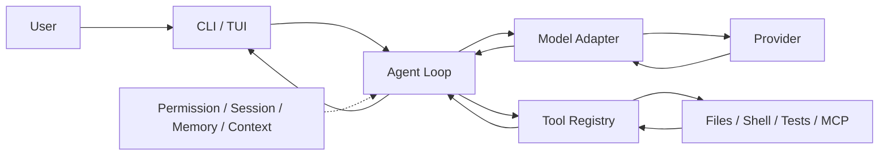

# 06. 简历写法与面试复习

这份文档可以单独反复看。最重要的原则是：只写你真的做过、真的能解释、真的能指出代码位置的内容。

## 1. 项目名称建议

```text
MiniCode Python：本地优先、可恢复的终端 Coding Agent
```

也可以更短：

```text
MiniCode Python — Terminal Coding Agent Runtime
```

## 2. 一句话项目介绍

### 初学者版

> MiniCode Python 是一个运行在终端中的编程 Agent，它通过大模型自主选择文件、搜索、命令和测试工具完成本地代码任务，并用权限审批、会话持久化、记忆、checkpoint/rewind 和验证门禁提高可控性。

### 技术版

> 该项目实现了 provider-independent 的模型—工具循环，将 Anthropic/OpenAI-compatible 响应统一为 `AgentStep`，通过 ToolRegistry 执行 23 个默认核心工具，并在循环外围加入权限、持久会话、长期记忆、上下文压缩、显式 phase/verification/widening 和 readiness 诊断。

## 3. 技术栈怎么写

```text
Python 3.11、Dataclasses/Typing、Threading/Concurrent Futures、
HTTP/SSE、CLI/TUI、JSON、BM25、MCP、Pytest/Hypothesis、
Agent Tool Calling、Session/Memory、Context Compaction
```

注意：核心 runtime 的 `dependencies = []`，主要基于 Python 标准库；`pytest` 和 `hypothesis` 属于 dev dependencies。

## 4. 根据你的真实参与程度选择简历版本

### 版本 A：如果你目前主要是在学习和分析

```text
MiniCode Python（开源项目学习与二次开发）
- 系统梳理终端 Coding Agent 的模型—工具闭环，完成 CLI/TUI、ModelAdapter、ToolRegistry、Agent Loop、Session/Memory 的调用链分析与架构文档。
- 基于实际源码复现文件读取、工具结果回填、权限审批、写前 checkpoint 与 rewind 流程，并为关键状态转换补充调试记录/测试（请仅保留你实际完成的部分）。
- 对上下文压缩、verification/widening 和控制论调度层进行边界分析，识别启发式指标、异常降级和大循环解耦等改进点。
```

### 版本 B：如果你已做了实际功能或修复

将方括号内容替换成你真实完成的改动：

```text
MiniCode Python（核心功能二次开发）
- 参与本地 Coding Agent Runtime 开发，围绕 [具体模块] 完成 [具体问题] 的实现与测试，支持模型在受控权限下读取、编辑并验证本地代码。
- 在 [ToolRegistry / Session / Memory / TUI] 链路中实现 [具体机制]，通过 [具体测试文件/命令] 验证 [正常路径、错误路径、恢复路径]。
- 优化 [上下文压缩 / 工具并发 / 事件传递 / provider fallback]，将 [可复现实验前值] 改善为 [实验后值]；指标来自 [benchmark 或测试脚本]。
```

没有真实前后实验数据时，删除第三条的百分比描述，不要编造。

### 版本 C：只有在你确实负责核心设计时使用

```text
MiniCode Python（本地优先 Coding Agent Runtime）
- 设计 provider-independent Agent Loop，以统一 AgentStep/ToolCall 合同适配 Anthropic 与 OpenAI-compatible API，实现“模型决策—工具执行—结果回填—继续规划”的多步闭环。
- 设计 23 个默认核心工具的统一注册、schema 校验、错误隔离和只读并发调度，并通过权限审批、写前 checkpoint、rewind/reverse-checkpoint 保护本地文件修改。
- 构建 durable session、BM25 分层记忆和上下文压缩体系，支持会话 resume/inspect/replay、按 query 注入项目知识及长任务上下文保护。
- 引入 explore/execute/verify phase、evidence guard、widening、provider fallback 与 readiness，使运行过程具有显式状态、停止原因和恢复路径。
```

如果这些不是你设计/实现的，请把动词改成“参与”“分析”“复现”“维护”，并明确你的真实贡献。

## 5. 可核实的项目规模数据

2026-09-01 当前工作区静态快照：

- 主包 140 个 Python 文件，约 52,978 行；
- 活跃测试目录 82 个 Python 文件，约 23,847 行；
- 23 个默认核心工具；
- 5 个控制台入口；
- 仓库 README 记录一次跨平台 CI 为 `1311 passed, 2 skipped`。

推荐写法：

> 在包含 140 个主包 Python 文件和 82 个测试文件的 Agent Runtime 中，负责/分析了……

不推荐写法：

> 独立完成 5 万行 Agent 系统。

除非 5 万行确实全部由你独立完成。

## 6. 60 秒项目介绍

> 这个项目叫 MiniCode Python，是一个本地优先的终端 Coding Agent。它和普通聊天机器人的区别是，大模型不只生成答案，还能根据任务选择读文件、搜索、编辑、命令和测试等工具；工具结果会回填给模型，让它继续规划，直到完成或遇到明确 blocker。
>
> 架构上，ModelAdapter 屏蔽 Anthropic 和 OpenAI-compatible 协议差异，ToolRegistry 统一工具 schema、校验和错误隔离，Agent Loop 负责多步执行，Turn Kernel 负责 explore、execute、verify 阶段和完成门禁。项目比较有特色的是本地可信度：每次编辑先展示 diff、通过权限门禁并保存 checkpoint，之后可以 preview 和 rewind；会话还能 resume、inspect、replay，长期记忆则按 BM25 相关性选择性注入。
>
> 我重点负责/学习的是【替换成你的真实部分】。我认为当前最大的技术债是 `agent_loop.py` 集成职责仍然过多，控制论层还有一些启发式信号，需要进一步拆分并用消融实验证明真实收益。

## 7. 三分钟项目介绍

可以按“问题—架构—难点—结果—反思”讲。

### 问题

> 单次聊天模型不能安全地操作本地仓库，也很难在长任务中保留状态、恢复错误编辑和解释失败原因。

### 架构

> 入口层有交互 TUI 和 headless；组装层加载配置、prompt、tools、model、memory 和 permissions；核心层由 Agent Loop 和 Turn Kernel 构成；能力层包含 23 个核心工具、MCP、Skills 和子 Agent；外围还有 session/checkpoint、memory/context 和 runtime control。

### 主链路

> 每一步先由 ModelAdapter 把 messages 和工具 schema 发给 provider，响应统一成 AgentStep。如果是 tool calls，ToolRegistry 校验参数并执行，结果以 tool_result 回填；如果是文本，Turn Kernel 判断它是 progress、final 还是需要 verification/widening。循环有 max steps、context blocking limit 和明确 stop reason。

### 难点

> 第一个难点是安全编辑：统一走 diff 审批，写前保存 checkpoint，rewind 前再存 reverse checkpoint。第二个是长上下文：用 micro compaction、read dedup、stable task pack、compactor 和 circuit breaker 分层处理。第三个是状态生命周期：turn state、TUI state、session、working memory 和长期 memory 分开管理。

### 结果和反思

> 项目已经形成可运行的本地 Agent 产品面和较完整测试/benchmark 体系。我自己的贡献是【真实内容】。反思是主循环过大、部分控制信号仍是估算值，下一步会拆出 TurnExecutor/RecoveryCoordinator/CodaReporter，并做控制器消融实验，而不是继续堆功能。

## 8. 高频面试题与参考回答

### Q1：什么是 Agent？

Agent 是以大模型为决策器、以工具为动作接口、以循环和状态为运行时的系统。模型观察任务和工具结果，动态选择下一步，直到完成、等待用户或被边界停止。

### Q2：它和普通 Chatbot 最大区别是什么？

Chatbot 一般只生成文本，每轮下一步主要由用户决定；Agent 可以主动调用外部工具并根据真实结果改变后续计划。MiniCode 的关键闭环是 `model.next -> tool calls -> ToolResult -> messages -> model.next`。

### Q3：为什么不能只让模型一次生成完整修改？

模型没有仓库的全部实时信息，也不知道命令实际结果。多步闭环允许先检查、再修改、再验证，并根据错误纠正，比一次性猜测更可靠。

### Q4：ModelAdapter 解决什么问题？

不同 provider 的 message、tool schema、stream event 和 token usage 格式不同。Adapter 将它们统一成内部 `AgentStep`，让 Agent Loop 不依赖某个厂商协议，符合 Adapter 与依赖倒置思想。

### Q5：模型怎么知道工具参数？

ToolDefinition 暴露 name、description 和 JSON input schema。Provider 把 schema 交给模型，模型返回结构化 tool call；Registry 的 validator 再做运行时校验，不能只相信模型生成的参数。

### Q6：ToolRegistry 为什么重要？

它统一工具查找、参数校验、异常保护、输出截断、日志和资源释放。没有 Registry，每个工具会各自实现这些横切逻辑，行为不一致且难测试。

### Q7：如何保证工具调用安全？

不是单点保证，而是多层防御：固定工具面和 schema、路径规范化、cwd 边界、危险命令分类、编辑 diff 审批、allow/deny scope、写前 checkpoint、日志和最终验证。Prompt injection 当前主要告警，不能宣称绝对安全。

### Q8：为什么只读工具可以并行，写工具要串行？

多个独立读取通常没有共享写冲突，线程池可降低等待；文件写入和命令可能影响同一状态，串行能保持模型给出的顺序并避免覆盖。结果最终仍按原 call 顺序回填，保证 provider 对应关系稳定。

### Q9：Session 和 Memory 有什么区别？

Session 是一次工作的完整档案，用于 resume/replay/rewind；Memory 是从过去任务中保留、未来可能相关的知识，用检索按需注入。Session 像录像，Memory 像提炼后的笔记。

### Q10：Context 和 Memory 又有什么区别？

Context 是当前模型请求真正携带的有限文本；Memory 是外部持久存储。Memory 必须先检索再进入 Context，不能把所有历史无限塞给模型。

### Q11：为什么使用 BM25？

记忆条目通常是短文本，BM25 能处理词频和文档长度，比简单子串或纯 TF 更适合关键词相关性排序。项目还叠加标签、分类、使用次数、新鲜度和 domain bonus。

### Q12：如何防止记忆越来越多、越来越脏？

有条目/大小限制、数据完整性恢复、去重和相似合并、usage/recency 排序、时间衰减、tier 升降、冲突检测与 reflection feedback。仍需防错误记忆污染，重要决策最好让用户确认或保留来源。

### Q13：为什么需要 Context Compaction？

工具输出和多轮消息会耗尽上下文窗口，导致高成本或请求失败。项目用微压缩、重复读取去重、工具结果摘要/持久化和主动压缩降低占用，并用 StableTaskPack 保护任务目标与证据。

### Q14：Circuit Breaker 在这里做什么？

防止压缩连续失败后每一步继续重试，形成二次故障循环。达到失败阈值后暂停压缩，让系统显式阻塞或采用其他路径。

### Q15：Explore/Execute/Verify 有什么价值？

它将每步的主要目标显式化：先建立证据，再做具体修改，最后验证。这样减少一上来盲改或改完不测。phase 由 turn state 推导，并通过 runtime event 对用户可见。

### Q16：Verification Guard 能保证正确吗？

不能。它只能要求最终回答引用本轮证据，减少无依据完成；真正正确性来自真实测试、静态检查和用户复核。文本 evidence 检查本身是启发式。

### Q17：Widening 是什么？

当原路径在一定步数后出现工具错误、空响应或重复停滞，系统允许模型比较其他方案，并给有限 step bonus。它是有条件的换路，不是无限扩大范围。

### Q18：如何处理 Provider 失败？

先分类。上下文过长优先压缩；临时不可用、5xx、overload、连接问题可尝试 fallback；认证、bad request、tool schema 等通常不切模型。失败会生成显式 blocked reason 和 readiness 指导。

### Q19：为什么 TUI 要把 Agent 放后台线程？

模型和工具可能阻塞数秒。后台线程保证主线程能持续读取键盘、刷新流和权限框；TurnEventQueue 将后台事件串行归并到 UI 状态，降低跨线程竞态。

### Q20：Checkpoint 和 Git 有什么区别？

Checkpoint 是 session 内每次写入前的快照，粒度细、即时、无需 commit；Git 是仓库版本与协作历史。两者互补，checkpoint 不替代 Git。

### Q21：为什么 rewind 前还要创建 reverse checkpoint？

回退本身也可能选错范围。如果直接覆盖当前状态，用户无法撤销回退。先保存当前状态就能实现“撤销 rewind”的安全路径。

### Q22：MCP、Skill、Tool 怎么区分？

Tool 是可执行动作；Skill 是告诉 Agent 如何完成某类任务的文档；MCP 是把外部工具、资源和 prompt 接入 Agent 的统一协议。MCP 工具最终也包装成 ToolDefinition。

### Q23：子 Agent 的优缺点是什么？

优点是隔离上下文、可限制工具、适合并行或专项分析；缺点是额外调用成本、结果摘要可能丢细节、权限和状态同步更复杂。简单查找不应使用。

### Q24：控制论层做了什么？

它把 Agent 当动态系统，用上下文、错误、成本和进度信号调节步数、并发、超时、token budget、压缩和模型 fallback。Orchestrator 统一管理 controller 生命周期。

### Q25：你认为控制论层最大的风险是什么？

部分信号是估算值，controller 多会增加耦合和调参难度，多个闭环可能相互干扰。需要消融实验比较“基线 Agent、单 controller、组合 controller”的成功率、成本和延迟，证明收益而不是只展示架构复杂度。

### Q26：项目用了哪些设计模式？

- Adapter：不同模型 provider；
- Registry：工具与 capability；
- Strategy/Policy：runtime profile、step policy、compaction；
- Observer/Event Queue：TUI runtime event；
- Facade：CyberneticOrchestrator；
- Circuit Breaker：压缩失败保护；
- Command-like object：ToolCall/ToolDefinition；
- Repository-like persistence：Session/Memory manager。

不要为了凑模式名硬套，回答时指出具体类和解决的问题。

### Q27：如何测试非确定性的 Agent？

用 fake adapter 返回预定 AgentStep，将模型随机性移除；用临时目录和 fake tools 验证消息回填、权限、checkpoint 和状态机；provider 协议使用 fake HTTP response；长链路用 integration/benchmark；真实 provider smoke 必须显式 opt-in。

### Q28：为什么核心 runtime 没有第三方依赖？

优点是安装轻、供应链少、跨平台发布简单；代价是 HTTP/SSE、TUI、检索和协议处理有更多自研代码，维护成本和边界 bug 风险更高。dev 测试仍依赖 pytest/hypothesis。

### Q29：当前最大技术债是什么？

`agent_loop.py` 仍集成 provider recovery、工具调度、context、memory 和大量 controller；宽泛降级异常使主路径稳，但可能隐藏诊断；prompt governance 与仓库结构规范也可能漂移。应继续拆边界、建立 typed events 和控制器实验矩阵。

### Q30：如果让你继续重构，会怎么做？

先保持行为不变，按职责拆出：

```text
TurnPreludeBuilder
ModelStepRunner
ToolBatchExecutor
RecoveryCoordinator
TurnCodaReporter
```

共享 `TurnRecurrentState` 和 typed decisions；先加 characterization tests，再逐块迁移。控制器通过统一 signal/action 接口接入，避免直接改 scheduler 私有字段。

## 9. 面试官让你画架构图时

画最小版本即可：



讲图顺序：

1. 用户输入；
2. Prompt/ModelAdapter；
3. 工具闭环；
4. 安全和状态；
5. 完成与验证。

不要一上来画 15 个 controller，面试官会失去主线。

## 10. 一个安全编辑的白板题

如果面试官问“Agent 如何安全改文件”，你可以写：

```text
resolve path
-> load old content
-> build new content
-> generate diff
-> permission approval
-> checkpoint old content
-> atomic/controlled write
-> run verification
-> record session
-> optional rewind
```

然后补充当前实现的边界：普通文本写入使用 `write_text`，checkpoint 与 permission 已有，但真正文件写入本身不是跨文件事务；多文件原子性仍可改进。

## 11. 反问与改进题

### 如何提高生产可靠性？

- 将命令执行放进容器/沙箱；
- 对网络和 MCP 建立更细 capability policy；
- 多文件 edit transaction 与失败回滚；
- 对最终结论绑定结构化 verification artifact；
- 引入 trace id 和 OpenTelemetry；
- 将 controller 输入替换成真实 latency/token/cost；
- 建立 provider contract tests 与 chaos tests。

### 如何降低成本？

- 小模型做搜索/分类，大模型做复杂修改；
- tool result 结构化摘要；
- 减少重复 system prompt；
- memory retrieval 控制 top-k 和 token；
- 只读工具并发；
- 任务拆分与 cache；
- 用 benchmark 验证每项优化，避免“省 token 却降低成功率”。

### 如何评价 Agent 成功？

至少同时看：

```text
任务完成率
验证通过率
平均/分位延迟
token 与美元成本
工具错误率
用户干预次数
错误编辑与成功恢复率
重复动作率
```

## 12. 面试前速记卡

### 10 个必须记住的符号

```text
main.main
run_tty_app
run_agent_turn
AgentStep
ModelAdapter
ToolRegistry
TurnRecurrentState
PermissionManager
SessionData
MemoryManager
```

### 6 个核心事件

```text
phase
compaction
guard
widening
recovery
stop
```

### 6 个停止原因

```text
done
await_user
blocked
max_steps
verification_failed
widen_needed
```

### 3 个阶段

```text
explore -> execute -> verify
```

### 3 个记忆 scope

```text
local -> project -> user
```

### 4 个记忆 tier

```text
working -> short_term -> long_term -> archival
```

## 13. 面试前最后检查

```text
[ ] 我能不用术语解释 Agent
[ ] 我能画最小模型—工具闭环
[ ] 我能跟出 main 到 tool_result 的真实路径
[ ] 我能解释 Session、Memory、Context 的区别
[ ] 我能解释安全编辑与 rewind
[ ] 我能说出 verification 的能力和限制
[ ] 我能说出一个我真实做过的修改及验证
[ ] 我不会把仓库历史成果全部冒充个人成果
[ ] 我知道当前最大技术债和下一步方案
```

## 14. 最后一句提醒

面试官真正想知道的不是你能否背出“PID、BM25、MCP”三个词，而是：为什么需要它、它在哪条调用链上、失败时会怎样、你如何证明它有效。每个简历 bullet 都应准备一段代码证据和一条验证证据。

