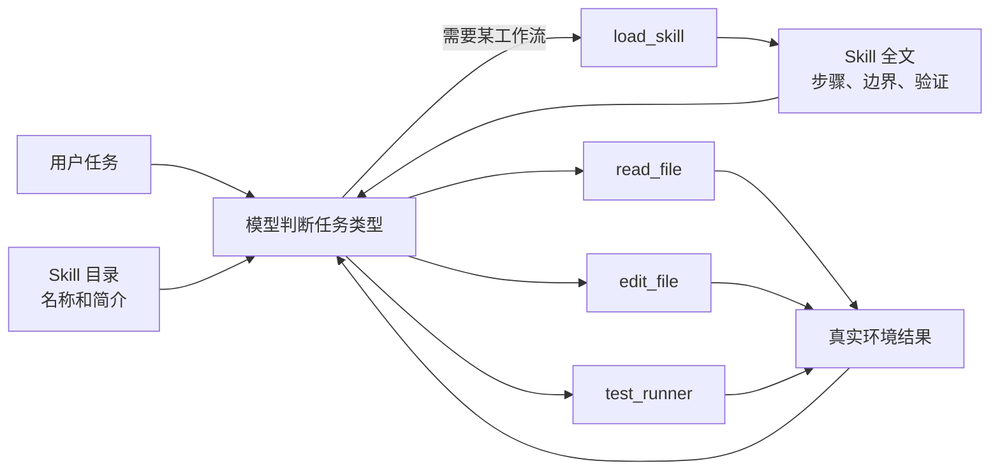
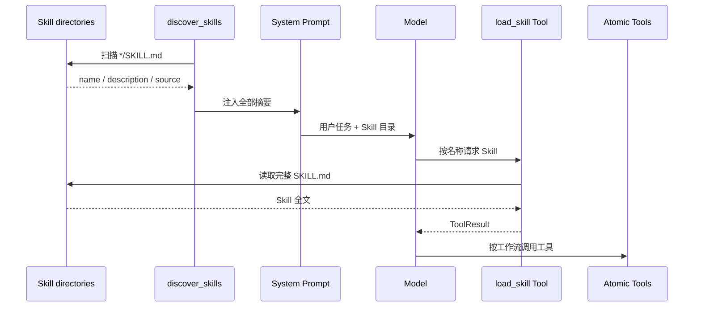
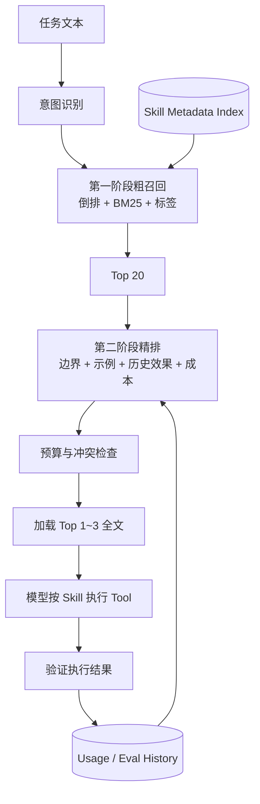

# 01. Skill 能力体系：从 Tool 到按需工作流

> 对应简历第一点。本章同时讲清“当前仓库已经实现什么”和“二阶段召回与精排应该如何设计”。面试时必须主动区分两者。

## 1. 先给结论：这条简历应该怎样理解

Skill 体系想解决的问题不是“怎么多注册几个 Tool”，而是：当 Agent 会做的事情越来越多时，如何只把当前任务真正需要的工作方法交给模型。

当前 MiniCode 已经具备：

- 从项目级、用户级和 Claude 兼容目录发现 `SKILL.md`；
- 只把 Skill 的名称与简介放进 system prompt；
- 模型判断需要某项 Skill 后，通过 `load_skill` 工具读取全文；
- 同名 Skill 按目录优先级覆盖；
- 支持安装和删除受管理的 Skill。

当前仓库还没有完整实现：

- 基于意图、标签和示例的候选索引；
- Skill 专用 BM25/向量召回；
- 第二阶段 reranker；
- 自动生成、验证并发布新 Skill 的闭环。

因此面试时最稳妥的说法是：

> 当前实现了 Skill 的分层发现、摘要暴露和按需全文加载；针对 Skill 数量增长后的检索噪声，我进一步设计了“粗召回—精排”的演进方案，但这部分不能说成已经完整落地，除非后续补齐实现和评测。

## 2. Tool、Skill、Skill 目录分别是什么

### 2.1 Tool：可以执行的原子动作

Tool 是 Agent 的“手”。它一般有：

- 固定名称，例如 `read_file`；
- 功能描述；
- JSON 参数 schema；
- 参数校验器；
- 真正执行动作的函数；
- 标准化结果 `ToolResult`。

例如 `read_file` 负责读取文件，但它不知道“排查线上故障的正确顺序”。

### 2.2 Skill：完成一类任务的方法说明

Skill 是 Agent 的“操作手册”。它通常描述：

- 什么时候应该使用；
- 什么时候不应该使用；
- 应按什么步骤工作；
- 需要调用哪些 Tool；
- 如何验证结果；
- 有哪些风险和失败处理方法。

例如“系统化调试”Skill 可以规定：先复现、再缩小范围、定位根因、做最小修改、运行回归测试。它本身不直接读取文件，而是指导模型正确组合 `read_file`、`grep_files`、`edit_file` 和 `test_runner`。

### 2.3 Skill 目录：能力索引

Skill 目录不是 Skill 全文，而是轻量索引。当前实现暴露：

```text
name + description + path + source
```

它让模型先知道“有哪些能力”，真正使用时再读取对应 `SKILL.md`。

### 2.4 三者关系



一句话记忆：

```text
Tool 决定“能做什么”；Skill 决定“怎样把一组 Tool 用对”；目录决定“当前该看哪份 Skill”。
```

## 3. 当前仓库的真实执行链

### 3.1 Skill 来源和优先级

代码在 [`minicode/skills.py`](../../../../minicode/skills.py) 中依次扫描：

```text
<workspace>/.mini-code/skills       project
~/.mini-code/skills                 user
<workspace>/.claude/skills          compat_project
~/.claude/skills                    compat_user
```

`discover_skills()` 使用 `setdefault` 按名称去重，因此先出现的目录优先。项目级 Skill 可以覆盖用户级同名 Skill，MiniCode 原生目录又优先于 Claude 兼容目录。

这个优先级的意义是：

- 项目可以针对自身约束覆盖通用工作流；
- 用户级 Skill 可在多个项目复用；
- 兼容目录提供迁移能力；
- 同名冲突有确定结果，而不是随机加载。

### 3.2 摘要发现

发现阶段会查找每个子目录中的 `SKILL.md`。`extract_description()` 跳过 Markdown 标题，取第一段有效正文作为描述。

当前摘要不是复杂 metadata parser，也不会读取 front matter 中的 tags、examples 或边界字段。面试时不要把它说成已经建立了完整元信息索引。

### 3.3 Prompt 中只放目录

工具注册时，Skill 摘要会进入 `ToolRegistry.skills`；构建 system prompt 时，只拼接名称和简介。相关代码：

- [`minicode/tools/__init__.py`](../../../../minicode/tools/__init__.py)
- [`minicode/prompt.py`](../../../../minicode/prompt.py)

这样比把每份 `SKILL.md` 全文都塞入 prompt 更节省 token，但当 Skill 数量达到几百或几千时，“所有摘要全部注入”仍会膨胀，这正是未来需要检索路由的原因。

### 3.4 按需加载全文

当模型认为任务匹配某个 Skill 时，调用：

```text
load_skill({"name": "systematic-debugging"})
```

[`minicode/tools/load_skill.py`](../../../../minicode/tools/load_skill.py) 调用 `skills.load_skill()`，返回来源、路径和全文。模型随后按照 Skill 的流程继续使用原子 Tool。

### 3.5 当前时序图



## 4. 为什么会需要二阶段召回

假设系统只有 10 个 Skill，把 10 条简介放入 prompt 很简单。若有 2,000 个 Skill，会出现：

- 目录本身占用大量 token；
- 名称相似的 Skill 相互干扰；
- 模型容易选到“看起来相关、实际边界不符”的 Skill；
- 重复功能越来越多；
- 每次请求都重复发送大量无关描述。

检索系统通常要平衡两个指标：

- **召回率 Recall**：真正有用的 Skill 有没有进入候选集；
- **精确率 Precision**：候选集中有多少确实有用。

第一阶段追求不漏，第二阶段追求选准。

## 5. 二阶段方案应该怎样设计

> 本节是可落地的演进设计，不是当前 `skills.py` 已有功能。

### 5.1 先建立结构化元信息

每个 Skill 可以维护：

```yaml
name: systematic-debugging
description: 系统化定位软件故障
intents: [debug, diagnose, fix-test]
tags: [error, traceback, regression, root-cause]
boundaries:
  include: [可稳定复现的软件问题]
  exclude: [纯产品方案讨论]
examples:
  positive: ["定位这个失败测试的根因"]
  negative: ["帮我起一个产品名字"]
required_tools: [read_file, grep_files, test_runner]
risk: medium
estimated_prompt_tokens: 1800
version: 1.2.0
```

其中：

- `intents/tags` 服务粗召回；
- `boundaries/examples` 服务精排；
- `required_tools/risk` 服务能力和权限检查；
- `estimated_prompt_tokens` 服务预算控制；
- `version` 服务回滚和效果比较。

### 5.2 第一阶段：低成本粗召回

输入是任务描述，输出 Top-K 候选，例如从 2,000 个缩到 20 个。可以组合：

```text
名称/标签倒排匹配
+ BM25 文本相关性
+ 任务意图匹配
+ 必需工具可用性
+ 项目级优先级
```

粗召回要快，并宁可多放几个候选，也不要过早漏掉正确 Skill。

### 5.3 第二阶段：高精度精排

对 20 个候选进一步计算：

```text
final_score =
    语义相关性
  + 正例相似度
  + 项目/用户历史成功率
  + 适用边界匹配
  - 负例相似度
  - 功能重叠惩罚
  - Token 成本惩罚
  - 风险与权限不匹配惩罚
```

精排器可以是规则、轻量模型或 LLM。若用 LLM，需要缓存、超时和降级：reranker 失败时仍返回第一阶段结果，不能让 Skill 路由拖垮整个 Agent。

### 5.4 只加载最终少量全文

最后只把 Top-1 或 Top-3 Skill 的全文载入上下文。若两个 Skill 冲突，应由组合策略决定：

- 选择更具体的；
- 项目级覆盖用户级；
- 安全 Skill 优先于效率 Skill；
- 明确互斥时只保留一个；
- 可组合时规定先后顺序。

### 5.5 目标流程图



## 6. “Skill 自进化”怎样才算真正成立

真正的 Skill 生长至少需要：

```text
发现重复成功模式
-> 生成候选 Skill
-> 去重/冲突检测
-> 静态安全扫描
-> 在固定任务集上评测
-> 人工审批
-> 版本化发布
-> 线上效果监控
-> 效果变差时回滚
```

当前代码中的 FeedbackController 可以产生 `recommend_skill_update`，Agent Loop 会设置 `_pending_skill_update` 标志；但没有后续完整消费者把它变成新 Skill、跑评测并发布。因此只能说“具备更新建议入口”，不能说“已经实现 Skill 自动成长闭环”。

## 7. 最容易被追问的指标

如果以后实现二阶段路由，应至少测：

| 指标 | 说明 |
| --- | --- |
| Recall@K | 正确 Skill 是否在前 K 个候选中 |
| MRR / NDCG | 正确 Skill 排名是否靠前 |
| 路由准确率 | Top-1 是否选择正确 |
| 无 Skill 识别率 | 不需要 Skill 时是否能拒绝加载 |
| 平均注入 token | 每轮 Skill 内容占用多少上下文 |
| 路由延迟 P95 | 路由是否拖慢 Agent |
| 重复/冲突率 | 新增 Skill 是否与旧 Skill 重叠 |
| 任务成功率 | 路由改进是否真的提高端到端完成率 |

没有这些实验时，不要说“提升了多少准确率”或“降低了多少 Token”。

## 8. 60 秒面试回答

> Tool 是可执行原子动作，Skill 是组合 Tool 完成某类任务的工作流。MiniCode 当前从项目、用户和 Claude 兼容目录发现 `SKILL.md`，只把名称和简介放进 system prompt；模型命中后再调用 `load_skill` 读取全文，这是一种 progressive disclosure，可以避免每轮注入所有 Skill 正文。同名 Skill 按项目优先的固定顺序覆盖。当前实现还不是完整的二阶段检索；我设计的演进方向是先基于意图、标签和 BM25 做高召回候选筛选，再根据适用边界、正反例、历史成功率和 token 成本精排，最后只加载少量全文。这样能在 Skill 数量增长后控制检索噪声和上下文成本。完整落地还需要离线标注集、Recall@K/MRR 和端到端任务成功率评测。

## 9. 高频追问与参考回答

### Q1：Skill 和 Tool 的本质区别是什么？

Tool 有执行副作用和结构化参数；Skill 是工作方法文本，不直接产生副作用。Skill 可以指导模型组合多个 Tool。

### Q2：为什么不能把所有 Skill 全文放入 system prompt？

Skill 数量增加会占满上下文、增加请求成本，并让无关规则互相干扰。目录摘要加按需加载可以把固定成本从“全部全文”降为“轻量目录 + 少量命中全文”。

### Q3：为什么要两阶段，而不是直接让大模型从全部 Skill 中选？

全量 LLM 选择成本高、延迟大，目录过长还会降低注意力质量。第一阶段便宜地缩小候选，第二阶段只对少量候选做复杂判断。

### Q4：第一阶段为什么强调 Recall？

正确 Skill 如果在第一阶段被丢掉，第二阶段再强也找不回来，因此粗排宁可保留少量噪声。

### Q5：Skill 重名怎么办？

当前按固定根目录顺序，项目级优先。成熟系统还应记录来源和版本，并在 UI 中展示最终选择，避免静默覆盖导致不可解释。

### Q6：Skill 会不会包含恶意提示？

会。Skill 是本地文本，也属于潜在不可信输入。安装时应校验来源、签名和权限声明；加载时不能让 Skill 绕过更高优先级的系统安全规则。

### Q7：元信息由谁维护？

初期人工维护最可靠；自动生成只能作为候选，必须经过 schema 校验、冲突检查、回归评测和人工审批。

### Q8：如何处理多个 Skill 同时匹配？

先判断互斥还是可组合；互斥时按专用性、项目优先级和历史效果选择，可组合时给出确定顺序和共享 token 预算。

### Q9：怎么证明路由有用？

在同一任务集比较“无 Skill、全量 Skill、仅粗召回、粗召回+精排”，同时看完成率、token、延迟和错误 Skill 选择率。

### Q10：当前仓库真正实现了 reranker 吗？

Memory 有可选 reranker，但 Skill 没有。Skill 当前是摘要目录加模型自主 `load_skill`，这是必须如实回答的边界。

## 10. 源码证据与测试

| 内容 | 位置 |
| --- | --- |
| Skill 数据结构、发现、加载 | [`minicode/skills.py`](../../../../minicode/skills.py) |
| `load_skill` 工具 | [`minicode/tools/load_skill.py`](../../../../minicode/tools/load_skill.py) |
| 默认工具与 Skill 摘要注册 | [`minicode/tools/__init__.py`](../../../../minicode/tools/__init__.py) |
| Prompt 中的 Skill 目录 | [`minicode/prompt.py`](../../../../minicode/prompt.py) |
| 安装/删除 Skill | [`minicode/manage_cli.py`](../../../../minicode/manage_cli.py) |
| 当前发现/优先级测试 | [`tests/test_skills.py`](../../../../tests/test_skills.py) |
| Skill 更新建议入口 | [`minicode/feedback_controller.py`](../../../../minicode/feedback_controller.py) |

建议亲自执行：

```powershell
python -m pytest -q tests\test_skills.py
rg -n "discover_skills|load_skill|pending_skill_update" minicode tests
```

## 11. 面试前自测

你应该能够脱稿回答：

```text
[ ] Tool、Skill、目录各负责什么
[ ] 当前 Skill 来源和覆盖顺序
[ ] 为什么摘要注入比全文注入省 token
[ ] 当前实现为什么还不算二阶段召回
[ ] Recall@K 与精排的区别
[ ] Skill 冲突、恶意 Skill 和自动生长如何治理
[ ] 哪些话是当前事实，哪些只是下一步设计
```

最重要的事实边界：

> 可以说“实现分层发现与按需加载”；不能说“已经实现 Skill 二阶段召回、精排和自动成长”，除非你先补齐代码与实验。
