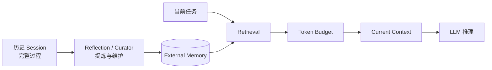
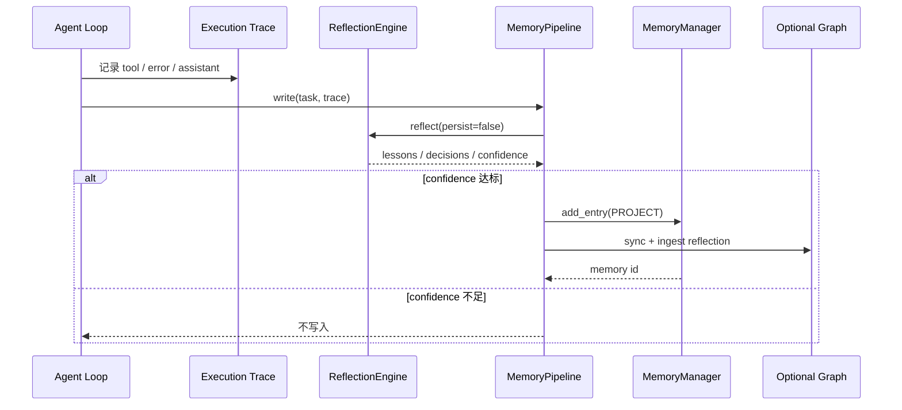
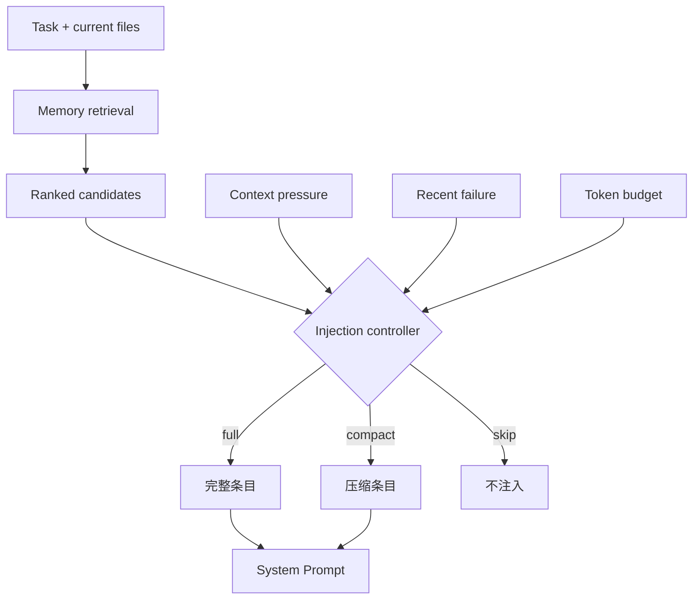

# 02. 自进化记忆沉淀：让经验跨会话复用

> 对应简历第二点。这里的“记忆”是保存在模型外部、经过检索后注入 prompt 的数据，不是训练或修改模型参数。

## 1. 先用一句人话解释

普通聊天结束后，下一次任务通常不知道上次学到了什么。Agent 记忆系统把有复用价值的事实、决策、失败经验和用户偏好保存在本地；新任务到来时，只检索少量相关内容放回当前上下文。

它解决的是：

```text
过去发生过什么，哪些经验与现在有关，应该以多大成本把它交给模型。
```

而不是：

```text
把所有聊天永久塞进 prompt，或者在本地重新训练大模型。
```

## 2. 简历表述的真实边界

当前 MiniCode 确实具备较完整的外部记忆链路：

- user/project/local 三种持久作用域；
- working/short-term/long-term/archival 四种 tier；
- BM25、标签、领域、使用次数和新鲜度评分；
- 可选 LLM reranker、vector 和 graph 检索；
- 执行结束后的 Reflection；
- 成功/失败反馈；
- 去重、归档、聚合、tier 调整和关系链接；
- token 预算和上下文压力控制下的按需注入。

但“自进化”必须谨慎解释：

- 它是外部 memory store 的内容与排序在变化；
- 不是大模型参数自我训练；
- Reflection 中很多提炼规则是启发式；
- 自动写入的记忆可能错误，需要验证、来源和淘汰机制；
- 它不能自动完成 Skill 的生成、评测与发布。

推荐面试表述：

> 我把自进化限定为“记忆资产的写入、检索、反馈和维护闭环”，而不是模型自训练。系统会从执行轨迹提炼候选经验，按作用域持久化；后续任务通过 BM25 与可选重排按需检索，并根据使用结果调整价值，后台再做去重、归档和聚合。

## 3. Session、Context、Memory 的区别

这是高频面试题。

| 概念 | 保存什么 | 主要用途 | 比喻 |
| --- | --- | --- | --- |
| Session | 一次会话的完整消息、工具调用和 checkpoint | resume、replay、rewind | 工作录像 |
| Context | 当前这次模型调用实际看到的有限消息 | 当下推理 | 摆在桌面上的材料 |
| Memory | 从过去任务提炼的可复用知识 | 跨任务检索 | 可查询的长期笔记 |

关系是：



Memory 不在模型里；只有被检索并注入 Context 的条目，模型本轮才能看到。

## 4. 三种 Scope：谁能看到这条记忆

[`MemoryScope`](../../../../minicode/memory.py) 定义：

| Scope | 典型路径 | 适合保存 | 优先级 |
| --- | --- | --- | ---: |
| local | `.mini-code-memory-local/` | 当前机器或当前项目私有信息 | 1 |
| project | `.mini-code-memory/` | 项目架构、约定、决策 | 2 |
| user | `~/.mini-code/memory/` | 跨项目用户偏好和通用习惯 | 3 |

检索注入时顺序是：

```text
LOCAL -> PROJECT -> USER
```

这是局部优先原则：越接近当前工作区的信息通常越具体。Token 不够时，低优先级 scope 可能不会进入 prompt。

安全上还要注意：

- 用户级记忆会跨项目复用，不应保存项目 secret；
- 项目级共享记忆也不应包含个人隐私；
- local 只是作用域更窄，不等于自动加密；
- 记忆文件必须排除 API key、令牌和未经授权的源码片段。

## 5. 四种 Tier：这条记忆有多“长期”

[`MemoryTier`](../../../../minicode/memory.py) 定义：

```text
WORKING -> SHORT_TERM -> LONG_TERM -> ARCHIVAL
```

- `WORKING`：当前工作过程，细节多、访问快；
- `SHORT_TERM`：近期经验，保留相对完整信息；
- `LONG_TERM`：经过巩固、压缩的稳定经验；
- `ARCHIVAL`：长期留存但默认低频使用的材料。

Tier 与 Scope 是两个维度：

```text
Scope 回答“归谁/在哪使用”；Tier 回答“处于哪个生命周期阶段”。
```

一条 project memory 既可以是 short-term，也可以以后被提升为 long-term。

## 6. MemoryEntry 保存哪些字段

核心字段包括：

```text
id
scope
category
content
created_at / updated_at
tags
usage_count
domains
tier
last_accessed
related_to
```

这些字段分别支持：

- 检索：content/category/tags/domains；
- 反馈：usage_count/last_accessed；
- 生命周期：tier/时间；
- 图关系：related_to；
- 审计：id/scope/created_at。

数据同时写入 JSON 元数据和便于人阅读的 `MEMORY.md`。写入采用临时文件加 `os.replace()`，降低进程中断导致文件半写坏的风险。

## 7. 写入链路：从执行轨迹到记忆

### 7.1 执行轨迹

Agent 一轮中会形成工具调用、错误和 assistant 消息。结束阶段可以把这些事件交给 [`ReflectionEngine`](../../../../minicode/agent_reflection.py)。

### 7.2 Reflection 提炼

当前 Reflection 会：

- 判断是否成功；
- 从 assistant 文本提取关键决策；
- 收集工具错误；
- 生成经验和改进建议；
- 从工具参数提取文件、库和工具名；
- 计算 confidence；
- confidence 达到阈值后形成 memory entry。

注意：这些逻辑包含关键词和规则启发式。例如“是否成功”主要依据有没有错误和 assistant 输出，不能等同于测试真正通过。因此成熟系统还应绑定结构化 verification artifact。

### 7.3 结构化写入

[`MemoryPipeline.write()`](../../../../minicode/memory_pipeline.py) 让 Reflection 只负责生成候选，由 Pipeline 统一写一次，避免重复持久化。当前默认写入 `PROJECT` scope，并同步可选的 memory graph。



## 8. 检索链路：怎样找到“现在有用”的记忆

### 8.1 基础 BM25

BM25 是关键词检索算法。直觉上它奖励：

- 查询词出现在文档中；
- 稀有词比到处出现的词更重要；
- 同一个词出现更多次有帮助，但收益逐渐饱和；
- 不让超长文档天然占便宜。

常见形式：

```text
score(q, d) = Σ IDF(t) * tf(t,d)*(k1+1)
              / (tf(t,d) + k1*(1-b+b*|d|/avgdl))
```

不需要背公式，但要会解释三个量：

- `TF`：词在当前条目出现多少次；
- `IDF`：词越稀有越有区分力；
- `|d|/avgdl`：长度归一化。

### 8.2 MiniCode 的混合评分

基础检索不只用 BM25，还叠加：

```text
BM25
+ 完整/部分子串匹配
+ tag/category 匹配
+ domain Jaccard 相似度
+ log(usage_count) 使用奖励
+ 随时间衰减的新鲜度奖励
```

结果按总分排序，并做内容去重和数量限制。

### 8.3 MemoryPipeline 的增强路径

[`MemoryPipeline.read()`](../../../../minicode/memory_pipeline.py) 的顺序可以概括为：

```text
领域识别
-> BM25 与 query reformulation
-> 可选 vector 检索和 RRF 融合
-> 条件式 graph 检索
-> 可选 LLM reranker
-> related_to spreading activation
-> Top-N 结果
```

其中 vector 和 graph 默认是可选能力；不要把实验/可选分支说成所有运行都必然启用。

### 8.4 为什么需要 reranker

BM25 擅长词面匹配，但对“表达不同、语义相同”或“字面相关、任务边界不符”处理有限。Reranker 在少量候选上再看：

- 是否真正帮助当前任务；
- 是否与当前文件/领域匹配；
- 是否存在冲突；
- 哪些条目应被丢弃。

Reranker 调用失败时，代码回退到原 BM25 结果，保证记忆增强不是主流程的单点故障。

## 9. 注入链路：相关不等于都要放进 Prompt

检索之后还要受上下文预算控制。当前有两条互补路径：

- `MemoryManager.get_relevant_context()`：按 local/project/user 优先级和 token 上限格式化；
- `MemoryInjector`：根据上下文压力、失败状态和 cooldown 决定 full/compact/skip 等注入模式。



这能回答面试官：“记忆多了会不会把上下文撑爆？”——不会全量注入，而是检索、排序、预算和 cooldown 四层限制。

## 10. 反馈与维护：为什么叫闭环

### 10.1 Outcome Feedback

[`MemoryPipeline.feedback()`](../../../../minicode/memory_pipeline.py) 会根据任务结果调整本次用过的记忆：

```text
任务成功：usage_count + 2
任务失败：usage_count - 1，最低为 0
```

并更新 `last_accessed`、持久化发生变化的 scope。其作用是让长期排序考虑“这条经验过去是否真的帮到任务”。

局限是：任务成功与某条记忆之间不一定存在因果关系。这只是弱反馈，不能当成严格强化学习奖励。

### 10.2 Curator Maintenance

[`MemoryCuratorAgent`](../../../../minicode/memory_curator_agent.py) 周期性执行：

- 归档重复条目；
- 校验记忆；
- 聚类并合成 insight；
- 促进/降级 tier；
- 链接相关记忆；
- 维护可选 graph。

### 10.3 完整闭环


这就是简历里“执行—反思—提炼—分类存储—索引更新—按需复用”的技术含义。

## 11. 程序性、情景性、用户画像如何理解

这三类是概念分类，不完全等于当前代码里的三个固定 class：

| 类型 | 例子 | 推荐保存方式 |
| --- | --- | --- |
| 程序性经验 | “改数据库迁移前先备份并跑 dry-run” | pattern/convention 类记忆 |
| 情景记忆 | “上次这个测试因 Windows 路径分隔符失败” | task reflection + 时间/文件上下文 |
| 用户画像 | “用户偏好中文提交、避免自动安装依赖” | user scope/profile，且需可查看和删除 |

用户画像尤其需要隐私控制：明确来源、最小化收集、允许纠正和删除，不能从一次对话过度推断长期偏好。

## 12. 失败模式与治理

### 错误记忆污染

Agent 可能把错误结论写成记忆，之后反复注入。应保留 evidence/source、confidence 和验证状态，关键决策由测试或用户确认。

### 旧决策覆盖新决策

简单 BM25 可能同时召回新旧结论。Graph 的 supersedes/temporal 路径可以缓解，但默认是否启用必须说清楚。

### 热门条目越来越热门

使用次数奖励会产生反馈放大。需要衰减、探索和离线评测，避免早期误命中永久占据前排。

### 敏感信息泄漏

跨项目 user memory 最危险。写入前应做 secret/PII 扫描，注入前再根据目标项目和权限过滤。

### 维护过程误合并

相似文本不一定表示同一事实。自动聚合应保留原条目和可回滚记录。

## 13. 60 秒面试回答

> MiniCode 的记忆是模型外部的检索式记忆，不是训练参数。底层按 user、project、local 三个 scope 隔离，并用 working、short-term、long-term、archival 四个 tier 管理生命周期。任务结束后，ReflectionEngine 从执行轨迹提取决策、错误、文件和工具等上下文，置信度达标后由 MemoryPipeline 统一写入。新任务先通过 BM25、标签、领域、使用次数和新鲜度召回，必要时再走 vector、graph 或 LLM reranker，最后依据 token 预算和上下文压力选择性注入。任务结果还会反馈到使用价值，Curator 周期性去重、归档和聚合。这里的“自进化”指外部记忆内容和排序持续更新，不代表模型自训练；错误记忆、隐私和因果归因仍是主要风险。

## 14. 高频追问与参考回答

### Q1：为什么不直接保存全部聊天？

完整聊天属于 Session，体积大且噪声多。Memory 只保存可复用知识，并在未来按相关性取少量内容。

### Q2：为什么同时需要 Scope 和 Tier？

Scope 是可见范围，Tier 是生命周期。一个项目级决策也可能从 short-term 逐步变成 long-term。

### Q3：BM25 比简单关键词包含好在哪里？

它考虑词的重要性、词频饱和和文档长度，能避免常见词及长文档天然得高分。

### Q4：为什么还要加 usage 和 recency？

文本相关不代表实际有用。usage 提供历史效用信号，recency 降低陈旧结论权重；二者只能轻量加权，不能压过内容相关性。

### Q5：LLM reranker 失败怎么办？

回退到确定性的 BM25 排名。增强层必须可降级，不能让记忆系统阻断主 Agent。

### Q6：如何判断任务成功？

当前可用错误数量、最终消息等信号，但更可靠的方案是绑定测试结果、静态检查和结构化 verification artifact。

### Q7：自进化和强化学习有什么区别？

这里没有更新模型权重，只是根据结果改变外部记忆的内容、tier 和检索权重，属于 retrieval feedback，不是 RL 训练。

### Q8：如何删除错误记忆？

需要可 inspect、按 ID 删除、保留维护报告和回滚。自动 Curator 只能辅助，关键事实应允许用户显式纠正。

### Q9：怎么验证记忆确实让修复更快？

在相同历史和任务集上做 A/B：关闭记忆与开启记忆，比较任务完成率、首次正确工具路径、工具调用数、token、延迟和错误修复步数。

### Q10：记忆会不会泄露另一个项目的信息？

有风险。必须依靠 scope、项目路径、权限和敏感信息过滤；user scope 应只存真正跨项目且不敏感的信息。

### Q11：为什么需要原子写？

进程中断时，直接覆盖 JSON 可能留下半个文件。先写临时文件再原子替换，能保证旧版或新版至少有一份完整数据。

### Q12：当前最大的技术债是什么？

部分 reflection 和 success 信号偏启发式，可选 vector/graph 的默认路径与收益需要更系统的消融实验，很多增强分支也采用 best-effort 异常降级，诊断可见性仍可提升。

## 15. 应该怎样做实验

建立固定任务集，对比：

```text
A. 无 Memory
B. 仅 BM25
C. BM25 + metadata signals
D. C + LLM reranker
E. D + feedback/curator
```

同时记录：

```text
任务成功率
Memory Recall@K
错误记忆注入率
平均注入 token
工具调用数
完成步数
P50/P95 延迟
跨项目泄漏率
维护后信息损失率
```

只有实验结果存在，才能把“支持复用”升级成“使错误修复平均减少 X 步”。

## 16. 源码证据与测试

| 内容 | 位置 |
| --- | --- |
| Scope、Tier、MemoryEntry、BM25 | [`minicode/memory.py`](../../../../minicode/memory.py) |
| read/inject/write/feedback/maintain | [`minicode/memory_pipeline.py`](../../../../minicode/memory_pipeline.py) |
| 二阶段 LLM 重排 | [`minicode/memory_reranker.py`](../../../../minicode/memory_reranker.py) |
| 注入控制与模式 | [`minicode/memory_injector.py`](../../../../minicode/memory_injector.py) |
| 执行后反思 | [`minicode/agent_reflection.py`](../../../../minicode/agent_reflection.py) |
| 去重、验证、聚合维护 | [`minicode/memory_curator_agent.py`](../../../../minicode/memory_curator_agent.py) |
| 图关系记忆 | [`minicode/memory_graph.py`](../../../../minicode/memory_graph.py) |
| 记忆主流程测试 | [`tests/test_memory_integration.py`](../../../../tests/test_memory_integration.py) |
| 搜索回归 | [`tests/test_memory_search_regression.py`](../../../../tests/test_memory_search_regression.py) |
| reranker 测试 | [`tests/test_memory_reranker.py`](../../../../tests/test_memory_reranker.py) |

建议亲自执行：

```powershell
python -m pytest -q tests\test_memory_integration.py tests\test_memory_search_regression.py tests\test_memory_reranker.py
rg -n "class MemoryScope|class MemoryTier|def read|def write|def feedback" minicode\memory.py minicode\memory_pipeline.py
```

## 17. 面试前自测

```text
[ ] 我能说明 Session、Context、Memory 的区别
[ ] 我能说出三个 scope 和四个 tier
[ ] 我能用人话解释 BM25
[ ] 我能画出 write -> retrieve -> inject -> feedback -> maintain
[ ] 我知道 reranker/vector/graph 是可选增强
[ ] 我知道自进化不等于模型训练
[ ] 我能说出错误记忆、隐私和反馈偏差三个风险
[ ] 我不会把“支持复用”说成未经测量的性能提升
```
