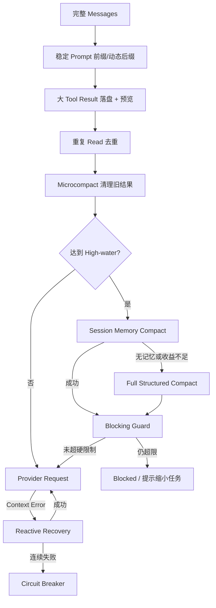
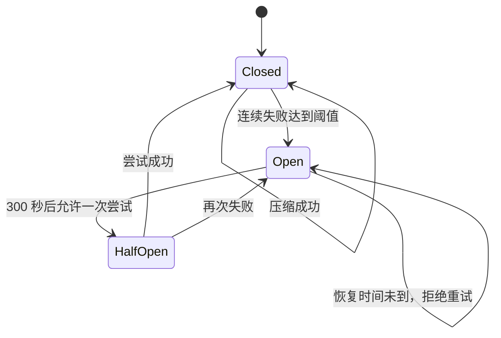
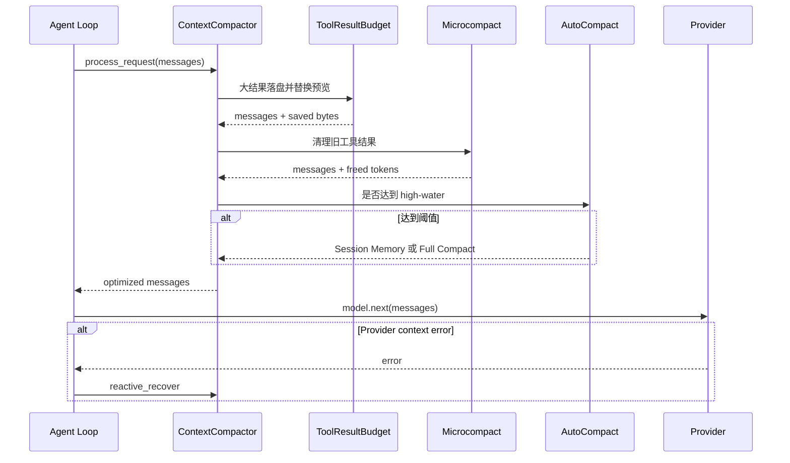

# 03. 分层上下文压缩：长任务为什么不会无限膨胀

> 对应简历第三点。当前仓库对工具结果外置、读取去重、微压缩、自动压缩、溢出恢复和熔断都有实际代码；但“提升 Prompt Cache 命中率”没有端到端命中率数据，面试时只能说“缓存友好设计”。

## 1. 什么是 Context Window

模型每次请求只能接收有限 token。一个 Coding Agent 的上下文通常包含：

```text
system prompt
+ 用户请求
+ 历史 assistant 文本
+ tool call 参数
+ tool result 内容
+ memory/skill/instruction
+ 当前任务状态与验证证据
```

其中最容易突然变大的通常是工具结果，例如：

- 读取一个数万行文件；
- 全仓库搜索输出；
- 测试失败栈；
- 构建日志；
- Git diff。

当 token 接近模型上限时，会发生：

- Provider 直接拒绝请求；
- 延迟和费用上升；
- 模型注意力被旧日志稀释；
- 早期任务目标在压缩中丢失；
- Agent 因缺少关键 tool call/result 配对而推理错误。

## 2. 为什么不能简单删除最旧消息

“只保留最近 N 条”有三个问题：

1. 最早的用户目标可能最重要；
2. tool call 和 tool result 必须配对，截断一半会破坏协议；
3. 旧消息中可能有已确认决策、改动文件和失败证据。

因此上下文治理要同时满足：

```text
省 token + 保任务 + 保证据 + 保协议结构 + 失败可降级
```

MiniCode 不是单一压缩器，而是多层管线。

## 3. 总体架构



## 4. 第一层：Prompt 的稳定区和动态区

[`PromptPipeline`](../../../../minicode/prompt_pipeline.py) 将 system prompt 分为：

- 静态区：角色、固定治理规则；
- 动态区：权限、Skill、MCP、memory、项目说明等；
- 中间放置 `SYSTEM_PROMPT_DYNAMIC_BOUNDARY` 标记；
- 动态段落可按 TTL 缓存，文件读取还会结合 mtime 缓存。

它有两个直接效果：

1. 减少本地每轮重复读取和拼接成本；
2. 保持静态前缀顺序稳定，为 Provider prompt caching 创造条件。

但必须说清楚当前边界：

- Anthropic/OpenAI adapter 没有读取这个 marker 并发送 provider-specific `cache_control`；
- 仓库也没有记录 provider prompt-cache read/write token；
- 因而不能宣称已测得 Prompt Cache 命中率提升。

准确说法：

> 实现了静态前缀与动态后缀分离及本地段落缓存，保持 prompt 结构缓存友好；Provider 侧缓存标记和命中率监控仍可继续补齐。

## 5. 第二层：大工具结果外置化

[`ToolResultBudgetManager`](../../../../minicode/context_compactor.py) 的默认参数：

```text
单条持久化阈值：4000 chars
预览最大长度：500 chars
结果目录：<workspace>/.mini-code-tool-results/
```

超过阈值的 `tool_result` 会：

1. 规范化为字符串；
2. 原子写入磁盘；
3. 在 messages 中替换成小预览；
4. 预览保留 tool 名、结果大小、文件名、头部和尾部若干行；
5. 记录节省字节数。

示意：

```text
原结果：50,000 字符的测试日志

替换后：
[Tool result persisted to disk — 50000 chars]
Tool: test_runner
Path: test_runner_12_....txt
--- Preview ---
前几行
...
最后几行
```

优势：

- 主要上下文只承担判断所需的摘要；
- 原始证据没有直接丢失；
- 后续可以根据文件位置再次读取。

限制：

- 它不是数据库式检索服务；
- 当前 preview 主要显示文件名，重新读取路径仍依赖约定；
- 落盘内容也可能包含敏感日志，需要生命周期清理和权限控制；
- 字符数不等于精确 token 数。

## 6. 第三层：重复读取去重

[`ReadDedupManager`](../../../../minicode/context_compactor.py) 记录：

```text
file path + content hash + message index
```

同一路径且内容 hash 未变化，再次读取时用 stub 替代全文。Agent Loop 在成功执行 `read_file` 后调用它。

为什么必须包含 content hash？

- 只按路径去重会漏掉文件已经变化的情况；
- 路径和 hash 都相同，才说明重复全文没有新增信息。

为什么仍要保留 stub？

- 模型需要知道“这个文件刚才被读取过”；
- 完全删除会让操作历史不可解释；
- stub 可以指向先前消息位置。

## 7. 第四层：Microcompact

系统有轻量级压缩路径，用固定标记替换较旧、可丢弃的工具结果，不调用模型生成摘要。

`context_compactor.py` 中 time-based 默认策略是：

```text
间隔：1 小时
保留最近：5 个 tool results
更旧结果：替换为固定清理标记
```

`micro_compact.py` 还提供预 API 的时间/预算型清理，并维护“绝不能压缩”的工具结果类型。

Microcompact 的特点：

- 快；
- 确定性强；
- 不增加模型调用成本；
- 只适合清理低价值历史，不能总结复杂决策。

## 8. 第五层：High-water 自动压缩

[`AutoCompactDispatcher`](../../../../minicode/context_compactor.py) 默认在估算用量达到上下文窗口的 85% 时触发。

### 8.1 优先尝试 Session Memory Compact

它先从 MemoryManager 获取约 6,000 token 的相关记忆作为摘要基线，再保留最近消息 tail。

关键细节：

- 至少保留一定数量的近期消息；
- tail 上限可配置；
- 调整切点，避免把 tool use/result 配对切开；
- 若压缩后只节省不到约 5%，视为无效并回退。

优点是复用已经维护的项目决策和约定，不额外调用 LLM。

风险是：Memory 未必覆盖本轮所有临时事实，因此不能只依靠它保护任务状态。

### 8.2 回退到 Full Compact

当没有可用 memory 或压缩收益不足时，Full Compact 会从历史中提取：

- 用户讨论主题；
- 使用过的工具；
- 涉及文件；
- 出现的错误；
- 最近消息 tail。

它生成新的 compact boundary，并把后续上下文建立在这个新基线上。

这里的“Full”不是把所有信息无损压缩，也不表示一定调用 LLM；当前实现主要是结构化规则摘要。

## 9. StableTaskPack：压缩时保护任务核心

[`StableTaskPack`](../../../../minicode/turn_kernel.py) 用于保存不应随普通历史一起消失的状态，例如：

```text
原始目标
约束
当前 phase
已完成动作
验证证据
task graph 进度
工作记忆摘要
```

Agent Loop 会把它更新为受保护的 system state message。这样即使旧对话被压缩，模型仍能知道“任务是什么、已经做了什么、还缺什么证据”。

可以用一句话概括：

```text
压缩负责丢掉低价值历史，StableTaskPack 负责钉住高价值状态。
```

## 10. 第六层：Blocking Guard 与 Reactive Recovery

### 10.1 预请求 Guard

Agent Loop 在发请求前估算 token。如果到达硬限制，会先尝试 compact；仍无法降下来时停止继续请求，避免把必然失败的超长 payload 发给 provider。

### 10.2 Provider 报上下文错误

若 provider 仍返回 context-length/413 类错误，[`ReactiveCompactEngine`](../../../../minicode/context_compactor.py) 会执行更激进恢复，再尝试请求。

这是两种控制的区别：

```text
Proactive：预计快超限，提前压缩。
Reactive：已经收到超限错误，恢复后重试。
```

## 11. 第七层：Circuit Breaker

压缩本身也可能失败。如果每一步都继续压缩、失败、重试，会形成二次故障循环。

默认熔断参数：

```text
连续失败阈值：3
自动半开恢复时间：300 秒
```

状态可理解为：



熔断器不解决压缩问题，它解决“失败的压缩不要无限放大故障”。

## 12. 一次请求的实际处理顺序

[`ContextCompactor.process_request()`](../../../../minicode/context_compactor.py) 在请求模型前处理 messages：



## 13. Token 估算为什么不精确

本地通用估算常用“字符数除以 4”，但：

- 中文与英文 token 密度不同；
- 不同 tokenizer 不同；
- tool schema 和 provider wrapper 也占 token；
- provider usage 可能滞后一轮或不可用。

因此系统需要保留安全余量，并优先使用 provider 返回的 usage；不能把本地估算当绝对值。

## 14. 60 秒面试回答

> Coding Agent 的上下文主要被工具日志和重复读取撑大，简单删除旧消息又可能丢失用户目标或破坏 tool call/result 配对。MiniCode 用分层管线治理：首先将大工具结果原子落盘，只保留头尾预览；相同文件按 path+hash 去重；再用 microcompact 清理旧结果。到达约 85% high-water 后，优先用已有 project memory 构建摘要并保留近期 tail，效果不足再做结构化 Full Compact。StableTaskPack 单独保护目标、约束和验证证据；接近硬限制时预请求拦截，provider 真报 context error 时走 reactive recovery，连续压缩失败则熔断。Prompt 还区分稳定前缀和动态后缀，但当前没有 provider cache-control 和命中率数据，所以我只把它称为缓存友好设计，不宣称具体命中率提升。

## 15. 高频追问与参考回答

### Q1：外置工具结果是不是把信息丢了？

不是立即删除，原文落盘，主上下文保留预览与文件定位。不过后续重新读取仍有 I/O 与权限成本，也应制定清理策略。

### Q2：为什么预览同时保留头和尾？

日志开头常有命令和环境，尾部常有最终错误或总结；两端比只截前 500 字更有诊断价值。

### Q3：Read Dedup 为什么不能只看路径？

文件可能已经被编辑；必须比较内容 hash，避免把新内容误判为重复。

### Q4：Microcompact 和 Full Compact 有什么区别？

Microcompact 用固定 marker 清理低价值旧结果，便宜且确定；Full Compact 重建摘要基线，节省更多但信息损失风险更大。

### Q5：为什么优先用 Session Memory？

已维护的 memory 通常包含稳定决策和约定，复用它不用再调用模型。但若 memory 为空或压缩收益不足，必须回退。

### Q6：如何避免切断 tool call/result？

选择 tail 切点时检查相邻的 assistant tool-use 和 tool-result，把切点调整到完整配对之外。

### Q7：为什么需要 StableTaskPack？

普通摘要可能漏掉最初目标和完成标准。StableTaskPack 把这类状态作为受保护信息持续重注入。

### Q8：熔断后是不是就不管上下文了？

不是。它只暂停重复失败的自动压缩；系统仍可停止请求、提示拆分任务或等待恢复，防止无限失败循环。

### Q9：怎样证明压缩没有伤害效果？

除 token 降幅外，还要比较任务完成率、事实保留率、tool-pair 完整率、重复读取率和压缩后返工次数。

### Q10：Prompt Cache 已经生效了吗？

本地段落缓存已生效，静态/动态边界也存在；但 provider adapter 没有发送专用 cache-control，仓库也没有命中率 telemetry，因此不能说已完成 provider prompt caching。

### Q11：为什么 85% 就开始，而不是 100%？

下一轮模型输出、工具 schema 和包装消息都需要空间。提前触发可以留出安全余量，避免临界点才处理。

### Q12：压缩最危险的错误是什么？

把“尚未验证的假设”压成“已经确认的事实”。摘要应标记事实来源、未决项和验证状态。

## 16. 应该怎样评测

对同一组长任务比较：

```text
A. 不压缩
B. 仅截断
C. Tool budget + dedup
D. C + microcompact
E. D + auto/full compact + StableTaskPack
```

记录：

```text
最大/平均上下文 token
Provider context error 数
每轮请求成本
P50/P95 延迟
任务完成率
验证通过率
关键事实保留率
tool use/result 配对完整率
压缩后重复读取和返工次数
Prompt cache read/write tokens（接入后）
```

## 17. 源码证据与测试

| 内容 | 位置 |
| --- | --- |
| 统一分层压缩管线 | [`minicode/context_compactor.py`](../../../../minicode/context_compactor.py) |
| Context token 估算与基础压缩 | [`minicode/context_manager.py`](../../../../minicode/context_manager.py) |
| 预 API microcompact | [`minicode/micro_compact.py`](../../../../minicode/micro_compact.py) |
| 静态/动态 Prompt 管线 | [`minicode/prompt_pipeline.py`](../../../../minicode/prompt_pipeline.py) |
| StableTaskPack 与 phase state | [`minicode/turn_kernel.py`](../../../../minicode/turn_kernel.py) |
| 主循环接入位置 | [`minicode/agent_loop.py`](../../../../minicode/agent_loop.py) |
| 熔断器通用实现 | [`minicode/circuit_breaker.py`](../../../../minicode/circuit_breaker.py) |
| 压缩测试 | [`tests/test_context_compactor.py`](../../../../tests/test_context_compactor.py) |
| 上下文控制测试 | [`tests/test_context_cybernetics.py`](../../../../tests/test_context_cybernetics.py) |

建议亲自执行：

```powershell
python -m pytest -q tests\test_context_compactor.py tests\test_context_cybernetics.py
rg -n "ToolResultBudgetManager|ReadDedupManager|AutoCompactDispatcher|reactive_recover" minicode
```

## 18. 面试前自测

```text
[ ] 我能说出上下文的主要组成
[ ] 我能解释为什么不能直接删除最旧消息
[ ] 我能画出外置、去重、微压缩、自动压缩、恢复五层流程
[ ] 我知道 high-water、blocking limit 和 circuit breaker 的区别
[ ] 我能解释 StableTaskPack 保护什么
[ ] 我知道字符估算不等于精确 token
[ ] 我不会宣称尚未测量的 Prompt Cache 命中率提升
```
