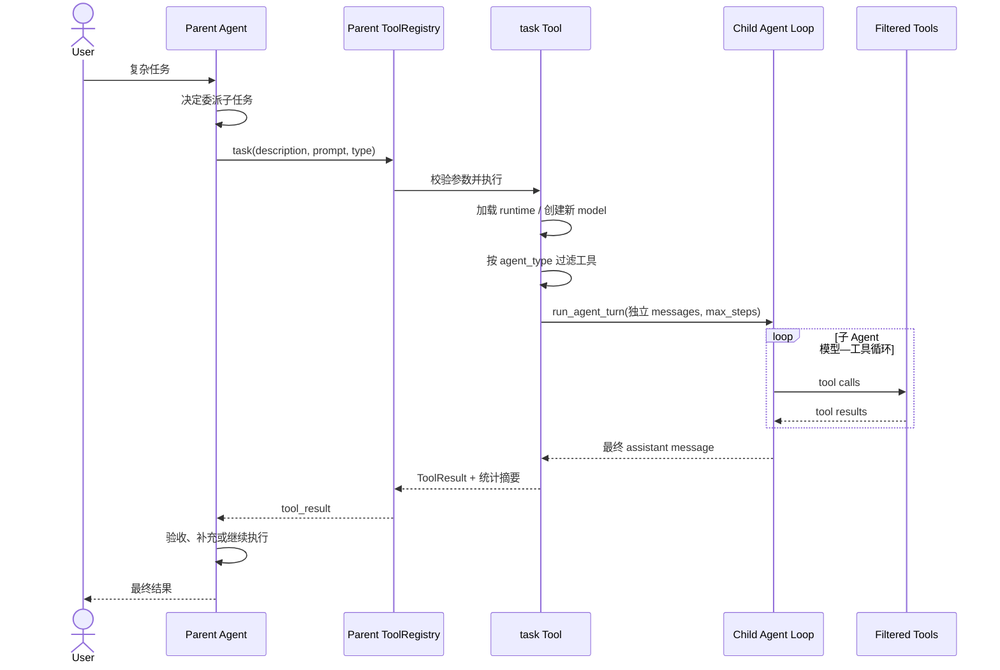
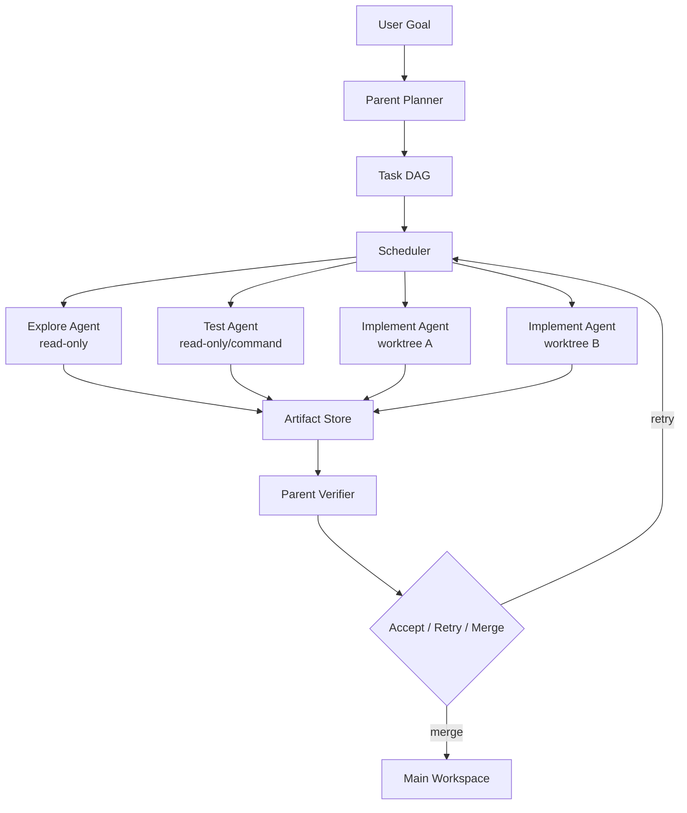

# 04. 中心化多 Agent 协作：主 Agent 如何受控委派

> 对应简历第四点。当前仓库真正落地的是 `task` 工具驱动的同步子 Agent 委派；Fork、Worktree 和 Agent Team 不能说成已经完整接入的运行模式。

## 1. 什么是多 Agent

一个 Agent 通常包含：

```text
模型 + 上下文 + 工具 + 循环状态 + 权限边界
```

多 Agent 不是简单“多调用几次模型”，而是把不同任务交给多个相对独立的执行单元，并处理：

- 谁拆任务；
- 谁拥有最终决策权；
- 子任务能看见什么上下文；
- 能调用什么工具；
- 是否可以写同一文件；
- 如何返回结果；
- 失败、超时和冲突如何处理。

这些协调问题往往比“启动第二个模型”更难。

## 2. 中心化与去中心化的区别

### 2.1 中心化（Supervisor–Worker）

```text
主 Agent：理解用户目标、拆分、委派、整合、最终负责
子 Agent：完成限定子任务，返回结果，不直接接管用户会话
```

优点：

- 只有一个最终决策者；
- 权限和状态更容易统一；
- 子 Agent 不必互相通信；
- 结果回收路径清晰；
- 适合强约束 Coding 场景。

缺点：

- 主 Agent 可能成为吞吐瓶颈；
- 主 Agent 需要消化所有摘要；
- 错误拆分会让所有子任务偏离；
- 中心故障影响整个任务。

### 2.2 去中心化（Peer/Team）

多个 Agent 可以互相发消息、认领任务、协商冲突。它适合开放探索，但需要：

- 共享任务状态；
- 消息路由；
- leader election 或冲突仲裁；
- 分布式取消；
- 文件写入锁或 merge；
- 更复杂的 tracing。

当前 MiniCode 没有这套 Agent Team 基础设施。

## 3. 当前 MiniCode 真正实现了什么

[`minicode/tools/task.py`](../../../../minicode/tools/task.py) 把子 Agent 包装成一个普通 Tool：

```text
tool name: task
input: description + prompt + agent_type
output: 子 Agent 最终摘要
```

主 Agent 仍然掌握外层 Agent Loop；子 Agent 执行完以后，结果以 `ToolResult` 回填，主 Agent再决定下一步。这就是“不移交最终控制权”的真实含义。

### 3.1 三种子 Agent

| 类型 | 工具范围 | 最大 step | 适合任务 |
| --- | --- | ---: | --- |
| explore | 只读搜索/读取/符号工具 | 5 | 快速定位代码 |
| plan | 只读工具 + code review | 8 | 深入理解和制定方案 |
| general | 完整默认工具集 | 15 | 独立多步实现 |

`explore` 和 `plan` 通过工具白名单限制写入能力；`general` 可使用完整工具，但仍经过自己的 PermissionManager。

### 3.2 子 Agent 的隔离边界

子 Agent 会新建：

- 独立 messages；
- 针对类型的 system prompt；
- 独立 model adapter；
- 过滤后的 ToolRegistry；
- 独立 step budget；
- 独立 PermissionManager。

但它仍然：

- 使用与父 Agent 相同的 `cwd`；
- 使用同一文件系统；
- 没有默认创建 worktree；
- general 类型可能继承父级的权限 prompt handler；
- 不会自动拿到父会话全部历史，只收到父 Agent传入的 prompt。

所以这是“上下文和工具层隔离”，不是容器或操作系统级安全隔离。

## 4. 一次子 Agent 委派的完整流程



关键点：用户只直接面对 Parent；Child 的最终文本只是 Parent 的一条工具结果。

## 5. 为什么把子 Agent 做成 Tool Call

### 统一协议

主循环已经会处理 `ToolCall -> ToolResult`，把子 Agent 包成工具后，不需要再设计第二套消息协议。

### 保持控制权

子 Agent 完成后只能返回结果，不能直接结束父任务。父 Agent 可以：

- 接受结果；
- 继续验证；
- 换一个子 Agent；
- 自己修改；
- 向用户报告 blocker。

### 权限复用

子 Agent 的文件和命令操作仍可走工具与 PermissionManager，而不是获得任意 Python 执行权。

### 可观测性复用

子 Agent 整体表现为一次 `task` 调用，父 Agent 的消息链能够记录输入和返回摘要。

## 6. “最小化结果传递”具体指什么

当前 `task` 工具不会把子 Agent 的全部 messages 塞回父上下文，而是：

1. 从子 messages 尾部找到最终 assistant 文本；
2. 添加类型、耗时、工具调用数和最大 step 等头信息；
3. 最终文本超过 8,000 字符时截断；
4. 作为一条 ToolResult 返回。

好处：

- 父上下文不会被子 Agent 全部过程撑爆；
- 降低子任务内部噪声；
- 父 Agent 更容易读取结论。

代价：

- 细节和证据可能在摘要中丢失；
- 父 Agent 不能只相信“已完成”，应检查文件或运行验证；
- 若需要证据，prompt 应明确要求返回路径、命令和结果，而不是只给结论。

## 7. 当前是否真正并行

这是必须如实回答的重点。

MiniCode 的 Agent Loop 确实能并行执行 `is_concurrency_safe` 的工具调用，主要是只读工具；写工具和命令进入串行队列。

但当前 `task` Tool：

- 没有只读/并发安全 metadata；
- 不在默认只读工具名集合中；
- 因此多个 `task` call 会被 ToolScheduler 分到串行执行；
- 子 Agent `_run()` 本身也同步等待 `run_agent_turn()` 返回。

所以当前不能声称“通过多 Agent 并行显著提升执行效率”。准确说法是：

> 已实现受控、隔离的子 Agent 委派；框架具备只读 Tool 并发，但子 Agent 并行调度仍是后续演进点。

## 8. TaskGraph 与子 Agent 的关系

[`TaskGraph`](../../../../minicode/task_graph.py) 支持：

- task definition；
- dependency DAG；
- priority；
- execution slot；
- pending/running/completed/failed 状态；
- 序列化持久化。

当前 Agent Loop 会为一轮任务创建 TaskGraph 和一个 turn slot，用于状态记录；但 `task` Tool 没有把多个子 Agent 自动映射为 DAG 节点并调度 ready tasks。

因此可以说“已有 TaskGraph 基础模型”，不能说“已经完成基于 DAG 的多 Agent 调度平台”。

## 9. Fork、Worktree、Agent Team 分别是什么

### 9.1 Fork

Fork 一般指复制当前任务上下文或状态，从同一基线探索另一条解法。需要：

- 明确复制哪些 messages/memory/checkpoint；
- 分支 ID；
- 结果比较；
- 选择或合并某一分支。

当前仓库没有完整 Fork runtime。

### 9.2 Worktree

Git worktree 让不同 Agent 在独立 checkout 中修改，避免直接写同一工作目录。

仓库中有 [`WorktreeIsolator`](../../../../minicode/task_graph.py)，可调用 `git worktree add/remove`；但没有被 Agent Loop 或 `task` Tool 调用。因此它是基础组件，不是已经启用的子 Agent 工作模式。

完整接入至少需要：

```text
创建 worktree
-> 子 Agent cwd 指向 worktree
-> 独立分支提交
-> 父 Agent 检查 diff/tests
-> merge/cherry-pick
-> 冲突处理
-> 清理 worktree
```

### 9.3 Agent Team

Agent Team 通常允许 peer Agent 之间传消息、分配任务和共享状态。当前没有 Agent 间 mailbox、任务认领或 team lifecycle，因此不要写“已支持 Agent Team”。

## 10. 一个更完整的未来架构



真正实现时需要把“并行”建立在独立写入空间或资源锁上，而不是简单开线程让多个 Agent 同时改同一目录。

## 11. 权限如何向子 Agent 传播

当前策略：

- `explore/plan` 只有只读工具，从能力面上避免写入；
- 它们创建无交互 PermissionManager；
- `general` 使用全工具，并尝试继承父 permissions 的 prompt handler；
- 所有子 Agent 都使用同一 cwd 路径边界。

这里有两个原则：

### 能力最小化

不需要写文件的 Agent 根本不获得写工具，比“有工具但靠 prompt 告诉它别写”更可靠。

### 授权不应自动扩大

父 Agent 能做的事情不代表每个子 Agent 都应该能做。理想设计应把一次性 scope token 显式传给子任务，并在任务结束后撤销。

## 12. 结果如何验收

子 Agent 的文本不能作为最终事实。Parent 应执行：

```text
检查返回的文件/符号证据
-> 查看真实 diff
-> 运行目标测试
-> 检查约束和权限
-> 决定接受、重试或放弃
```

这也是“主 Agent 负责质量控制”的可落地解释。当前代码提供父循环继续操作的能力，但没有一个独立的、强制执行的 `ParentApprovalGate`；质量控制主要取决于父模型的后续行为和 Turn Kernel verification。

## 13. 常见失败模式

### 子任务描述不完整

子 Agent 没有父上下文，只收到传入 prompt。必须包含目标、范围、限制、期望输出和验证方法。

### 多 Agent 重复搜索

任务边界重叠会浪费 token。调度器应给每个任务明确文件域或问题域，并在结果中标记覆盖范围。

### 写冲突

同一 cwd 下并发写会互相覆盖。需要串行、文件锁或 worktree 隔离。

### 摘要丢证据

只返回结论会让 Parent 无法验证。应要求返回绝对/相对路径、关键 symbol、测试命令和失败信息。

### 权限扩大

General Agent 获得完整工具面时风险更高。应优先使用只读类型，只有明确需要时才授予写能力。

### 无限递归委派

General 子 Agent 的完整工具注册表中也可能包含 `task`，存在层层委派风险。Step budget 能限制单次循环，但成熟系统还应限制 delegation depth 和全局预算。

## 14. 60 秒面试回答

> MiniCode 采用中心化的 supervisor–worker 思路：主 Agent 保留用户目标和最终决策权，子 Agent 通过 `task` Tool 被调用。Task Tool 会为 explore、plan、general 三种类型创建独立 messages、model adapter、工具集和 step budget；只读类型只获得搜索和分析工具，general 才能使用完整工具。子 Agent 结束后只把最终文本和少量统计作为 ToolResult 回填，主 Agent 再检查证据并决定后续动作，因此没有把控制权交给子 Agent。当前实现是同步委派，并没有把 `task` 标记为并发安全；WorktreeIsolator 也尚未接入 task 调用链，所以 Fork、Worktree 和 Agent Team 是演进方向，不能当成已经完成的功能。若继续实现，我会用 Task DAG 调度、worktree 写隔离、全局预算和结构化验收 artifact 保证并行安全。

## 15. 高频追问与参考回答

### Q1：为什么用多个 Agent，不让一个 Agent 全做完？

独立上下文可以减少主上下文污染，并用不同工具权限聚焦专项任务；代价是额外模型成本和信息同步损失。简单任务不应拆分。

### Q2：为什么把子 Agent 做成 Tool？

可以复用现有 ToolCall/ToolResult 协议、权限链和主循环，不需要新增一套通信框架。

### Q3：子 Agent 是否能直接回复用户？

不能。它的最终消息被封装为 Parent 的 ToolResult，用户输出仍由 Parent 负责。

### Q4：如何做到最小权限？

先从工具面裁剪：explore/plan 根本没有写工具；再由 PermissionManager 约束路径和危险动作。能力缺失比 prompt 约束更可靠。

### Q5：当前是否并行？

普通只读工具可以并发，但 task 子 Agent 当前按串行 Tool 执行。不能混淆“工具并发”和“子 Agent 并发”。

### Q6：如何避免子 Agent 污染父上下文？

使用独立 messages，只传任务 prompt；返回时只提取最终文本并限制长度。需要证据时返回结构化 artifact，而不是全部轨迹。

### Q7：主 Agent 怎么做质量控制？

重读目标、检查子 Agent 指出的文件和 diff、运行测试、绑定 verification evidence。不能把子 Agent 的“完成了”直接当成完成。

### Q8：Worktree 解决什么问题？

它提供文件系统和 Git 分支级写隔离，让两个实现 Agent 不直接覆盖同一个 working tree；它不解决语义 merge 冲突。

### Q9：为什么不直接让所有 Agent 共享完整上下文？

成本高、噪声大、权限边界模糊。应传最小 task packet，并把大证据放 artifact store 按需读取。

### Q10：如何取消失控子 Agent？

当前主要靠 max steps 和工具 timeout。更完整系统需要 cancellation token、全局 deadline、budget 和进程/线程资源回收。

### Q11：如何评估多 Agent 的收益？

和单 Agent 基线比较端到端成功率、墙钟时间、总 token、重复工作率、冲突率、父 Agent 验收失败率。并行更快但 token 翻倍不一定值得。

### Q12：TaskGraph 已经在调度多个 Agent 吗？

没有。类支持 DAG 与 slot，主循环也记录 turn task，但 task 子 Agent 尚未接到 DAG ready-task scheduler。

## 16. 并行调度时必须考虑的公式

假设有三个独立子任务，串行耗时：

```text
T_serial = T1 + T2 + T3
```

理想并行耗时：

```text
T_parallel ≈ max(T1, T2, T3) + orchestration + merge
```

但成本通常接近：

```text
Cost_parallel ≈ Cost1 + Cost2 + Cost3 + parent coordination
```

因此多 Agent 优化的是墙钟时间和上下文隔离，不一定降低 token 或总计算量。

## 17. 应该怎样评测

比较：

```text
A. 单 Agent
B. 同步子 Agent 委派
C. 并行只读子 Agent
D. Worktree 隔离的并行实现 Agent
```

记录：

```text
端到端任务完成率
验证通过率
墙钟时间 P50/P95
总 token / 总成本
重复读取和重复分析率
写冲突与 merge 冲突率
子任务超时/取消率
父 Agent 驳回率
上下文节省量
```

## 18. 源码证据与测试

| 内容 | 位置 |
| --- | --- |
| task 子 Agent 工具 | [`minicode/tools/task.py`](../../../../minicode/tools/task.py) |
| Agent 主循环与工具并发 | [`minicode/agent_loop.py`](../../../../minicode/agent_loop.py) |
| ToolScheduler | [`minicode/agent_intelligence.py`](../../../../minicode/agent_intelligence.py) |
| TaskGraph 与 WorktreeIsolator | [`minicode/task_graph.py`](../../../../minicode/task_graph.py) |
| 工具元信息和并发安全 | [`minicode/tooling.py`](../../../../minicode/tooling.py) |
| 子 Agent 相关基础测试 | [`tests/test_tools.py`](../../../../tests/test_tools.py) |
| Agent Loop 测试 | [`tests/test_agent_loop.py`](../../../../tests/test_agent_loop.py) |

建议亲自执行：

```powershell
rg -n "AGENT_TYPES|def _run|WorktreeIsolator|schedule_calls" minicode
python -m pytest -q tests\test_tools.py tests\test_agent_loop.py
```

## 19. 面试前自测

```text
[ ] 我能解释中心化和去中心化多 Agent
[ ] 我能说出 explore/plan/general 的工具和 step 边界
[ ] 我知道子 Agent 隔离了什么、没有隔离什么
[ ] 我能画出 task Tool 的调用链
[ ] 我能解释为什么最小结果传递也会丢证据
[ ] 我不会把只读工具并发说成子 Agent 并发
[ ] 我知道 WorktreeIsolator 尚未接入 task
[ ] 我不会宣称当前支持 Fork 或 Agent Team
```
