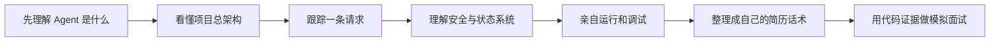
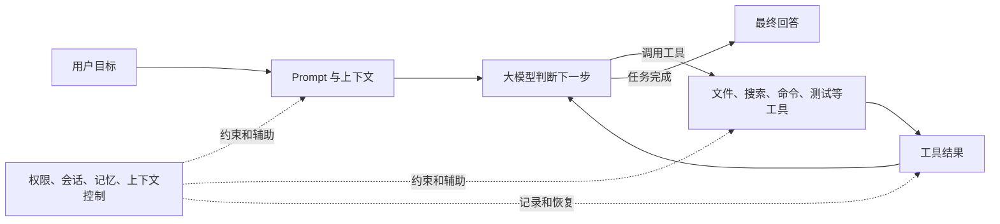

# MiniCode Python 项目学习手册

这套文档写给“想把 MiniCode Python 写进简历，但还不了解 Agent”的读者。目标不是让你背一堆名词，而是让你能回答三件事：

1. 这个项目解决了什么问题？
2. 一条用户请求在代码里到底怎么跑？
3. 面试官继续追问时，你能用代码证据把答案讲清楚吗？

如果只读一遍，按文件名前面的数字顺序读。面试前时间不够，可以直接看第 6 份和第 7 份。

## 文档导航

| 文档 | 你会学到什么 | 建议用时 |
| --- | --- | --- |
| [01-Agent-Basics.md](./01-Agent-Basics.md) | LLM、Agent、工具、记忆、MCP、Skill 等基础概念 | 30 分钟 |
| [02-Architecture.md](./02-Architecture.md) | 仓库结构、模块职责、整体架构图 | 45 分钟 |
| [03-Request-Lifecycle.md](./03-Request-Lifecycle.md) | 一条请求从输入到最终回答的完整执行流程 | 60 分钟 |
| [04-Key-Systems.md](./04-Key-Systems.md) | 工具、权限、会话、回退、记忆、上下文和控制论机制 | 60 分钟 |
| [05-Run-Debug-Read-Code.md](./05-Run-Debug-Read-Code.md) | 如何安装、运行、调试、测试和阅读源码 | 45 分钟 |
| [06-Resume-Interview.md](./06-Resume-Interview.md) | 简历写法、项目介绍话术、面试问答和速记卡 | 面试前反复看 |
| [07-Code-Evidence-Map.md](./07-Code-Evidence-Map.md) | 每个重要说法对应哪段代码，哪些内容不能夸大 | 查证时使用 |

## 简历五点专项面试册

下面五份文档逐条对应简历截图中的五个技术亮点。每份都包含原理、真实源码边界、流程图、60 秒回答、深挖问答、评测方法和自测清单：

| 简历亮点 | 专题文档 |
| --- | --- |
| Skill 能力体系 | [01-Skill-System.md](./InterviewFiveTopics/01-Skill-System.md) |
| 自进化记忆沉淀 | [02-Self-Evolving-Memory.md](./InterviewFiveTopics/02-Self-Evolving-Memory.md) |
| 分层上下文压缩 | [03-Layered-Context-Compaction.md](./InterviewFiveTopics/03-Layered-Context-Compaction.md) |
| 中心化多 Agent 协作 | [04-Centralized-Multi-Agent.md](./InterviewFiveTopics/04-Centralized-Multi-Agent.md) |
| 权限与安全审查 | [05-Permission-Security-Audit.md](./InterviewFiveTopics/05-Permission-Security-Audit.md) |

建议先读每份的“60 秒面试回答”，再回头学习原理和源码。凡是文档标记为“当前未完整实现”的部分，都不能在面试中说成已经落地。

## 先用一句话认识项目

MiniCode Python 是一个运行在本地终端里的编程 Agent。它让大模型不只“回答问题”，还可以在权限约束下读取仓库、搜索代码、修改文件、运行命令和测试，并把会话、记忆、工具结果、检查点与运行状态保存下来。

更口语化地说：

> 普通聊天模型只能告诉你“应该怎么改”；MiniCode Python 会尝试自己查看代码、动手修改、执行验证，并在失败后继续调整。

## 推荐学习路线

不要一开始就钻进 `agent_loop.py` 的全部细节。它是主循环，也是仓库里最复杂的文件之一。先建立地图，再顺着主链路读，效率会高很多。

## 项目事实快照

下面数据来自 2026-09-01 的当前工作区快照，会随着项目迭代变化：

| 项目 | 当前值 | 来源 |
| --- | ---: | --- |
| Python 版本要求 | 3.11+ | `pyproject.toml` |
| 包版本 | 0.1.0 | `pyproject.toml` |
| 主包 Python 文件 | 140 个 | 对 `minicode/**/*.py` 的本地统计 |
| 主包代码行数 | 52,978 行 | 对 `minicode/**/*.py` 的本地统计 |
| 活跃测试文件 | 82 个 | 对 `tests/**/*.py` 的本地统计 |
| 测试代码行数 | 23,847 行 | 对 `tests/**/*.py` 的本地统计 |
| 默认核心工具 | 23 个 | `minicode/tools/__init__.py` |
| 核心运行时依赖 | 空列表 | `pyproject.toml` 的 `dependencies = []` |
| 控制台入口 | 5 个 | `pyproject.toml` 的 `[project.scripts]` |

这些是代码规模和结构数据，不等于业务效果。简历上可以写“构建了 23 个默认核心工具的统一注册与执行面”，但不要把“52,978 行代码”包装成性能指标。

仓库 README 记录过一次 `1311 passed, 2 skipped` 的跨平台 CI 结果。生成本手册时，本机 Python 环境没有安装 `pytest`，因此没有独立复跑这一数字。面试时应说“仓库 README/CI 记录”，不要说成“我刚在本机验证通过”。

## 你最终应该能画出的最小心智模型

中间的“模型判断下一步 → 执行工具 → 把结果交回模型”就是 Agent 的核心循环。MiniCode Python 的大部分工程价值，来自如何让这条循环更安全、更可恢复、更可观察。

## 学习时必须区分的三类事实

### 已实现并进入主路径

- CLI/TUI 与 headless 两种入口；
- Anthropic 与 OpenAI-compatible 模型适配；
- 工具注册、参数校验、执行、结果回填；
- 文件编辑审批、编辑前 checkpoint、rewind；
- 会话保存、恢复、inspect、replay；
- 分层记忆检索与 prompt 注入；
- 上下文估算、压缩与熔断；
- runtime phase、verification、widening；
- MCP、Skill 与子 Agent 工具接入。

### 已实现，但需要谨慎描述

- 控制论调度器确实在默认 `run_agent_turn` 路径中初始化并参与参数调整；
- 其中部分信号是工程启发式估算，例如用 `step * 2.0` 近似延迟；
- 很多增强控制器用 `try/except` 做降级，失败不会阻断主循环；
- 因此更准确的说法是“实现了可插拔的运行时控制与自愈实验层”，而不是“已经达到生产级自动控制精度”。

### 不能只凭代码仓库宣称

- 不能宣称提高了某个百分比的生产效率，除非你有真实实验设计和结果；
- 不能宣称系统绝对安全，权限与 prompt injection 只能降低风险；
- 不能把 README 中的历史测试数字说成自己刚刚跑出的结果；
- 不能把整个开源仓库都说成自己独立完成，除非事实确实如此。

## 七天复习建议

| 天数 | 学习内容 | 当天产出 |
| --- | --- | --- |
| Day 1 | 第 1 份：Agent 基础 | 不看文档解释“Agent 和聊天机器人有什么不同” |
| Day 2 | 第 2 份：架构 | 手画一遍总架构图 |
| Day 3 | 第 3 份：执行流程 | 从 `main.py` 跟到一次 `tool_result` |
| Day 4 | 第 4 份前半：工具、权限、会话 | 解释一次安全编辑为何可回退 |
| Day 5 | 第 4 份后半：记忆、上下文、控制论 | 解释 memory 和 session 的区别 |
| Day 6 | 第 5 份：运行与调试 | 本地完成一次安装、运行和断点跟踪 |
| Day 7 | 第 6、7 份：面试 | 录一段 3 分钟项目介绍并复盘 |

## 最重要的学习原则

面试不是背诵模块名。你要形成下面这条因果链：

> 因为模型本身不能操作本地环境，所以需要工具；因为工具可能修改真实文件，所以需要权限和 checkpoint；因为任务会持续很多轮，所以需要 session、memory 和 context management；因为模型可能提前结束、卡住或调用失败，所以需要 verification、widening、retry 与 fallback；因为这些过程复杂，所以需要事件、日志和 readiness 来观察。

只要你能顺着这条因果链讲清楚，这个项目就不再是一堆陌生的 Python 文件。
