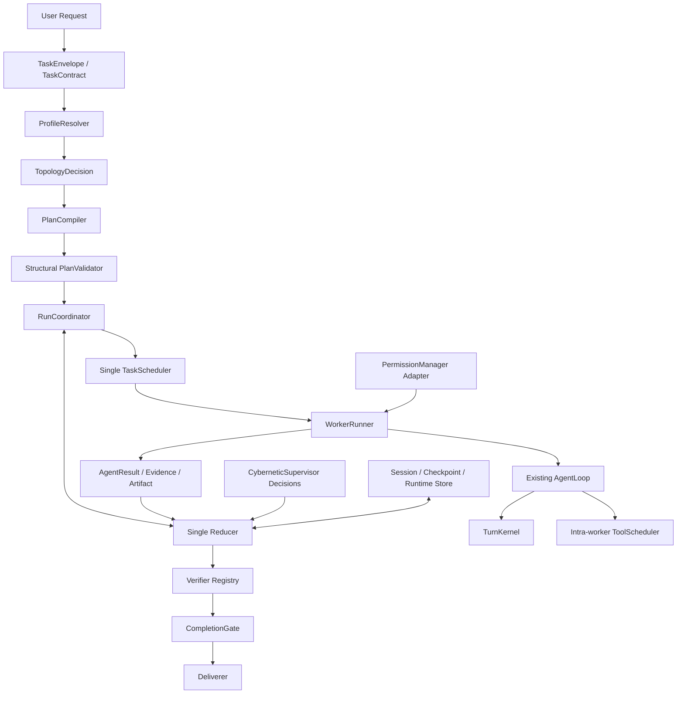
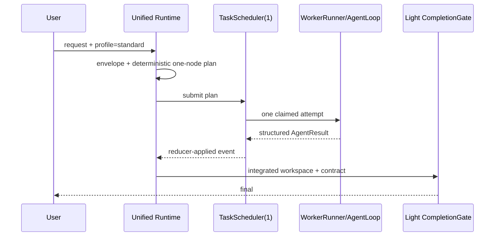
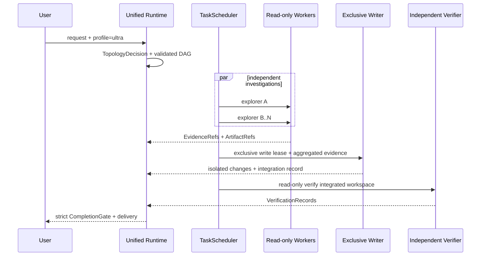
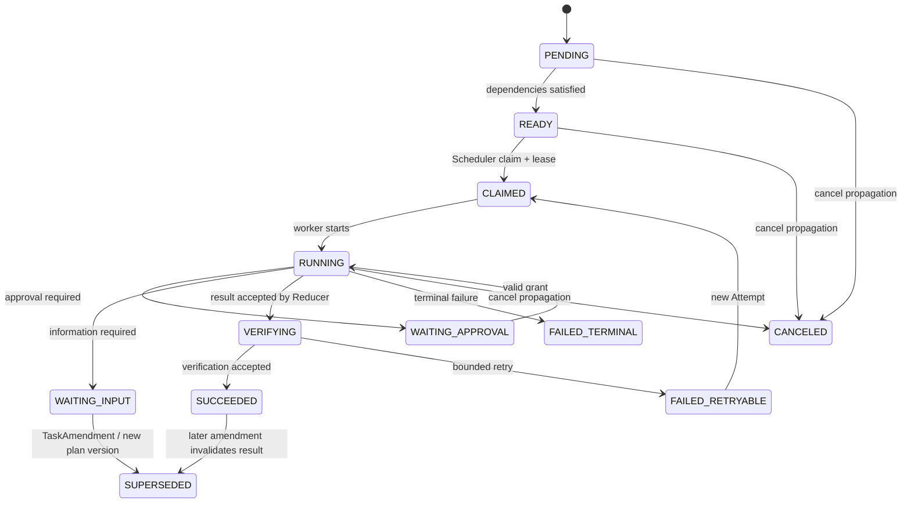
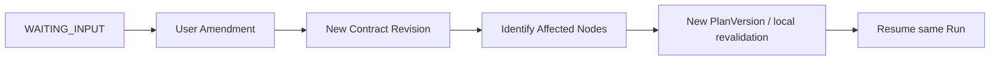

# MiniCode 统一 Runtime 与 Ultra V1 升级方案

## 1. 目标、范围与判定口径

本方案把 MiniCode 现有的模型—工具循环纳入一个统一、可审计、可恢复的 Runtime。Standard 和 Ultra 是同一个 Runtime 的 `ExecutionProfile`，不是“旧 AgentLoop”和“新 Task Runtime”两套系统。两者共享协议、PlanGraph、Reducer、Scheduler、权限/审批语义、Session/Checkpoint、结果与最终完成条件，只在推理预算、执行拓扑和验证强度上取不同配置。

本轮交付范围是统一 Runtime 和 Ultra V1：

```text
并行只读 Explorer/Reviewer
  -> 结构化 Evidence 聚合
  -> 唯一 Writer 在隔离 workspace 修改并集成
  -> 独立只读 Verifier 验收集成后的工作区
  -> CompletionGate 决定是否交付
```

配套验收见 [统一 Runtime 与 Ultra V1 验收计划](./2026-09-02-multi-agent-runtime-v2-acceptance.md)。文档中“本轮”表示必须落实到代码和自动化测试；“deferred”只表示保留协议或设计，不构成本轮完成声明。

## 2. 真实基线与约束

以下是本轮实施前审计确认的可复用边界；本轮已按第 12 节迁移映射将它们接入统一 Runtime：

- `minicode/agent_loop.py::run_agent_turn` 是成熟的单 Worker 模型—工具循环；本轮以 `WorkerRunner` 包装，不重写其内部主循环。
- `minicode/turn_kernel.py::TurnKernel` 管理一个 Worker 内的 explore/execute/verify 与 evidence guard；它不是任务级 Final Verifier。
- `minicode/agent_intelligence.py::ToolScheduler` 只并发一个 Worker 发出的工具调用；它不是 Worker Scheduler。
- `minicode/tools/task.py` 实施前会直接启动子 `AgentLoop`，并对结果做 8,000 字符截断；本轮已改为 `DelegationGateway`，完整大结果进 Artifact Store。
- `minicode/task_graph.py::TaskGraph` 是现有任务图入口；本轮使其成为/适配唯一 Canonical PlanGraph，不再增加另一份可独立推进的 Plan 状态。
- `minicode/pipeline_engine.py::PipelineEngine` 当前主要服务兼容测试和控制器适配；它不再拥有产品执行权，逐步收敛为 `PlanCompiler`/legacy adapter。
- `minicode/cybernetic_supervisor.py::CyberneticSupervisor` 继续提供成本、进度、上下文与稳定性信号，只能生成结构化 Decision/Command，不能直接改 Runtime 状态。
- `minicode/permissions.py::PermissionManager` 保持 Worker 侧交互与兼容能力，由中央 Policy/Approval 适配器统一解释。
- `minicode/session.py`、`minicode/session_contract.py`、现有 checkpoint/rewind 与 `minicode/memory.py` 继续作为兼容基础；Runtime 扩展写入 Session extension 或 MiniCode 状态目录。

基线行为必须先由 golden/regression tests 冻结。简单 Standard 的关键基线是：单次任务只有现有 Worker 所需的模型调用，不额外引入 LLM Planner、LLM Plan Validator 或 LLM Final Verifier。

## 3. 四个正交维度

以下维度不得重新绑定：

| 维度 | 值 | 说明 |
|---|---|---|
| 用户模式 | `standard`, `ultra` | 产品入口；首版不公开 Auto |
| 推理预算 | low/medium/high 或统一预算对象 | 经 `BudgetPolicy` 转为供应商调用配置，不能散落供应商字段 |
| 执行拓扑 | `standard-single`, `deep-single`, `ultra-read-fanout` | 由可审计路由决定 |
| 验证强度 | `light`, `strict` | 共用 Verifier/CompletionGate 接口 |

因此 Standard 可以自适应 low/medium，Ultra 可以因强耦合选择 high-budget `deep-single`；Ultra 不等于必须启动多个 Agent，Standard 也不等于强制最低推理。

## 4. Profile 与 route

### 4.1 Standard

- 默认对外 profile；`max_active_workers=1`。
- 简单请求编译为确定性单节点 Plan。
- 默认不调用 LLM Planner、LLM Plan Validator、LLM Final Verifier。
- 复用现有 AgentLoop、TurnKernel、工具权限、Memory、Session、Checkpoint、Rewind。
- 保留 `task` 兼容行为时，DelegationRequest 仍由统一 Scheduler 登记并串行执行。
- 使用 `light` CompletionGate。

### 4.2 Ultra 与 deep-single

Ultra 启用更高预算、更严格验证和最多多个 Worker，但必须先生成 `TopologyDecision`。若任务强耦合、独立子问题不足、写冲突高、共享上下文依赖高或预算不足，选择内部 `deep-single`，并向 trace/TUI 说明原因。这是合法成功路径，不是降级错误。

### 4.3 Ultra V1 read fan-out

仅当至少两个子问题可独立输入、输出和验证，并行收益高于协调成本，且没有未隔离写入，才选择 `ultra-read-fanout`。中央 Plan 预先创建只读节点；`dynamic_worker_delegation=false`，`max_delegation_depth=1`。所有 Explorer/Reviewer 完成后，由唯一 Writer 修改，再由独立只读 Verifier 针对集成结果验收。

## 5. 统一架构



Standard fast path仍经过同一组件，但组件可执行零模型、常量时间的确定性工作：



Ultra V1 调用链：



## 6. 唯一权威与组件职责

| 组件 | 本轮权威职责 | 明确禁止 |
|---|---|---|
| `RunCoordinator` | 组装命令、驱动计划、恢复与交付 | 直接绕过 Reducer 改状态 |
| `Reducer` | 串行应用所有 Runtime Command/Result/Event | Worker、Policy、Verifier 直接改全局状态 |
| `TaskScheduler` | Worker 创建、ready/claim、Attempt、lease、fencing、并发、retry、cancel | 第二个 Scheduler；用 ToolScheduler 调 Worker |
| `TaskGraph` / Canonical PlanGraph | 当前 PlanVersion、节点依赖与版本关系 | PipelineEngine 持有平行可执行图 |
| `WorkerRunner` / `AgentLoop` | 单 Worker 模型—工具循环 | 修改全局 DAG；生成未登记 Worker |
| `TurnKernel` | Worker 内阶段与 evidence guard | 代替集成 Final Gate |
| `ToolScheduler` | Worker 内并发安全的工具调用 | Worker claim/lease |
| `DelegationGateway` | 将 `task` 转成 `DelegationRequest` | 直接 import/call/实例化 AgentLoop |
| `PermissionManager` adapter | 执行已由中央 Policy/Approval 约束的 Worker 操作 | Worker 自建不一致审批语义 |
| `CyberneticSupervisor` | 输出成本/稳定性/恢复 Decision/Command | 任意修改 state/plan |
| `PipelineEngine` | legacy Plan adapter / 离线控制器兼容 | 产品 Runtime、第二 Scheduler |
| Verifier Registry | 确定性优先的节点/最终验证 | 把 PolicyDenied/ApprovalExpired 当验证失败 |

## 7. 核心协议

所有对象有 `schema_version`，使用 Enum/dataclass/TypedDict 形式，必须可 JSON 序列化、可恢复。

### 7.1 Task 与 Profile

- `TaskEnvelope`: `run_id`, `request`, `workspace`, `requested_profile`, `created_at`, compatibility/session refs。
- `TaskContract`: envelope + `contract_revision`, constraints, acceptance criteria, expected outputs, budgets。
- `TaskAmendment`: amendment id、base/next contract revision、changed fields、affected node hints。
- `ExecutionProfile`: `requested_mode`, `selected_route`, `reasoning_budget`, `planner_budget`, `verifier_budget`, `max_active_workers`, `max_agents`, `max_tokens`, `max_cost`, `deadline`, `retry_budget`, `max_delegation_depth`, `verification_level`, `write_isolation`。

### 7.2 可审计 TopologyDecision

必须包含：`requested_profile`, `selected_route`, `independent_subproblems`, `shared_context_dependency`, `write_conflict_risk`, `expected_parallel_gain`, `deterministic_verifiability`, `estimated_extra_cost`, `reasons`, `rejected_routes`。

选择 fan-out 必须同时满足：独立子问题数至少 2；各自有明确输入/输出/验收；可独立验证；能降低墙钟或显著增覆盖；共享上下文依赖低；无未隔离并行写；收益大于协调成本；不超 agents/token/cost/deadline。任一条件失败则选择 `deep-single`。

示例：

```json
{
  "requested_profile": "ultra",
  "selected_route": "ultra-read-fanout",
  "independent_subproblems": ["audit call sites", "audit state recovery"],
  "shared_context_dependency": "low",
  "write_conflict_risk": "none",
  "expected_parallel_gain": 0.37,
  "deterministic_verifiability": true,
  "estimated_extra_cost": 0.08,
  "reasons": ["two independently verifiable read-only investigations"],
  "rejected_routes": {"deep-single": "lower expected coverage per wall-clock"}
}
```

### 7.3 Run → PlanVersion → PlanNode → NodeAttempt

- Replan/TaskAmendment 创建新 `PlanVersion`；旧节点结果可复用，但受影响节点必须 `SUPERSEDED`。
- Retry 只创建同一逻辑 `PlanNode` 的新 `NodeAttempt`。
- Attempt 含 `attempt_number`, `lease_owner`, `lease_expiry`, `fencing_token`, idempotency key。
- 节点状态：`PENDING`, `READY`, `CLAIMED`, `RUNNING`, `WAITING_APPROVAL`, `WAITING_INPUT`, `VERIFYING`, `FAILED_RETRYABLE`, `FAILED_TERMINAL`, `SUCCEEDED`, `CANCELED`, `SUPERSEDED`。
- Reducer 拒绝过期 lease、旧 fencing token、superseded 节点、非当前 Attempt 与重复完成结果。



### 7.4 Invocation、Context、Result 与 Evidence

- `AgentInvocationSpec` 固化角色、objective、工具 effect scope、上下文与预算。
- `ContextManifest` 记录 contract revision、plan version、node、repo/base revision、included file hashes、dependency/artifact refs、memory record/version、policy/prompt versions、tool capability scope、budget allocation。
- `AgentResult` 包含 run/plan/node/attempt/status/base revision、summary、evidence/artifact refs、changed resources、verification records、usage、warnings、failure。
- `EvidenceRef` 包含 type、path/resource、line/page/range、content hash、claim、producer node、base revision。
- `ArtifactRef` 包含 artifact id、content hash、size、media type、store path/key。
- 超过内联容量的完整输出原子写入 Artifact Store；结果只保存明确摘要和引用，禁止静默 8,000 字符截断。Verifier 必须可读完整 Artifact。

### 7.5 Command、Event 与 execution result

Typed Command 与 Event、TaskAmendment、Execution Result 相互独立：

```text
Commands: ApproveToolCall | RejectToolCall | AmendTask | CancelRun | ResumeRun
Events:   ToolCallApproved | ToolCallRejected | TaskAmended | RunCanceled | RunResumed
Results:  PolicyDenied | ApprovalExpired | ToolFailed | WorkerTimedOut | VerificationFailed
```

`ApprovalRequest/Grant` 绑定 `approval_id`, run/node/attempt/tool-call ids、`operation_digest`, cwd、arguments、environment scope、base revision、expiry、single-use。任一绑定字段改变即失效。PolicyDenied/ApprovalExpired 先进入 Reducer，再由其决定等待、终止、重规划或请求输入，不能直接送入 Verifier。

Needs Input 恢复流：



### 7.6 Budget、lease 与 replay

`BudgetEnvelope` 统一限制 agents、active workers、delegation depth、tokens、cost、deadline、retry。取消必须传播到子 Worker、工具/子进程、lease、等待审批与临时 workspace。

工具调用 replay policy：`safe`、`idempotent_with_key`、`verify_before_retry`、`never_auto_retry`。外部副作用不承诺绝对 exactly-once；结果不明确的非幂等操作为 `never_auto_retry`。

## 8. Tool effect、工作区隔离与唯一 Writer

工具必须有显式 effect，不再用 `concurrency_safe` 推断只读：

| effect | 典型操作 | Ultra Explorer | Ultra Writer | 默认 replay |
|---|---|---:|---:|---|
| `read_only` | read/list/grep/diff/static inspect | 允许 | 允许 | safe |
| `workspace_write` | write/edit/patch/delete/move | 拒绝 | 独占 lease 后允许 | verify_before_retry |
| `external_side_effect` | 外部提交、发布、写 API | 拒绝 | Policy/Approval 后允许 | 按工具声明 |
| `privileged` | shell、动态委派、敏感管理 | 默认拒绝 | Policy/Approval 后允许 | never_auto_retry |

Ultra Explorer/Reviewer 的 registry 只能暴露 `read_only`。Policy 层还要拒绝未知/误标写入，并用工作区 hash 测试证明零修改。Verifier 默认只读。

Writer 必须取得全局独占 workspace-write lease，并通过 `WorkspaceProvider` 工作：优先临时 workspace/worktree/patch workspace；集成前校验每个目标的 base hash/revision，发生漂移或冲突即停止，不覆盖用户无关修改。非 Git workspace 使用 temp-copy/patch fallback，能力边界记录在 result。成功、失败、取消均清理隔离目录。本轮严禁两个 Writer 并行，不实现 AI merge arbiter。

## 9. Verifier Registry 与 CompletionGate

Registry 顺序固定为确定性优先：exit code/schema → unit → integration → lint/format → type → static → invariant → browser/render → 必要时 model judgment。代码、文档、数据、Web 可注册不同 verifier；Browser 只是其中一种。

Node Verifier 检查节点 acceptance criteria；Final Verifier 必须针对集成后的最终 workspace 与完整最新 TaskContract。CompletionGate 共用接口：Standard=`light`，Ultra=`strict`，至少检查条款覆盖、集成状态、必需 verification records、冲突、审批、Policy violation、Artifact/Evidence、仍运行/失联 Worker 与当前 PlanVersion。任一强制项缺失不得 final。

## 10. DelegationGateway

`minicode/tools/task.py` 只构造：

```yaml
run_id: run-...
parent_node_id: node-...
requested_role: explore
objective: inspect session recovery
context_requirements: [contract, repository]
allowed_tool_capabilities: [read_only]
proposed_budget: {max_tokens: 4000, deadline_seconds: 60}
delegation_depth: 1
idempotency_key: ...
```

它将请求交给当前 Runtime 的 `DelegationGateway`。Scheduler 注册 child Node/Attempt，Reducer 接收 Result；Standard 兼容提交采用父 slot 的受控串行执行，仍受全局预算与取消控制。Ultra V1 的 Worker 动态提交固定禁用，中央 Plan 负责 fan-out。工具没有 Runtime context 时返回结构化治理错误，不回退到影子 AgentLoop。

## 11. 配置与兼容

```yaml
runtimeV2: true
profile: standard
standard:
  max_active_workers: 1
  verification_level: light
ultra:
  max_active_workers: 4
  max_agents: 6
  max_delegation_depth: 1
  dynamic_worker_delegation: false
  verification_level: strict
  write_isolation: temporary-workspace
```

- CLI/TUI/config 只公开 Standard/Ultra，缺省为 Standard；旧配置缺 profile 时等价 Standard。
- `runtimeV2` 是当前配置字段，仅作灰度迁移工具，不是永久双 Runtime。关闭时仅用于紧急回退到已冻结的串行 Worker 行为。
- 旧 Session/Checkpoint/rewind 数据继续加载；新 Runtime 信息位于可选 extension，旧 reader 可忽略。
- V2 内部错误在尚未产生副作用且策略允许时可安全回退 `standard-single`；不得在结果不明确的外部副作用后重放。
- Milvus 如未来接入，只能索引 Memory/Evidence；Run/Plan/Node/Attempt/Approval/Artifact revision 的权威是 Runtime State/Event Store。

## 12. 现有模块迁移映射

| 现有路径 | 本轮迁移 | 状态目标 |
|---|---|---|
| `minicode/agent_loop.py` | 保留 `run_agent_turn`；由 WorkerRunner 调用并注入 Runtime context | Worker-local |
| `minicode/turn_kernel.py` | 保留 worker evidence guard | 非 Final Gate |
| `minicode/agent_intelligence.py::ToolScheduler` | 保留单 Worker工具并发 | 非 Worker scheduler |
| `minicode/tools/task.py` | 改为 DelegationGateway client | 无直接 AgentLoop |
| `minicode/tooling.py` | 增加 `ToolEffect`/`ReplayPolicy` 和 effect filter | 显式能力治理 |
| `minicode/task_graph.py` | Canonical PlanGraph compatibility facade | 唯一图语义 |
| `minicode/pipeline_engine.py` | 标记/收敛为 legacy PlanAdapter | 不参与产品执行 |
| `minicode/cybernetic_supervisor.py` | 只产出 command/decision/snapshot | 不写全局 state |
| `minicode/permissions.py` | Worker-side adapter for central policy | 统一审批 digest |
| `minicode/session.py`, `session_contract.py` | optional runtime extensions | 旧数据兼容 |
| `minicode/main.py`, `headless.py`, `tui/input_handler.py`, `web_worker.py` | 接入统一入口 | Standard 默认 |

## 13. 实施 Phase 0–7

| Phase | 本轮内容 | 退出条件 | 实测状态 |
|---|---|---|---|
| 0 | 冻结旧行为、golden tests、基线指标 | 旧 AgentLoop/task/permission/session/turn tests 可重复 | `passed`；20 样本 + 3 warmup 校准已落盘 |
| 1 | 统一协议、序列化、PlanGraph 模型，不改拓扑 | schema/state round-trip 测试通过 | `passed` |
| 2 | AgentLoop Worker 化；Scheduler 以 max workers=1 接管 Standard | 无额外 Planner/Verifier 模型调用 | `passed` |
| 3 | Reducer、持久状态、Approval、Needs Input、Cancel、Recovery | fake clock/fault tests 通过 | `passed` |
| 4 | 并行只读 Worker、ContextManifest、Evidence/Artifact | barrier 证明真实并行且工作区零修改 | `passed` |
| 5 | 隔离唯一 Writer、Verifier Registry、Integrated Final Gate | base drift/cancel/integration failure 被阻止 | `passed` |
| 6 | Standard/Ultra 入口、TopologyDecision、预算路由与 trace | route 表驱动、兼容、性能门禁通过 | `passed`；G4 定量校准与 G6 live smoke 已通过 |
| 7 | 多 Writer 实验设计（deferred） | 本轮不进入实现；需隔离/merge/冲突形式化前置 | `deferred` |

## 14. Milestone M0–M5

| Milestone | 进入条件 | 退出条件 / 独立交付物 | 回滚 | 验收映射 | 实测状态 |
|---|---|---|---|---|---|
| M0 Baseline | 仓库测试可运行 | golden、调用次数、延迟/token 基线 | 无代码路径变更 | R17, R30 / G0-G1 | `passed` |
| M1 Protocol | M0 | 可序列化协议、Canonical PlanGraph、Reducer invariants | flag off，旧 Session 忽略 extension | R01-R08, R18 / G0-G1 | `passed` |
| M2 Unified Standard | M1 | Standard 经 Scheduler/Reducer/WorkerRunner，task 受治理 | `runtimeV2=false` 串行兼容 | R10, R17, R19-R21 / G1-G2 | `passed` |
| M3 Read Fan-out | M2 | Ultra route、只读并行、预算/cancel、Artifact | route 强制 deep-single | R11-R13, R22-R27 / G2-G4 | `passed`；等价可拆分负载 p95 改善 36.3853% |
| M4 Exclusive Writer | M3 | isolation、唯一 lease、Verifier、Final Gate | Ultra 强制 deep-single/Standard | R14-R16, R28-R35 / G3-G5 | `passed` |
| M5 Product Ready | M4 | CLI/TUI、兼容、全仓/性能证据、文档回写 | profile 默认 Standard、临时 flag off | 全部本轮 R / G0-G6 | `accepted` |

## 15. 风险、灰度与回滚

- 状态分叉：Reducer 单写 + event id 去重；禁止 Runtime 外直接改 Plan。
- 并发写污染：只读 registry + workspace hash；唯一 writer lease + fencing。
- 旧配置/session 回归：profile 缺省、可选 extension、golden tests。
- 简单任务成本回归：确定性 compiler/validator/gate；记录模型调用数与 token。
- 不确定副作用重放：replay policy；`never_auto_retry` 为默认保守策略。
- Artifact 元数据不一致：内容原子写、hash 校验、孤儿清理/恢复扫描。
- 灰度发现问题：禁止新 fan-out、选择 deep-single；若仍失败且无副作用，临时 flag 回退旧串行路径。最终移除 flag 与旧产品入口，不能长期维护双 Runtime。

## 16. 明确非目标

- 不公开 Auto profile。
- 不实现远程/分布式 Worker。
- 不实现递归动态委派；Ultra V1 动态委派关闭，深度上限 1。
- 不实现多 Writer、并行写或 AI Merge Arbiter。
- 不把 Milvus 或向量数据库作为 Runtime 权威状态库；如以后需要安装存储中间件，统一放入 Docker Desktop 同一 MiniCode 应用组。
- 不让每个节点默认调用高推理 Model Verifier。
- 不承诺外部副作用绝对 exactly-once。

## 17. Definition of Done

本轮只有在下列条件全部成立时才能声明 Ultra V1 完成：

1. Standard/Ultra 共用统一入口、Canonical PlanGraph、Reducer、Scheduler、Result 与 CompletionGate。
2. Standard 默认、单活跃 Worker，简单任务没有额外 LLM planner/final verifier 调用，兼容性能满足 G4。
3. `task` 不直接启动 AgentLoop；child Node/Attempt、预算、取消和结果均由 Scheduler/Reducer 管理。
4. Ultra 有可审计 TopologyDecision，可合法选择 deep-single。
5. fan-out 至少两个只读 Worker真并行，工具 effect 显式，仓库零修改。
6. Ultra 任一时刻仅一个有效 writer lease；隔离修改、base drift 与清理经过测试。
7. lease/fencing/attempt/version stale result 全被拒绝；重复 result 幂等。
8. 大结果完整存 Artifact，AgentResult 可恢复，Verifier 可读取，禁止静默截断。
9. Approval/Needs Input/Amendment/Cancel/Resume 为一级状态，完整 digest 绑定且可恢复。
10. 确定性 Verifier 优先；Final Gate 验证集成后的最终 workspace，能阻止节点均成功但集成失败的交付。
11. Session/Checkpoint/Rewind 和旧配置兼容；所有关键决定/状态可序列化、追踪、恢复。
12. [验收计划](./2026-09-02-multi-agent-runtime-v2-acceptance.md) 的 G0–G5 全部通过；G6 live smoke 若受环境阻塞须如实记录，不得伪造。

Phase 7 多 Writer 永远不计入本轮 DoD。

## 18. 本轮实施回填（2026-09-02）

功能代码已落在真实产品入口，不是空协议：

- 协议、状态与调度：`minicode/runtime_protocol.py`、`minicode/runtime_state.py`、`minicode/runtime_scheduler.py`、`minicode/unified_runtime.py`。
- Worker 与委派：`minicode/worker_runtime.py`、`minicode/delegation.py`、`minicode/tools/task.py`；`task.py` 不再 import/call AgentLoop。
- 安全与恢复：`minicode/tooling.py`、`minicode/runtime_policy.py`、`minicode/permissions.py`、`minicode/tools/run_command.py`；operation digest 进入真实工具调用上下文，allow-once 不跨操作复用，deadline/cancel 可终止子进程。
- 隔离、结果与验收：`minicode/workspace_provider.py`、`minicode/runtime_artifacts.py`、`minicode/verifier_registry.py`；确定性命令 Verifier 在集成状态的临时副本上运行，不污染用户工作区。
- 兼容与产品入口：`minicode/config.py`、`minicode/main.py`、`minicode/headless.py`、`minicode/tui/input_handler.py`、`minicode/web_worker.py`、`minicode/session.py`、`minicode/session_contract.py`。

实际验证：Runtime V2 专项测试 `104 passed`；全仓为 `1512 passed, 2 skipped, 1 warning`，无失败。两个 skip 是未设置 `ANTHROPIC_API_KEY` 时按设计跳过的原有 Anthropic live API 用例；Windows junction/hardlink 安全场景均以真实文件系统对象通过。CI 参数的 `ruff minicode/` 通过；`mypy` 全仓保持 224 个历史基线错误，低于 CI 上限 225，新增 Runtime V2 模块单独检查为 0 个错误；`compileall` 和 `git diff --check` 通过。

G4 已由 `benchmarks/runtime_v2_calibration.py` 的 20 个测量样本与 3 次 warmup 通过：Standard 成功率差 0pp、p95 +3.1578%、token +0%、model call +0；Ultra 对等可拆分负载 p95 墙钟改善 36.3853%。G6 也已在真实 DeepSeek `deepseek-v4-pro` 上通过：Standard=`standard-single`，Ultra 对不可拆分 smoke 合法选择 `deep-single`；脱敏证据位于 `benchmarks/runtime_v2_provider_smoke_standard.json` 与 `benchmarks/runtime_v2_provider_smoke_ultra.json`。

验收状态为 `accepted`，G0–G5 全部通过且无一票否决项，可选 G6 同样通过。Phase 7 仍为 deferred。本轮未引入 Milvus、向量库或其他存储中间件；如后续需要，仍必须放入 Docker Desktop 同一 MiniCode 应用组，且不得成为 Runtime 权威状态库。
