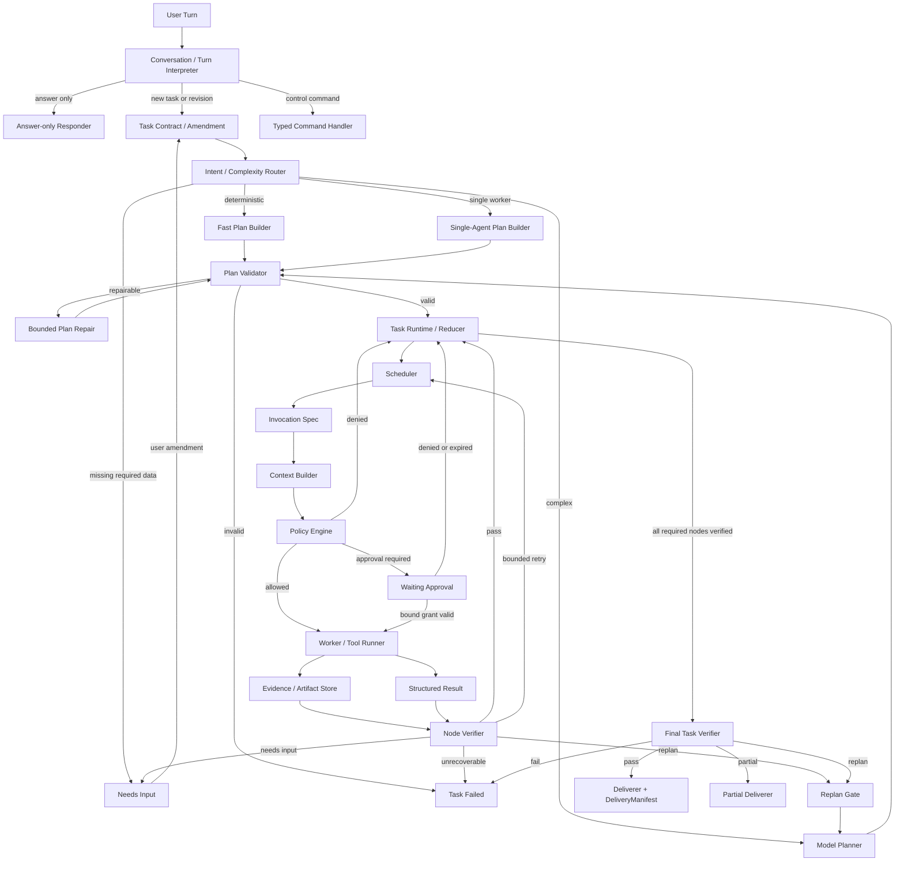

# MiniCode 多 Agent Runtime V2 升级方案

## 1. 目标

在不推翻现有 `run_agent_turn`、工具系统、权限管理、记忆、会话和恢复能力的前提下，把当前“主 Agent 通过 `task` Tool 同步调用子 Agent”的实现升级为统一、可验证、可恢复的任务运行时。

升级后的系统同时支持两条执行路径：

```text
简单任务：Interpreter -> Contract -> Fast Plan -> Validator
         -> Runtime/Scheduler -> 单 Worker -> Verifier -> Deliverer

复杂任务：Interpreter -> Contract -> Model Plan -> Validator
         -> Runtime/Scheduler -> 多 Worker -> Node Verifier
         -> Final Verifier -> Deliverer
```

两条路径必须共用同一组任务契约、状态机、权限、证据、验证和交付协议。简单任务只省略不必要的模型规划和并行调度，不得绕过安全与验收边界。

## 2. 当前基线

当前仓库已经具备可复用基础：

- `minicode/agent_loop.py`：成熟的单 Agent 模型—工具循环，可作为 Worker Kernel。
- `minicode/tools/task.py`：`explore`、`plan`、`general` 三种同步子 Agent。
- `minicode/task_graph.py`：Task DAG、依赖、优先级、slot 和持久化数据结构。
- `minicode/agent_intelligence.py`：工具调用并发安全分类和并发度控制。
- `minicode/turn_kernel.py`：单次 Agent Turn 的 explore/execute/verify 阶段与证据门禁。
- `minicode/permissions.py`：路径、命令和编辑审批。
- `minicode/verification_controller.py`：验证计划生成。
- `minicode/session.py`：会话持久化、重放、checkpoint 和 rewind。
- `minicode/memory.py`、`memory_pipeline.py`、`working_memory.py`：记忆检索和回注。
- `minicode/cybernetic_orchestrator.py`：上下文、成本、稳定性和恢复控制。

当前主要缺口：

1. Router 主要选择模型，不选择 answer-only、fast、single-agent 或 multi-agent 执行拓扑。
2. `TaskGraph` 没有成为 `task` 子 Agent 的真实 ready-node 调度源。
3. `PipelineEngine` 没有接入产品主链，且计划步骤与真实 Worker/Tool Invocation 脱节。
4. `task` Tool 同步等待子 Agent 完成，多个子 Agent 默认串行。
5. 子 Agent 结果是文本摘要，不是可机器验收的结构化结果。
6. Turn 级验证不能替代节点级和任务级验收。
7. General 子 Agent 与父 Agent 共用工作目录，缺少并行写隔离和合并协议。
8. 权限审批没有形成绑定到 invocation、参数、资源版本和有效期的授权凭证。
9. 缺少统一 DeliveryManifest、Partial Delivery 和任务恢复协议。

## 3. 非目标

V2 首版不做以下事项：

- 不实现去中心化 Agent Team、leader election 或任意 Agent 间点对点通信。
- 不让多个写 Agent 直接并发修改同一 checkout。
- 不用新的 Planner 替换现有模型适配层。
- 不删除现有 `task` Tool；它在迁移期作为兼容入口。
- 不把 `CyberneticSupervisor` 改造成业务编排器；它继续负责运行健康信号。
- 不把模型的“我已完成”当作验收证据。
- 不以 stub、mock 成功值或跳过测试冒充能力完成。

## 4. 设计原则

### 4.1 一个控制面，多个执行形态

Fast、Single-Agent 和 Multi-Agent 只产生不同形状的合法 Plan，后续全部进入同一个 Runtime、Scheduler、Policy、Verifier 和 Deliverer。

### 4.2 Reducer 是任务状态的唯一写入口

Worker、Tool Runner、Verifier 和 Deliverer 只产生事件，不能直接散改任务状态。Reducer 按 `task_id + plan_revision + event_id` 归并状态，保证重放和恢复确定性。

### 4.3 Claim 必须引用 Evidence

WorkerResult 中的每个可验收 Claim 必须引用 EvidenceRef。文本摘要只用于人读，不能使节点进入 `verified`。

### 4.4 能力最小化

Scheduler 根据节点声明发放最小工具集、路径范围、网络范围和预算。只读 Worker 不获得写工具；写 Worker 不自动继承父任务的全部授权。

### 4.5 先安全串行，再受控并行

第一阶段只并行无共享写副作用的节点。写节点必须串行，直到 worktree、资源 ownership 和 merge 验证全部落地。

### 4.6 复用现有 Worker Kernel

`run_agent_turn` 保持单 Worker 职责。任务分解、跨 Worker 调度和最终验收放在外层，不把更多全局状态继续塞入 `agent_loop.py`。

## 5. 目标架构



## 6. 核心数据契约

所有契约使用可序列化的 dataclass/TypedDict，并提供显式 `schema_version`。持久化数据禁止保存不可重建的进程内对象。

### 6.1 TaskContract

| 字段 | 要求 |
| --- | --- |
| `task_id` | 全局稳定 ID |
| `revision` | 从 1 开始递增；Amendment 后产生新 revision |
| `goal` | 单一、可验收目标 |
| `scope` | 允许读取、修改和调用的资源范围 |
| `constraints` | 用户、仓库、权限、成本和时间约束 |
| `required_outputs` | 必须交付的结果类型和路径 |
| `acceptance_criteria` | 可由 Verifier 判定的条件 |
| `risk_class` | `low`、`medium`、`high`、`critical` |
| `conversation_refs` | 形成契约的用户消息引用 |
| `status` | `draft`、`needs_input`、`active`、`completed`、`partial`、`failed` |

### 6.2 TaskAmendment

Amendment 必须记录：原 revision、变更字段、变更原因、用户消息引用、受影响节点集合和新 revision。未受影响且输入版本一致的已验证节点可以复用；其他节点必须失效并重新规划或验证。

### 6.3 Plan 与 PlanNode

| 字段 | 要求 |
| --- | --- |
| `plan_id` / `revision` | 每次 replan 产生新 revision |
| `node_id` | plan 内唯一且稳定 |
| `kind` | `tool` 或 `agent` |
| `capability` | 所需能力，不直接绑定实现名称 |
| `dependencies` | 只引用同 plan 的节点，形成 DAG |
| `input_refs` | TaskContract、Artifact 或 Evidence 引用 |
| `expected_outputs` | 节点必须产生的结果 |
| `write_scope` | 写资源集合；只读节点为空 |
| `verification_spec` | verifier 类型、断言和必要证据 |
| `retry_policy` | 最大次数、可重试错误、退避策略 |
| `approval_policy` | 是否需要审批及审批范围 |
| `budget` | step、token、cost、timeout 上限 |
| `required` | 是否影响最终任务完成 |

### 6.4 InvocationSpec

Scheduler 输出 InvocationSpec，至少包含：

- `invocation_id`、`task_id`、`plan_revision`、`node_id`；
- Worker 类型和模型选择；
- 输入 Artifact/Evidence 的不可变引用；
- 工具白名单与能力范围；
- 读写路径、网络、命令和环境变量范围；
- 工作目录或 worktree ID；
- deadline、budget、retry attempt 和 idempotency key；
- 父 invocation 与 delegation depth；
- 所需 ApprovalGrant 引用。

Context Builder 必须在 Worker 启动前根据 InvocationSpec 构建最小上下文。

### 6.5 WorkerResult

```text
WorkerResult
  summary
  status: succeeded | blocked | failed | cancelled
  claims[]: { claim, evidence_refs[] }
  artifacts[]: ArtifactRef
  files_inspected[]
  files_changed[]
  commands_executed[]
  side_effects[]
  unresolved[]
  suggested_followups[]
  usage: { steps, tokens, cost, elapsed_ms }
```

WorkerResult 不直接宣告节点通过；它只是 Node Verifier 的输入。

### 6.6 EvidenceRef 与 ArtifactRef

Evidence 必须包含来源类型、内容摘要、完整性哈希、产生 invocation、时间、资源版本和可重放定位信息。ArtifactRevision 必须带父 revision、patch/文件清单和工作区基线 commit。

### 6.7 VerificationResult

```text
VerificationResult
  verdict: pass | fail | inconclusive | needs_input
  assertions[]
  evidence_refs[]
  failed_criteria[]
  retryable
  replan_required
  verifier_id
  verifier_version
```

### 6.8 ApprovalRequest / ApprovalGrant

Grant 必须绑定：

- task、plan revision、node 和 invocation；
- 规范化 action、参数、资源范围和资源版本；
- `issued_at`、`expires_at` 和使用次数；
- grant 哈希与用户决定引用。

任何 action、参数、路径、版本或 invocation 变化都使旧 Grant 失效。

### 6.9 DeliveryManifest

最终交付必须包含：任务与 plan revision、完成/部分完成状态、required output、Artifact、通过的验收条件、关键 Evidence、未解决项、已知风险、执行与成本摘要，以及用户可执行的下一步。

## 7. 状态机与不变量

### 7.1 任务状态

```text
draft -> needs_input -> planned -> running
running -> waiting_approval | replanning | verifying
verifying -> completed | partial | failed | replanning
waiting_approval -> running | needs_input | failed
```

### 7.2 节点状态

```text
pending -> ready -> scheduled -> running -> produced
produced -> verifying -> verified
running/verifying -> retry_wait -> ready
running/verifying -> blocked | failed | cancelled
verified -> invalidated  # 仅 Amendment/Replan 影响输入时
```

### 7.3 强制不变量

1. Plan 必须无环，所有依赖和输入引用存在。
2. 只有依赖节点已 `verified` 的节点才能进入 `ready`。
3. 同一 `task_id + plan_revision + node_id + attempt` 最多有一个有效执行 lease。
4. 同一资源范围不能同时存在两个未隔离写 lease。
5. Required node 未验证时，任务不能进入 `completed`。
6. Claim 没有 EvidenceRef 时，相关验收断言不得通过。
7. ApprovalGrant 必须与实际 invocation 完全匹配。
8. Retry、replan、delegation depth、token、cost 和 elapsed time 都受全局预算约束。
9. 旧 plan revision 的迟到结果只能归档，不能覆盖当前 revision 状态。
10. Reducer 对相同事件重复应用必须幂等。

## 8. 组件职责

### 8.1 Conversation / Turn Interpreter

负责把输入分类为 answer-only、新任务、TaskAmendment、控制命令或审批决定。它不做任务执行，也不自行修改 runtime 状态。

### 8.2 Intent / Complexity Router

输出 `answer_only`、`fast`、`single_agent`、`multi_agent` 或 `needs_input`。路由依据必须包含任务风险、未知量、预计副作用、依赖数量和可并行性，而不只使用关键词长度。

### 8.3 Plan Builders

- Fast Plan Builder：确定性模板，通常生成一个 tool/worker 节点和一个验证节点。
- Single-Agent Plan Builder：生成一个有完整验收要求的 Agent 节点。
- Model Planner：只生成结构化 Plan，不执行工具。

三者输出相同 Plan schema。

### 8.4 Plan Validator

验证 schema、DAG、引用、能力、预算、权限、验证覆盖、写冲突和最终目标覆盖。确定性错误先由正规化器修复；只有语义缺失才允许一次有界模型修复。修复后仍不合法则进入 `needs_input` 或 `failed`，不得无限回到 Planner。

### 8.5 Task Runtime / Reducer

持有任务、plan revision、节点状态、lease、budget、approval、artifact 和 event cursor。它是恢复、重放和 UI 状态的权威来源。

### 8.6 Scheduler

只调度 `ready` 节点，执行能力匹配、优先级、资源锁、并发槽和预算检查。Scheduler 不判断业务正确性。

### 8.7 Worker Runtime

复用 `run_agent_turn` 作为 Agent Worker Kernel。Tool Invocation 可直接调用现有 ToolRegistry。Worker Runtime 负责将旧消息结果正规化为 WorkerResult，并产生完整事件。

### 8.8 Context Builder

按 InvocationSpec 装配：任务目标、当前节点、必要依赖摘要、相关记忆、允许资源、验收标准和预算。默认不注入父会话完整历史，也不把无关 Worker 过程传给其他 Worker。

### 8.9 Policy Engine

把现有 PermissionManager 适配为统一 PolicyDecision。策略在 Worker 启动前和每次 Tool Invocation 前都执行；审批只授予绑定后的 Grant，不授予模糊的“以后都允许”。

### 8.10 Evidence / Artifact Store

持久化工具回执、页面快照、命令输出摘要、测试报告、patch、文件 revision 和 WorkerResult。大对象可落盘，事件中只保存哈希和引用。

### 8.11 Verifier Registry

按 verification spec 选择执行器：

- code：pytest、lint、type check、diff invariant；
- web：隔离 Browser Verifier；
- document：schema、render、link check；
- research：claim/source/citation consistency；
- generic：文件存在、哈希、命令退出码和结构断言。

Verifier 必须与产生结果的 Worker 解耦，禁止同一模型仅凭自述完成自验收。

### 8.12 Deliverer

Deliverer 只打包已被 Final Verifier 接受的事实，不重新判断任务是否成功。部分完成必须明确区分已验证、未完成和失败部分。

## 9. 现有模块迁移映射

| 现有模块 | V2 处置 |
| --- | --- |
| `agent_loop.py` | 保留为 Worker Kernel；移出全局编排职责 |
| `turn_kernel.py` | 保留单 Worker 阶段控制和局部 evidence guard |
| `tools/task.py` | 先返回结构化 WorkerResult；随后改为 Scheduler 兼容 facade |
| `task_object.py` | 迁移/适配为 TaskContract |
| `task_graph.py` | 升级为 PlanGraph 与 node state projection |
| `pipeline_engine.py` | 停止作为第二套执行器；可降级为 Fast/Single Plan Builder 兼容层 |
| `agent_router.py` | 保留模型路由；新增独立 Execution Router，避免概念混用 |
| `agent_intelligence.py` | ToolScheduler 保留；新增 TaskScheduler，不共用隐式安全规则 |
| `verification_controller.py` | 生成 VerificationSpec；实际执行交给 Verifier Registry |
| `permissions.py` | 作为 Policy Engine 的本地权限 adapter |
| `session.py` | 持久化 task events、artifact refs、approval 和 delivery manifest |
| `product_surfaces.py` | 展示真实 Agent Invocation，而不是只展示后台 shell task |
| `cybernetic_supervisor.py` | 保持健康监控，不承担 workflow supervisor 语义 |

## 10. 建议新增模块

| 文件 | 单一职责 |
| --- | --- |
| `minicode/task_contract.py` | TaskContract、Amendment 和验收条件 |
| `minicode/plan_model.py` | Plan、PlanNode、RetryPolicy、Budget |
| `minicode/plan_builders.py` | Fast、Single、Model Planner adapter |
| `minicode/plan_validator.py` | 确定性计划验证和有界修复协议 |
| `minicode/task_events.py` | 事件 schema、版本和序列化 |
| `minicode/task_runtime.py` | Reducer、projection、恢复与 plan revision |
| `minicode/task_scheduler.py` | ready-node 调度、lease、资源锁和并发槽 |
| `minicode/invocation.py` | InvocationSpec、InvocationResult 和幂等标识 |
| `minicode/worker_runtime.py` | Agent/Tool Worker adapter 与结构化结果 |
| `minicode/policy_engine.py` | PolicyDecision、ApprovalRequest/Grant |
| `minicode/evidence_store.py` | Evidence、Artifact 和完整性索引 |
| `minicode/verifier_registry.py` | Node/Final verifier 注册和执行 |
| `minicode/delivery.py` | DeliveryManifest 和 Partial Delivery |

每个新增模块都必须有对应镜像测试；不得将所有协议和执行逻辑堆入一个新的巨型 orchestrator 文件。

## 11. 分阶段实施计划

### Phase 0：冻结基线与兼容边界

目标：在任何迁移前记录当前行为，避免升级过程中把单 Agent 产品链路改坏。

任务：

1. 为 `task` Tool、TaskGraph、Turn Kernel、PermissionManager 和 session replay 增加 characterization tests。
2. 记录当前简单任务、工具任务和子 Agent 任务的事件序列。
3. 建立 `multiAgentRuntimeV2` feature flag，默认关闭。
4. 定义旧 `task` Tool 输出与新 WorkerResult 的兼容 adapter。

退出条件：旧行为有自动化基线；关闭 flag 时输出和权限行为不变。

### Phase 1：任务契约、事件和 Reducer

目标：建立后续所有组件共享的权威状态模型。

任务：

1. 实现 TaskContract、TaskAmendment、PlanNode、TaskEvent schema。
2. 实现纯函数 Reducer 和 projection。
3. 实现事件幂等、schema migration、持久化和 replay。
4. 把 Needs Input、Approval、Cancellation 和 Failure 变为显式状态。
5. 在 session inspect/replay 中展示 task revision 和节点状态。

退出条件：相同 event log 重放产生字节级等价 projection；进程中断后可恢复。

### Phase 2：统一 Router、Plan Builder 与 Plan Validator

目标：让简单和复杂任务进入同一个合法 Plan 协议。

任务：

1. 增加 answer-only、fast、single-agent、multi-agent、needs-input 路由结果。
2. 实现 Fast Plan 和 Single-Agent Plan 的确定性模板。
3. 为 Model Planner 定义严格结构化输出。
4. 实现 Plan Validator 全部不变量。
5. 实现最多一次的语义修复；记录原计划、错误和修复结果。

退出条件：任何进入 Runtime 的 Plan 都通过同一 Validator；无验证器旁路。

### Phase 3：Invocation、Context 与 Policy

目标：把“谁执行、能看什么、能做什么”变成显式契约。

任务：

1. 实现 InvocationSpec、lease、idempotency key 和 deadline。
2. 把 `run_agent_turn` 包装为 Agent Worker adapter。
3. 把 ToolRegistry 包装为 Tool Worker adapter。
4. 实现最小 Context Builder 和父/子 trace。
5. 将 PermissionManager 接入 PolicyDecision。
6. 实现与 action、参数、资源和版本绑定的 ApprovalGrant。
7. 增加 delegation depth、全局 token/cost/step/time budget。

退出条件：权限不能因委派扩大；修改 invocation 后旧审批不能复用。

### Phase 4：结构化结果、Evidence Store 与验证器

目标：把“模型说完成了”替换为“可独立验证的结果”。

任务：

1. `task` Tool 和 Worker adapter 输出 WorkerResult。
2. 实现 EvidenceRef、ArtifactRevision 和内容哈希。
3. 实现 Verifier Registry、Node Verifier 和 Final Task Verifier。
4. 将 VerificationController 改为生成 VerificationSpec。
5. 实现 claim-to-evidence 完整性检查。
6. 实现 retry、replan、needs-input 和 unrecoverable 分流。

退出条件：没有 Evidence 的 Claim 不能通过；required node 未验证不能交付 completed。

### Phase 5：Task Scheduler 与受控只读并行

目标：首次交付真实多 Worker 调度，同时保持共享工作区安全。

任务：

1. Scheduler 以 Plan DAG 的 ready nodes 为唯一输入。
2. 增加任务级 slot、优先级、lease 和取消传播。
3. 并行运行无共享写副作用的 explore/research/verify 节点。
4. 写节点继续串行，并显式声明 write scope。
5. 把旧 `task` Tool 转为 Scheduler facade；禁止无界递归 task 调用。
6. Product surfaces 展示 node、worker、attempt、budget 和最新 evidence。

退出条件：至少两个独立只读 Agent 可真实并行；失败、取消和重试可观察、可恢复。

### Phase 6：写隔离、Patch 收敛与合并

目标：允许多个实现 Worker 安全并行，而不是直接并发写当前 checkout。

任务：

1. 将 WorktreeIsolator 接入 InvocationSpec。
2. 每个写 Worker 使用独立 worktree 或 Artifact Workspace。
3. Worker 只交付 patch/artifact revision，不直接合并主工作区。
4. 实现 merge arbiter、基线版本检查和冲突状态。
5. 合并后重新执行受影响验证器。
6. 正常、失败、取消和进程崩溃路径都清理 lease 与临时 worktree。

退出条件：并行写不共享 checkout；有冲突时停止并报告，不能静默覆盖。

### Phase 7：交付、兼容迁移与默认启用

目标：形成用户可感知、可回滚的完整产品链路。

任务：

1. 实现 DeliveryManifest 和 Partial Delivery。
2. 把 task event、approval、artifact 和 delivery 写入 session replay。
3. 实现旧会话和旧 `task` 输出 schema 迁移。
4. 先 shadow 生成新 Plan，再对 opt-in 会话执行 V2。
5. 达到验收门禁后逐步默认启用 fast/single，再启用 multi-agent。
6. 至少保留一个版本的 V1 fallback，并记录触发原因。

退出条件：V2 默认路径通过验收计划；V1 fallback 有明确移除条件。

## 12. 里程碑

| 里程碑 | 包含阶段 | 可交付能力 |
| --- | --- | --- |
| M0 Baseline | Phase 0 | 可回归的旧运行时基线 |
| M1 Typed Runtime | Phase 1-2 | 契约、计划、验证和可恢复 Reducer |
| M2 Verified Single Worker | Phase 3-4 | 统一权限、结构化证据、节点/最终验证 |
| M3 Multi-Agent MVP | Phase 5 | 只读多 Worker 并行、单写 Worker 串行 |
| M4 Isolated Writers | Phase 6 | worktree 并行实现和受控合并 |
| M5 Default V2 | Phase 7 | 完整交付、迁移、回滚和默认启用 |

M3 是首个可对外称为“DAG 多 Agent 调度”的版本。M3 之前只能称为“受控子 Agent 委派”。

## 13. Rollout 与回滚

1. `off`：只执行 V1；用于基线与紧急回滚。
2. `shadow`：V1 执行，V2 只生成/验证 Plan，不产生副作用。
3. `single`：answer-only、fast 和 single-agent 使用 V2；multi-agent 仍回退 V1。
4. `readonly-multi`：允许 V2 只读多 Agent，并保持单 writer。
5. `isolated-write-multi`：启用 worktree 写 Agent。
6. `default`：V2 默认，V1 仅显式 fallback。

出现以下任一情况必须自动回退或停止 rollout：

- 未授权副作用；
- 事件重放不能恢复一致状态；
- 旧审批被新 invocation 复用；
- 写冲突造成用户改动丢失；
- required node 未验证却交付 completed；
- orphan process/worktree/lease 持续存在；
- 简单任务额外触发不必要的 Planner 模型调用。

## 14. 风险与缓解

| 风险 | 缓解措施 |
| --- | --- |
| 编排逻辑继续膨胀 `agent_loop.py` | 外层 TaskRuntime 组合现有 Worker Kernel；建立依赖边界测试 |
| 多 Agent token/cost 失控 | task 全局 budget + invocation 子预算 + hard stop |
| Planner 产生伪 DAG | 确定性 Plan Validator；非法计划不进入 Scheduler |
| 子 Agent 递归委派 | delegation depth 和 descendant budget；默认 Worker 不拥有 task capability |
| 摘要丢失证据 | WorkerResult 只引用 EvidenceStore；摘要不承担验收 |
| 只读声明与真实副作用不一致 | 工具 capability 元数据 + Policy 二次检查 + 测试夹具审计 |
| 并发写覆盖用户工作区 | M3 单 writer；M4 worktree + patch merge + base revision 检查 |
| replan 覆盖旧结果 | plan revision 隔离；迟到结果只归档 |
| 宕机造成重复执行 | event log、lease expiry、idempotency key |
| 验证器与 Worker 共同犯错 | 独立 verifier、不同工具链、确定性断言优先 |
| V1/V2 长期双轨漂移 | 兼容 adapter 有移除里程碑；禁止复制两套工具执行逻辑 |

## 15. Definition of Done

只有同时满足以下条件，V2 升级方案才算完成：

1. Fast、Single 和 Multi Plan 共用同一 schema 与 Validator。
2. TaskRuntime 可由持久事件确定性重放。
3. Scheduler 只运行合法 ready node，并实施 lease、预算和资源冲突控制。
4. Agent 与 Tool Invocation 都有显式 Context 和 Policy 边界。
5. Worker 产出结构化 Result，Claim 可追溯到 Evidence。
6. Node Verifier 与 Final Verifier 都是强制门禁。
7. M3 至少支持两个只读 Worker 真并行；M4 支持隔离写与受控合并。
8. ApprovalGrant 精确绑定且不会跨 invocation 扩权。
9. Needs Input、replan、retry、partial、cancel 和 crash recovery 均可恢复。
10. DeliveryManifest 与 session replay 能说明做了什么、凭什么通过、还有什么没完成。
11. 兼容、性能、安全和故障注入达到配套验收计划的全部发布门禁。

## 16. 配套验收

本方案的需求编号、测试场景、量化阈值、证据产物和发布判定，见：

- [MiniCode 多 Agent Runtime V2 方案验收计划](./2026-09-02-multi-agent-runtime-v2-acceptance.md)

