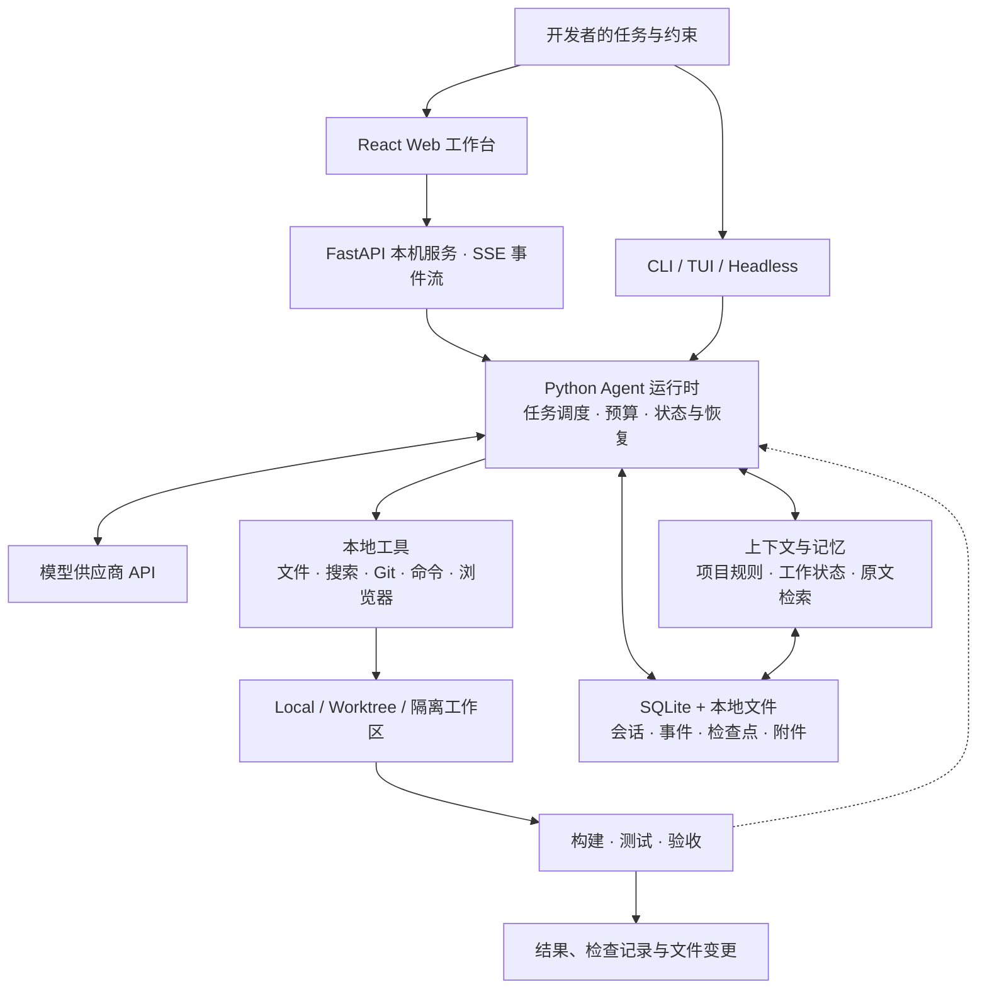

# MiniCode

MiniCode 是一个面向本地开发的 AI 编程 Agent，提供浏览器工作台、交互式终端和 Headless 命令行入口。开发者用自然语言描述任务，Agent 围绕选定项目读取代码、调用工具、实施修改和执行检查，并保存会话、记忆、检查点和运行记录。

本仓库包含 **Python Agent 运行时**与 **React Web 工作台**。模型通过配置的供应商 API 调用，文件、Git、命令和会话管理由本机 Python 服务执行。

[项目介绍](#项目介绍) · [整体架构](#整体架构) · [快速开始](#快速开始) · [后端技术指南](./MiniCode-Python-repo/README.md) · [Web 工作台](./MiniCode-Web/README.md)

## 项目介绍

MiniCode 围绕真实仓库中的开发任务构建：理解陌生项目、定位错误、实现功能、补充测试、维护文档，以及在多轮交互中继续处理尚未完成的工作。模型负责理解需求和选择行动，本地运行时负责执行工具、管理状态、约束预算，并记录实际结果。

项目重点是让一次编程任务形成可以检查和继续的工作过程。你可以查看 Agent 读取了哪些文件、执行了哪些命令、修改了什么、哪些检查通过，以及任务因什么原因停止；需要继续时，可以利用已保存的会话与任务状态，而不必重新描述全部背景。

这个仓库也适合学习 Agent 工程实现。前端交互、模型适配、工具协议、上下文管理、记忆检索、任务调度、权限审批和验证流程都有对应源码，可以沿着一条请求从页面或终端追踪到运行结果。阅读入口见[项目学习手册](./MiniCode-Python-repo/Docs/Documentation/AgentProjectGuide/README.md)。

### 典型使用场景

| 场景 | 可以交给 MiniCode 的任务 |
| --- | --- |
| 熟悉项目 | 梳理目录、启动入口、主要模块和依赖关系，给出带代码位置的说明。 |
| 功能开发 | 根据需求查找相关实现，修改代码并运行适用的构建、测试或浏览器检查。 |
| 问题排查 | 结合错误信息、日志和源码定位原因，实施修复并核对结果。 |
| 持续迭代 | 在原会话中追加要求、检查已有修改、分叉新方向，或在预算与环境就绪后继续未完成任务。 |
| 自动化调用 | 使用 Headless 执行单次任务，通过明确的预算和验收契约接入脚本流程。 |

## 主要能力

- **本地编程工作流**：读取、搜索、编辑项目文件，运行 Shell、Git、测试及浏览器检查。
- **三种执行模式**：Standard、Deep、Ultra，覆盖日常开发、深入处理和按需协作。
- **持久会话与恢复**：查看和回放历史，使用检查点预览、撤销文件编辑，继续未完成任务。
- **上下文与记忆**：维护任务状态、项目知识和分页原文，支持 Markdown 查看副本及备份恢复。
- **Web 项目管理**：项目与独立对话、流式运行记录、工具审批、任务停止、会话分叉及 Git Worktree。
- **扩展与诊断**：支持 Skill、MCP 和本地扩展包，提供配置检查、运行时状态及 readiness 诊断。

## 核心设计

### 会话、上下文和记忆共同支撑长任务

会话保存用户交互和运行记录，工作上下文保留当前目标、约束与进度，项目记忆保存可复用知识。分页记忆将原始事件和大型工具结果持久化，在需要时按来源读取，使长任务可以在有限模型窗口内继续处理。

项目内的 `AGENTS.md`、`CLAUDE.md` 等人工规则与自动提炼的经验分别管理。记忆与摘要提供工作参考，原始文件、工具回执和检查结果仍是核对结论的依据。SQLite 保存结构化状态，本地文件承载大型原文、附件及备份材料。

### 执行模式决定处理深度与协作方式

Standard、Deep、Ultra 面向不同规模的任务。日常工作可以由一个主 Agent 完成；深入任务可以增加严格检查；复杂任务可以在配置与预算允许时进行分工、通信和结果整合。协作节点保留各自的上下文与结果，主任务仍需完成最终集成和验收。

执行模式、Local / Worktree 环境、权限和任务预算分别配置。选择更深入的模式不会自动改变工具权限，模型推理参数的支持情况取决于供应商接口。

### 文件修改、检查与恢复构成完整流程

运行时记录文件变更、检查点、工具结果和任务状态；Web 展示工作记录、待处理审批及最终差异。检查既可以来自项目现有测试，也可以来自构建命令、浏览器场景或显式验收契约。失败、停止和预算耗尽保留相应状态，后续继续需要核对当前工作区与已保存成果。

检查点回退针对已记录的文件编辑；命令和外部请求的实际效果需要结合工具回执核对。工作区隔离、检查通过与任务完成分别记录，便于判断成果是否已经验证和应用。

## 整体架构



一条典型请求会经历：加载项目规则与会话 → 组织模型上下文 → 调用模型与工具 → 记录结果和变更 → 执行适用检查 → 返回结果或保存待继续状态。Web、终端和 Headless 使用同一套 Python 能力，分别提供页面交互、终端交互和脚本调用方式；具体运行时策略由入口与配置决定。

### 技术栈

| 层次 | 主要技术与职责 |
| --- | --- |
| Web 界面 | React、TypeScript、Vite；对话、项目、工作记录、审批与变更查看。 |
| 本地服务 | FastAPI、Uvicorn、SSE；连接浏览器与 Python 运行时，管理任务子进程。 |
| Agent 运行时 | Python 3.11+；模型与工具循环、执行模式、调度、预算、检查和恢复。 |
| 存储与上下文 | SQLite、本地文件、分页原文和项目 Markdown 规则。 |
| 开发工具 | Git / Worktree、ripgrep、Shell 和文件工具。 |
| 验证体系 | pytest、Vitest、Playwright，以及结构检查和 readiness 诊断。 |

## 仓库结构

```text
MiniCode/
├── README.md                         # 项目总览与快速开始
├── AGENTS.md                         # 工作区协作约定
├── MiniCode-Python-repo/              # Python 后端与终端入口
│   ├── minicode/                     # Python 包、命令入口及运行时集成
│   ├── Main/MinicodeFrontline/        # 产品入口与投影
│   ├── Package/AgentRuntime/         # Agent 运行时模块
│   ├── Package/EngineeringStructure/ # 工程结构检查
│   ├── tests/                        # 后端测试
│   ├── Docs/Documentation/           # 架构、使用与验证文档
│   ├── pyproject.toml                # Python 依赖与命令定义
│   └── docker-compose.yml            # minicode Compose 应用组
└── MiniCode-Web/                      # React + TypeScript + Vite 前端
    ├── src/                          # 页面、组件和 API 客户端
    ├── tests/                        # 浏览器测试
    ├── package.json                  # 前端依赖与脚本
    └── Start-MiniCode-Web.ps1         # Windows 本地启动脚本
```

## 快速开始

以下示例使用 **Windows PowerShell**，从仓库根目录执行。后端也支持 macOS / Linux；对应的虚拟环境解释器路径为 `.venv/bin/python`。

### 1. 准备环境

| 依赖 | 要求与用途 |
| --- | --- |
| Python | 3.11+，运行后端 |
| Node.js / npm | Node.js 22.12+，也支持 20.19+ 的 20.x 版本；用于安装和构建前端 |
| Git | 项目版本管理、Worktree 和差异查看 |
| ripgrep | `rg` 命令，需支持 PCRE2，用于代码搜索 |
| 模型配置 | 可用的 Provider、模型名称、Base URL 和 API Key |

检查基础命令：

```powershell
python --version
node --version
npm --version
git --version
rg --version
rg --pcre2-version
```

Windows 缺少 ripgrep 时，可运行 `winget install --id BurntSushi.ripgrep.MSVC --exact`，安装后重新打开终端。Docker 是可选运行方式，本地 Web 使用 SQLite 和本地文件存储即可启动。

### 2. 安装后端并配置模型

```powershell
cd .\MiniCode-Python-repo
python -m venv .venv
.\.venv\Scripts\python.exe -m pip install -e ".[web,memory]"
.\.venv\Scripts\python.exe -m minicode.install
.\.venv\Scripts\python.exe -m minicode.main --validate-config
```

安装向导用于配置模型供应商、模型、接口地址和密钥。以后也可以通过 Web 的模型设置修改配置。

首次安装时，可接着启用 SQLite 和本地文件存储；示例将数据放到 `D:/MiniCodeData`，也可换成其他绝对路径：

```powershell
.\.venv\Scripts\python.exe -m minicode.paged_memory.admin configure-local --data-root D:/MiniCodeData
.\.venv\Scripts\python.exe -m minicode.web_api --check --workspace .
```

已有安装应沿用当前数据配置；`configure-local` 初始化目标目录并保存设置，**不会迁移旧数据**。位置调整与恢复步骤见[分页记忆与存储说明](./MiniCode-Python-repo/Docs/Documentation/PAGED_MEMORY.md)。

### 3. 构建并启动 Web

接着进入同级前端目录：

```powershell
cd ..\MiniCode-Web
npm ci
npm run build
.\Start-MiniCode-Web.ps1
```

打开 [http://127.0.0.1:8765](http://127.0.0.1:8765)。启动脚本使用后端 `.venv`，检查依赖并由 FastAPI 托管前端 `dist`，日常使用只需运行这一个服务。

脚本默认选择后端目录作为工作区。处理其他项目时可指定目录，也可以进入页面后打开项目文件夹：

```powershell
.\Start-MiniCode-Web.ps1 -Workspace "D:\Projects\your-project"
```

同一用户配置目录只运行一个 Web 后端。更新代码或重新构建前端后，先用 `Ctrl+C` 停止旧服务，再启动并刷新页面。

## 执行模式与工作目录

| 模式 | 适用场景与行为 |
| --- | --- |
| Standard | 日常任务，以单主 Agent 为主；Web 项目任务直接修改所选 Local 或 Worktree 目录。 |
| Deep | 深入分析与实现；深度主 Agent 配合按需串行只读验证，使用隔离与回写流程。 |
| Ultra | 复杂任务；根据任务、配置和预算选择深度单 Agent 或协作执行，再进行整合与验证。 |

Web 新对话默认选择 **Deep**；CLI / Headless 的默认执行模式为 **Standard**，可用 `--profile standard|deep|ultra` 指定。Web 命令行入口与启动脚本默认使用 `primary` 运行时，终端入口沿用各自配置。

Local / Worktree 与执行模式分别选择。Worktree 需要 Git 仓库；任务预算、权限模式和验收要求可以在 Web 输入区调整。具体协作与恢复边界见[Web 说明](./MiniCode-Web/README.md)和[子代理协作文档](./MiniCode-Python-repo/Docs/Documentation/AGENT_COLLABORATION.md)。

## 终端与 Headless 使用

在后端目录中执行：

```powershell
# 交互式终端
.\.venv\Scripts\python.exe -m minicode.main --profile deep

# 单次任务，工作区为当前目录
.\.venv\Scripts\python.exe -m minicode.headless "解释这个项目的结构和主要入口"

# 只预览新版运行时配置，不调用模型或执行工具
.\.venv\Scripts\python.exe -m minicode.headless --preflight --runtime primary --profile deep --max-tokens 64000 --deadline-seconds 240

# 查看本地运行时与供应商就绪状态
.\.venv\Scripts\python.exe -m minicode.readiness --json --fail-on blocked
```

激活虚拟环境后，也可使用 `minicode-py`、`minicode-headless`、`minicode-web`、`minicode-readiness`、`minicode-memory` 等已安装命令。从其他项目启动 CLI 时，先切换到目标目录，再调用 MiniCode 虚拟环境中的解释器或命令。

终端常用命令包括 `/session`、`/sessions`、`/session-replay`、`/memory`、`/checkpoints`、`/rewind-preview` 和 `/readiness`，详见[后端技术指南](./MiniCode-Python-repo/README.md#会话与恢复)。

## 开发与检查

前端开发使用两个终端。终端一在后端目录启动 API：

```powershell
.\.venv\Scripts\python.exe -m minicode.web_api --workspace .
```

终端二在前端目录启动 Vite：

```powershell
npm run dev
```

开发页面位于 [http://127.0.0.1:5173](http://127.0.0.1:5173)，`/api` 代理到 `127.0.0.1:8765`。前端修改在开发模式下热更新；通过 `8765` 使用生产页面时，需要重新运行 `npm run build`。

后端检查在后端目录执行：

```powershell
.\.venv\Scripts\python.exe -m pip install -e ".[dev,web,memory]"
.\.venv\Scripts\python.exe -m playwright install chromium
.\.venv\Scripts\python.exe -m pytest -q --import-mode=importlib
```

前端检查在前端目录执行；端到端测试需要保持上面的 API 与 Vite 开发服务运行：

```powershell
npm run typecheck
npm test
npm run build
# 首次运行前端浏览器测试前安装对应浏览器
npx playwright install chromium
npm run test:e2e
```

后端检查定义见 [ci.yml](./MiniCode-Python-repo/.github/workflows/ci.yml)，前端专项脚本见 [package.json](./MiniCode-Web/package.json)。测试结果以当前环境的实际执行输出为准。

## 配置与数据

| 内容 | 保存位置或配置方式 |
| --- | --- |
| 模型、密钥与用户设置 | 默认 `~/.mini-code/settings.json`；已调整用户状态目录时使用对应位置 |
| SQLite、原文、附件、会话与备份 | 由 `memoryDataRoot` 或 `MINI_CODE_DATA_ROOT` 指定；快速开始示例为 `D:/MiniCodeData` |
| 项目人工规则 | 项目内的 `AGENTS.md`、`CLAUDE.md` 等文件 |
| Markdown 导出 | 数据目录下的 `exports/`，用于查看；恢复使用专门的备份 |

原生 Python / Web 入口不会自动加载后端的 `.env`，请使用安装向导、Web 设置或启动进程的环境变量。后端 [.env.example](./MiniCode-Python-repo/.env.example) 主要供 Docker Compose 使用。

Docker CLI / Headless 的操作说明见[后端技术指南](./MiniCode-Python-repo/README.md#docker-运行)。本工作区的 Compose 项目名固定为 `minicode`，配置统一位于 `MiniCode-Python-repo/docker-compose.yml`；现有本地运行方式无需额外部署数据库或向量服务。

## 更多文档

| 文档 | 内容 |
| --- | --- |
| [Python 后端技术指南](./MiniCode-Python-repo/README.md) | 后端安装、命令参考、工具边界、容器与运行时诊断 |
| [Web README](./MiniCode-Web/README.md) | 页面能力、构建启动、运行模式与专项验证 |
| [项目学习手册](./MiniCode-Python-repo/Docs/Documentation/AgentProjectGuide/README.md) | Agent 基础、架构、请求生命周期和代码证据 |
| [分页记忆与本地存储](./MiniCode-Python-repo/Docs/Documentation/PAGED_MEMORY.md) | SQLite、上下文、Markdown 导出、备份与恢复 |
| [会话分叉与工作树](./MiniCode-Python-repo/Docs/Documentation/SESSION_FORK_WORKTREE.md) | 分叉语义、Worktree 应用、冲突与恢复 |
| [浏览器截图与检查](./MiniCode-Python-repo/Docs/Documentation/BROWSER_CHECKS.md) | Playwright 检查、截图和验收证据 |
| [工作区约定](./AGENTS.md) | 中间件分组与协作约定 |


