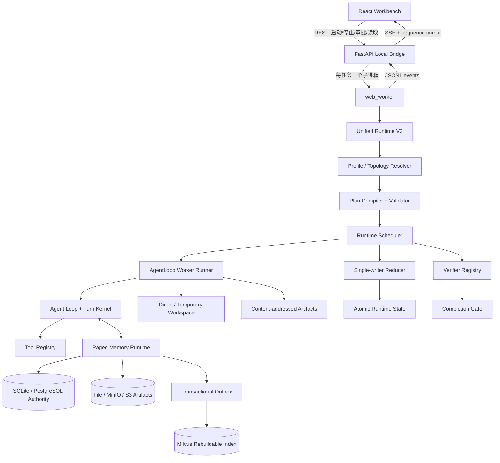

# MiniCode 项目亮点与面试高频题（基于源码）

> 分析时间：2026-09-03  
> 分析对象：当前工作区实际文件（Git 基线 `31126e9`，同时包含尚未提交的 Runtime V2、Paged Memory 与 Web 改动）  
> 阅读范围：`MiniCode-Python-repo`、`MiniCode-Web`、测试、Docker Compose、设计文档与基准报告；排除了 `.venv`、`node_modules`、构建产物、缓存、运行时数据和密钥值。  
> 使用原则：本文说明的是“代码里已经实现了什么”。面试时只把自己确实设计或实现过的内容说成个人贡献。

---

## 1. 一句话定位

MiniCode 不是简单的“聊天框套大模型”，而是一个 **local-first 的 Coding Agent 工作台**：它把模型调用、工具执行、任务规划、安全授权、会话恢复、分层记忆、并行执行、结果验证和 Web 可观测性组织成一套可持久化、可恢复、可审计的本地运行时。

项目最值得讲的主线是：

> 如何让一个会读写真实代码仓库的 Agent，不只“能跑”，还能够在上下文有限、工具可能失败、进程可能崩溃、多人/多 Worker 可能竞争的条件下，保持结果可验证、状态可恢复、写入不互相覆盖。

---

## 2. 面试开场稿

### 2.1 30 秒版本

> MiniCode 是一个 Python + React 实现的本地 Coding Agent。后端负责模型适配、工具调用、权限、会话与 Runtime V2，前端通过 FastAPI、子进程 JSONL 和 SSE 展示实时执行过程。项目的重点不是对话 UI，而是可靠执行：Standard 模式保持单 Worker 低开销，Ultra 模式只并行只读探索，写操作收敛到唯一 Writer，并经过隔离工作区、证据化验证和 Completion Gate。长任务还可以用 Paged Memory 将原始事实先持久化，再按需检索，避免把“检索没召回”误当成“信息已丢失”。

### 2.2 2 分钟版本

> 我把 MiniCode 定位为一个 local-first 的 Coding Agent 运行时和工作台。它支持 OpenAI、Anthropic、DeepSeek、OpenRouter、自定义 OpenAI-compatible 服务等模型入口，同时把文件、Shell、Git、网络、MCP、Skills 和 Hooks 统一到带 effect 与 replay policy 的工具注册表中。
>
> 单次任务进入后，会先解析 Standard 或 Ultra 执行档位，再由确定性的拓扑解析器选择单 Worker 深度执行，或“多个只读 Explorer + 唯一 Writer + 独立 Verifier”的 DAG。调度器只负责发命令，真正的状态变化全部经过单写者 Reducer；每次尝试都绑定 plan version、contract revision、lease、attempt 和 fencing token，所以崩溃恢复后，旧 Worker 的迟到结果不能污染新状态。Ultra 的写操作在临时工作区中进行，集成前校验基线快照；如果用户同时改了同一文件就拒绝覆盖，多文件集成失败还会回滚。
>
> 另一个重点是上下文和记忆。系统区分 INLINE、WORKING_SET、PAGED_MEMORY 三档，先把原始事件、工具结果和工件写入权威存储，再建立可重建的 Milvus 索引。高风险步骤要求 required dependency coverage 为 100%，且最终输入预算会把消息和动态工具 schema 一起计算。大于 8,000 字符的 Worker 输出不会只截断，而是写成内容寻址 Artifact，后续 Worker 通过受限分页工具读取完整内容。
>
> Web 端不是直接在请求线程里跑 Agent，而是一任务一子进程，通过 JSONL 传事件，FastAPI 再用带单调序号和游标续传的 SSE 推给 React。这样切换会话后任务仍能继续，回来时能去重、补流并恢复终态。当前验证中，前端单测、类型检查、构建和双服务 E2E 均通过；Python 全量 1,636 个用例里 1,632 通过、3 跳过、1 个输入预算边界用例失败，这也是当前明确的待修项。

---

## 3. 项目规模与技术栈

以下数字来自当前工作树，只用于说明工程量，不等于个人贡献量：

| 项目 | 当前结果 |
|---|---:|
| Python 实现文件（`minicode`、`Main`、`Package`） | 188 个，约 80,569 行 |
| Python 测试文件 | 118 个，约 31,316 行 |
| 显式 Python `test_*` 函数 | 1,575 个 |
| 本次 Pytest 实际收集用例 | 1,636 个（包含参数化展开） |
| Web 源文件（TS/TSX/CSS） | 17 个，约 7,699 行 |
| Web 单元测试 | 8 个 |
| Playwright 项目用例条目 | 32 个（16 通过、16 按设备条件跳过） |

主要技术：

| 层次 | 技术与职责 |
|---|---|
| Agent 后端 | Python 3.11+、自研 Agent Loop、Turn Kernel、Runtime V2 |
| Web API | FastAPI、Uvicorn、Pydantic、SSE |
| Web 前端 | React 19、TypeScript 5.8、Vite 7、React Markdown |
| 测试 | Pytest、Hypothesis、Vitest、Playwright |
| 本地权威存储 | SQLite；生产形态可切 PostgreSQL |
| 原始工件 | 本地文件；可切 MinIO / S3 |
| 向量检索 | Milvus（非权威、可重建） |
| 中间件编排 | Docker Compose：PostgreSQL、MinIO、etcd、Milvus、Indexer |
| 扩展 | MCP、Skills、Hooks、多模型 Provider |

Python 基础包声明为零强制依赖，把 Web、测试和 Memory 放到 extras 中。这是“轻 CLI 核心 + 按能力安装”的取舍，而不是项目完全不依赖三方库。

---

## 4. 总体架构



### 4.1 一次任务的核心链路

1. React 通过 REST 创建或继续任务，选择 Standard / Ultra。
2. FastAPI 的 `RunManager` 检查“同会话不可并跑”和全局并发上限，然后创建子进程。
3. `web_worker` 从 stdin 读取启动参数，从环境变量读取 Provider 密钥，并构造模型、工具、权限、会话和记忆运行时。
4. Unified Runtime 生成 Task Contract、Execution Profile、Topology Decision 和版本化 Plan DAG。
5. Scheduler 认领 ready node；Reducer 发放 attempt、lease、fencing token 和幂等键。
6. Worker 获得最小 Context Manifest 和按 effect 过滤后的工具视图，在直接或临时工作区中运行现有 Agent Loop。
7. Worker 返回摘要、完整 Artifact 引用、Evidence、变更资源和 usage；Reducer 拒绝过期或版本不匹配的结果。
8. Writer 的变更通过基线漂移检查后集成；Verifier 在隔离副本中执行确定性检查。
9. Completion Gate 只有在计划、合同、集成、证据和验证全部满足时才允许交付。
10. 过程事件经 JSONL → FastAPI → SSE 推送，React 用 sequence 去重并在重连时从 `after` 游标续传。

---

## 5. 最值得讲的 10 个项目亮点

### 5.1 Runtime V2：把 Agent 从“循环脚本”升级为可恢复状态机

### 解决的问题

普通 Agent Loop 往往把计划、工具结果、重试和最终回答都放在一个内存循环里。进程崩溃、重试或多个 Worker 并发后，很难回答：谁拥有当前任务、哪个结果仍有效、是否重复执行过副作用、恢复后从哪里继续。

### 核心设计

- 使用版本化协议对象描述 Task、Contract、Plan、Node、Attempt、Lease、Artifact、Evidence、Approval 和 Delivery。
- Scheduler 不能直接改状态，只能提交 Command；Reducer 是唯一状态写入入口。
- `command_id` 去重，使重复投递同一命令返回既有事件。
- Result 同时校验 run、plan version、contract revision、attempt、lease 和 fencing token。
- 状态快照采用临时文件、flush/fsync 和 `os.replace` 原子替换，并防御符号链接、重解析点和硬链接别名。
- 崩溃恢复会处理 running/verifying/waiting-approval 节点，重试次数受预算约束。

### 面试价值

这能把话题自然引到 **状态机、事件溯源、幂等、租约、fencing token、崩溃一致性和单写者模型**，技术含量远高于只介绍 Prompt。

### 证据文件

- `MiniCode-Python-repo/minicode/runtime_protocol.py`
- `MiniCode-Python-repo/minicode/runtime_state.py`
- `MiniCode-Python-repo/minicode/runtime_scheduler.py`
- `MiniCode-Python-repo/tests/test_runtime_reducer.py`
- `MiniCode-Python-repo/tests/test_runtime_recovery.py`

### 5.2 有边界的并行：只读 Fan-out，写入 Single-writer

### 解决的问题

多 Agent 并不天然更快。多个 Writer 同时改仓库会产生覆盖、冲突和不可复现结果；任务强耦合时，拆分成本甚至高于并行收益。

### 核心设计

- 对外只暴露 Standard 和 Ultra 两档，内部路由为 `standard-single`、`deep-single`、`ultra-read-fanout`。
- 拓扑解析器基于显式子问题数、可确定验证性、共享依赖、冲突风险、预计收益、协调成本和预算做确定性决策，并保留 decision reason。
- Fan-out 中多个 Explorer / Reviewer 只能拿到 READ_ONLY 工具。
- 所有写入汇聚到唯一 Writer；Writer 依赖所有探索节点，最终 Verifier 再依赖 Writer。
- Plan Validator 检查节点唯一性、依赖完整性、无环、角色 effect、唯一 Writer 和最大 Agent 数。

### 仓库内校准

`runtime_v2_calibration_results.md` 记录的离线、无网络、确定性校准中：

- Standard：统一运行时相对 legacy 的 p95 增加约 **3.16%**，两者均为 100% 成功、每次 1 个逻辑模型调用。
- Ultra 并行工作负载：fan-out 相对串行基线的 p95 墙钟时间下降约 **36.39%**。

这些只能证明受控工作负载下的运行时开销和并发收益，**不能证明真实模型回答质量提升 36%**。

### 证据文件

- `MiniCode-Python-repo/minicode/unified_runtime.py`
- `MiniCode-Python-repo/tests/test_topology_resolver.py`
- `MiniCode-Python-repo/tests/test_plan_validator_v2.py`
- `MiniCode-Python-repo/tests/test_ultra_read_fanout.py`
- `MiniCode-Python-repo/benchmarks/runtime_v2_calibration_results.md`

### 5.3 临时工作区 + 基线漂移检测：保护用户正在修改的代码

### 核心设计

- Standard 走 Direct Workspace，保持低开销和旧行为兼容。
- Ultra Writer 在运行时拥有的临时副本中写入，Git 和非 Git 目录都能工作。
- 快照使用普通文件内容 SHA-256，并忽略 `.git`、缓存和运行时目录。
- 集成时逐个检查被改资源的 source base：如果用户在 Worker 执行期间改了同一文件，拒绝覆盖。
- 多文件集成先 staging、备份，再用 `os.replace`；中途失败会回滚已经替换的文件。
- 拒绝符号链接、重解析点、硬链接别名和文件/目录类型攻击；清理只作用于带 owner marker 的运行时临时目录。

### 面试价值

这是“并发控制”落到文件系统层的完整回答：不仅讨论 Git merge，还讨论 TOCTOU、路径边界、原子替换和 rollback。

### 证据文件

- `MiniCode-Python-repo/minicode/workspace_provider.py`
- `MiniCode-Python-repo/tests/test_workspace_provider.py`

### 5.4 证据化完成：模型说“完成”不等于系统允许交付

### 核心设计

- Worker 结果携带 `EvidenceRef`、`ArtifactRef`、`changed_resources` 和 usage，而非只返回一段自然语言。
- Verifier Registry 以确定顺序执行 schema、unit、integration、lint、type、static、invariant、browser 等验证器。
- 命令验证在隔离副本中运行，避免测试产生物污染真实仓库。
- Strict 模式下，没有证据或验证记录不能通过。
- Completion Gate 会检查：当前 plan/contract、全部节点终态、Writer 已集成、无冲突/策略违规、验证结果通过。
- Turn Kernel 还有 evidence guard；严格验证时会扣住没有证据支持的 final。

### 面试表达

> 我们把“模型的自我声明”和“系统的交付事实”分开。LLM 可以建议完成，但只有确定性 gate 能签发 delivery。

### 证据文件

- `MiniCode-Python-repo/minicode/verifier_registry.py`
- `MiniCode-Python-repo/minicode/turn_kernel.py`
- `MiniCode-Python-repo/tests/test_completion_gate.py`
- `MiniCode-Python-repo/tests/test_verifier_registry.py`

### 5.5 Paged Memory：区分“存储无损”与“本轮检索完整”

### 核心思想

很多 RAG 系统把未召回的信息等同于不存在。MiniCode 把两个目标拆开：

- **Storage losslessness**：原始事件、事实、工具输出和工件先进入权威存储。
- **Retrieval completeness**：当前步骤再根据目标、依赖、约束和预算构造 Working Set。

### 三档模式

| 模式 | 适用场景 | 行为 |
|---|---|---|
| INLINE | 短任务 | 上下文可直接放入模型输入 |
| WORKING_SET | 中等任务 | 使用持久事实和受控工作集 |
| PAGED_MEMORY | 长任务/大工件 | 摘要 + 引用，按需分页读取 |

- 升档可立即发生；降档只允许在 phase 边界并使用 hysteresis，避免阈值附近来回抖动。
- 高风险步骤要求 `required_dependency_coverage_ratio == 1.0`；证明不了必需依赖已覆盖时，写操作 fail closed。
- 活跃任务的约束和决策会被当作隐式 required dependencies。
- 最终 Provider 预算同时计算消息和完整动态工具 schema；预算不足应在调用模型前报错，而不是静默丢约束。

### 离线记忆基准

仓库固定语料的确定性基准记录：INLINE 0% 压缩、WORKING_SET 约 28.18% 输入缩减、PAGED_MEMORY 约 92.44% 输入缩减，同时 required coverage、facet coverage 和约束保留为 100%。这只验证构造器在该语料上的压缩/覆盖属性，不是外部模型效果评测。

### 证据文件

- `MiniCode-Python-repo/Docs/Documentation/PAGED_MEMORY.md`
- `MiniCode-Python-repo/minicode/paged_memory/context_builder.py`
- `MiniCode-Python-repo/minicode/paged_memory/policy.py`
- `MiniCode-Python-repo/benchmarks/paged_memory_eval.py`

### 5.6 大结果不“截断即丢失”：内容寻址 Artifact + 受限分页

### 核心设计

- Tool 的原始结果先交给 observer 持久化，然后才执行兼容层的展示截断。
- Worker 输出超过 8,000 字符时，完整内容写入 `RuntimeArtifactStore`，返回摘要、artifact id、SHA-256 和大小。
- 下游节点只会看到自己依赖节点的 Artifact，不能任意枚举其他结果。
- `runtime_artifact_read` 每次读取受限字节范围，页大小被夹在安全区间内，并在读取时校验内容哈希。
- 工件存储使用内容寻址与原子写，测试覆盖篡改、孤儿文件、重启和硬链接攻击。

### 面试价值

这能回答一个很实际的问题：Agent 工具输出太大时，如何既控制 token，又不让后续推理建立在残缺内容上。

### 证据文件

- `MiniCode-Python-repo/minicode/tooling.py`
- `MiniCode-Python-repo/minicode/worker_runtime.py`
- `MiniCode-Python-repo/minicode/runtime_artifacts.py`
- `MiniCode-Python-repo/tests/test_large_agent_result.py`
- `MiniCode-Python-repo/tests/test_runtime_artifacts.py`

### 5.7 权威库、工件库、向量库分责 + Transactional Outbox

### 存储分工

| 组件 | 角色 | 是否权威 |
|---|---|---|
| SQLite / PostgreSQL | 事件、状态、事实、决策、依赖、checkpoint、outbox | 是 |
| 本地文件 / MinIO / S3 | 原始大工件、归档 | 是（针对工件内容） |
| Milvus | 向量检索加速 | 否，可重建 |
| Working Set | 当前步骤缓存 | 否 |

### 一致性策略

- 业务事实/事件与 outbox 在同一数据库事务内提交。
- Indexer 以租约领取 outbox，成功后完成，失败后延迟重试，必要时进入失败态。
- 消费语义是 **至少一次投递 + 幂等应用**，不是虚假的“天然 exactly-once”。
- Milvus 故障只让索引退化，不应回滚已经持久化的事实；恢复后可以重放 outbox 或全量重建。
- PostgreSQL 事件表用触发器保持 append-only；授权 hard-delete 走显式事务开关和审计。
- 向量化前先做 secret redaction，降低密钥进入索引的风险。

### 证据文件

- `MiniCode-Python-repo/minicode/paged_memory/sql/001_postgres.sql`
- `MiniCode-Python-repo/minicode/paged_memory/sqlite_store.py`
- `MiniCode-Python-repo/minicode/paged_memory/postgres_store.py`
- `MiniCode-Python-repo/minicode/paged_memory/indexer.py`

### 5.8 权限不是一个布尔值：effect、replay policy 与 operation digest

### 核心设计

- 每个 Tool 显式声明 effect；未知工具默认视为 PRIVILEGED，采取 fail-closed。
- Explorer 只获得 READ_ONLY 工具视图；Writer 才能获得写能力。
- Replay Policy 区分 `SAFE`、`IDEMPOTENT_WITH_KEY`、`VERIFY_BEFORE_RETRY`、`NEVER_AUTO_RETRY`。
- Approval 绑定完整 operation digest：run、node、attempt、tool call、cwd、args、env scope 和 base revision。
- 授权有过期时间、单次使用语义；参数或工作区变化后旧授权不能复用。
- 危险 Shell / Git / 磁盘命令有集中分类；路径检查对 Windows 大小写、链接和工作区边界做处理。

### 面试表达

> “允许执行 Shell”太粗。系统授权的是某个上下文中的某次具体操作，而不是给模型一张长期空白支票。

### 证据文件

- `MiniCode-Python-repo/minicode/tooling.py`
- `MiniCode-Python-repo/minicode/runtime_policy.py`
- `MiniCode-Python-repo/minicode/permissions.py`
- `MiniCode-Python-repo/minicode/path_safety.py`
- `MiniCode-Python-repo/tests/test_runtime_approval.py`
- `MiniCode-Python-repo/tests/test_tool_effects.py`

### 5.9 Web 运行链路：子进程隔离 + 可续传 SSE

### 核心设计

- Agent 不在 FastAPI 请求线程中运行，而是每个任务启动一个 Python 子进程。
- 父子进程使用 UTF-8 JSONL；Provider 密钥只通过进程环境传递，不出现在 CLI 参数和浏览器 payload 中。
- Web 默认只绑定本机，校验 Host / Origin，CORS 只开放 localhost；远程绑定必须显式允许。
- `RunManager` 默认限制最多 4 个活跃任务，同一 session 不能同时启动两次。
- 事件带单调 sequence；EventSource 重连携带 `after`，前端按 sequence 去重。
- UI 切走不会终止后台任务；切回后先重连事件流，必要时用 run snapshot 收敛终态。
- 审批是 REST/管道回传，服务端到浏览器的高频进度才走 SSE，符合单向事件流特征。
- `web_worker` 不把隐藏推理原文转发给前端，只发可公开的阶段状态。

### 证据文件

- `MiniCode-Python-repo/minicode/web_api.py`
- `MiniCode-Python-repo/minicode/web_worker.py`
- `MiniCode-Web/src/App.tsx`
- `MiniCode-Web/src/lib/timeline.ts`
- `MiniCode-Web/tests/e2e/workbench.spec.ts`

### 5.10 会话、Checkpoint、Rewind、Readiness 与工程门禁

### 核心设计

- Session 持久化消息、transcript、turn、permissions、skills、MCP、hooks、delegation、memory continuity、runtime run 和 checkpoint。
- 增量 delta 与周期性 full snapshot 结合，写入使用原子 contract bundle。
- 文件编辑前创建 checkpoint；rewind 支持预览和按 turn 回退，并先创建反向安全 checkpoint，降低误回退风险。
- Readiness 把本地逻辑检查与真实 Provider smoke 分开，不会因缺 API key 把本地单测结果伪装成线上可用。
- `Package/EngineeringStructure` 用 AST 和依赖图检查自定义工程边界、镜像测试、循环依赖与 carrier；本次结构门禁为 86 records、0 findings。
- Docker 中间件统一在名为 `minicode` 的 Compose 应用组中，并配置健康检查和具名卷。

### 证据文件

- `MiniCode-Python-repo/minicode/session.py`
- `MiniCode-Python-repo/minicode/readiness.py`
- `MiniCode-Python-repo/minicode/release_readiness.py`
- `MiniCode-Python-repo/Package/EngineeringStructure/`
- `MiniCode-Python-repo/docker-compose.yml`

---

## 6. Standard 与 Ultra 怎么讲

| 维度 | Standard | Ultra Deep Single | Ultra Read Fan-out |
|---|---|---|---|
| 目标 | 日常低开销与兼容 | 强耦合复杂任务 | 可拆、可并行验证的复杂任务 |
| Worker | 1 | 1 个深度 Worker，可带验证 | 多个只读 Explorer + 1 Writer + Verifier |
| 写隔离 | Direct Workspace | Temporary Workspace | Temporary Workspace，唯一 Writer |
| 验证 | Light | Strict | Strict + 独立 Verifier |
| 并行 | 否 | 否 | 只并行只读节点 |
| 选择方式 | 用户选 Standard | Ultra 经 Resolver 判定 | Ultra 经 Resolver 判定 |
| 关键取舍 | 延迟/成本低 | 避免不必要拆分 | 用协调成本换墙钟时间 |

面试时不要说“Ultra 一定会多 Agent”或“多 Agent 一定更好”。准确说法是：**Ultra 允许更强验证与隔离，但只有在可拆分、低冲突且收益覆盖协调成本时才 fan-out。**

---

## 7. 高频面试题与参考回答

推荐答题结构：**先结论 → 再机制 → 给代码/测试证据 → 最后主动说边界**。这样比背概念更可信。

### 7.1 项目与架构

#### 1）这个项目解决了什么问题？

答：它解决“让大模型安全、可靠地操作本地代码仓库”的问题。除了模型对话，还覆盖工具权限、任务状态、崩溃恢复、上下文预算、文件写入冲突、结果验证和实时 UI。目标不是替代 IDE，而是提供一个可审计的 Agent 执行层。

#### 2）它和普通 ChatGPT Wrapper 有什么区别？

答：Wrapper 的核心状态通常只有 messages；MiniCode 还有版本化 Plan、Attempt、Lease、Fencing Token、Artifact、Evidence、Approval、Checkpoint 和 Delivery Gate。模型说完成只是输入，系统必须通过确定性验证才能交付。

#### 3）为什么自己做 Runtime，而不是直接上 LangChain / LangGraph？

答：这里需要细粒度控制本地文件写入、授权摘要、恢复协议、会话格式和兼容的单 Worker 快路径，自研运行时更容易定义稳定不变量。代价是维护成本高、生态复用少。若需求以通用编排和快速集成为主，成熟框架可能更合适；不是“自研一定更优”。

#### 4）项目里最难的部分是什么？

答：可选两个真实参与过的方向讲。其一是并发正确性：如何允许读并行，又不让旧 Worker 或多个 Writer 覆盖用户代码；其二是长上下文：如何压缩当前输入但保证原始事实可追溯。回答时落到 reducer/fencing/workspace integration，或 authority/working set/artifact paging，而不是只说“Prompt 调优很难”。

#### 5）为什么后端基础 dependencies 是空的？

答：核心 CLI 尽量只用标准库，把 Web、Memory、Dev 分成可选 extras，减少最小安装面。但安装相应能力时仍依赖 FastAPI、psycopg、pymilvus 等，不能描述成“完全零依赖”。

#### 6）`Main/MinicodeFrontline` 和 `Package/EngineeringStructure` 是什么？

答：前者是面向产品入口与应用编排的工程结构示例，后者是自定义结构检查器，通过 AST、模块依赖和测试镜像规则做架构门禁。它们和核心 `minicode` runtime 并存，体现项目既有产品运行面，也有工程治理面。

### 7.2 Runtime、并发与恢复

#### 7）为什么 Reducer 必须是唯一状态写入者？

答：如果 Scheduler、Worker、Verifier 都能直接改状态，就难以保持事件顺序和重放确定性。单写者让每个 Command 在同一组 invariant 下转成 Event，再归约成状态；测试也能对“输入命令 → 事件/状态”做确定性断言。代价是 Reducer 可能成为吞吐瓶颈，但本项目是本地 Agent，正确性优先。

#### 8）Lease 和 Fencing Token 分别解决什么？

答：Lease 表示 Worker 在一段时间内持有执行权；超时后系统可以回收并重试。仅有 Lease 还不够，因为旧 Worker 可能稍后返回。单调递增或唯一的 fencing token 随 attempt 发放，Reducer 只接受当前 token，迟到结果即使任务内容正确也会被拒绝。

#### 9）`command_id` 去重和业务幂等键有什么区别？

答：`command_id` 防止同一状态命令被重复归约；业务幂等键防止重试同一个有副作用的操作造成二次效果。前者属于控制面，后者属于执行面。项目重试时保留幂等键，并根据 Tool 的 replay policy 判断是否允许自动重放。

#### 10）为什么并行 Agent 只允许读，不允许多个 Writer？

答：读操作的结果可以通过证据与引用汇总，写操作却会修改同一共享状态。让唯一 Writer 在读结果全部完成后统一写入，可以把 N 方冲突降成一个可审计集成点。它牺牲了写并行，但显著简化了冲突、回滚和最终验证。

#### 11）如何判断要不要 fan-out？

答：Resolver 检查是否至少有两个显式子问题、结果能否确定验证、共享依赖和冲突风险是否低、预估收益是否高于协调成本，以及 Agent/token 预算是否允许。判断是确定性的并记录原因，方便测试和复盘。

#### 12）如何防止 DAG 非法？

答：Plan Validator 校验 node id 唯一、依赖存在、图无环、并发数不超预算、只读角色没有写 effect，以及 Ultra fan-out 只有一个 Writer。非法计划在调度前失败，而不是运行到一半才发现。

#### 13）进程崩溃后如何恢复？

答：Runtime State 原子落盘，节点 attempt、lease、result、verification 和预算都在持久状态中。恢复时重新加载快照，对过期 running 节点按 replay policy 和预算决定重试，对 verifying 节点继续验证，对待审批节点创建新的 attempt 并保留必要幂等信息。恢复不是把整个 Prompt 从头再跑。

#### 14）计划变化时已完成工作怎么办？

答：Plan Amendment 会创建新 plan version；未受影响且已经成功的节点可保留，受影响节点被 supersede。任何旧 plan 结果因 version 不匹配都会被 Reducer 拒绝。

#### 15）取消是怎么传播的？

答：父运行持有 cancellation event，Scheduler 不再发新节点，Worker 在启动、工具执行和集成前检查取消，子委派也随父任务终止。关键点是取消前后仍由 Reducer 生成合法终态，不能只杀线程留下 running 状态。

#### 16）预算包含哪些维度？

答：有 deadline、token、cost、最大 Agent/attempt 等硬预算。Scheduler 在认领和重试前检查，Context Builder 在 Provider 调用前检查输入预算。预算耗尽应转成明确失败或阻塞状态，不应偷偷降质量后仍声称完成。

#### 17）为什么用线程池，不用 asyncio 或多进程？

答：Worker 主要等待模型和工具 I/O，线程池能以较低改造成本复用同步 Agent Loop；`FIRST_COMPLETED` 也适合 DAG 解锁。CPU 密集任务不适合靠线程扩展，未来可把 Worker 接口下沉到进程或分布式队列。当前实现是单机调度器，不应包装成分布式系统。

#### 18）会不会死锁或饿死？

答：计划先做无环校验；只有 ready node 才可领取，Writer lock 只保护单写者，不在持锁时等待依赖。还要靠 deadline、lease expiry、bounded retry 防止永久占用。面试中可补充：仍应持续做属性测试和故障注入，不能仅凭设计宣称绝无死锁。

### 7.3 Workspace 与文件安全

#### 19）用户在 Agent 执行期间也改了文件怎么办？

答：临时工作区记录创建时的 source snapshot。集成只关注 Worker 改过的资源；若对应源文件与 base revision 不一致，说明发生同资源漂移，系统拒绝覆盖。与任务无关的用户变更可以保留，不会因为整个仓库 hash 改变就全部失败。

#### 20）多文件写到一半失败如何回滚？

答：先校验所有目标，再把输出放到 staging，并备份现有文件，最后逐项 `os.replace`。如果中间失败，用备份恢复已经替换的目标。它提供的是本地文件集成层的补偿式原子性，不等于跨数据库、对象存储和 Git 的全局事务。

#### 21）为什么还要防 symlink / hardlink？

答：仅检查字符串路径是否以 workspace 开头，不能阻止链接指向目录外；硬链接还能让“看似仓库内”的文件共享外部 inode。项目对 resolved path、Windows reparse point、文件类型和硬链接别名做额外检查，避免越权覆盖。

### 7.4 记忆、RAG 与上下文

#### 22）为什么要分 INLINE、WORKING_SET、PAGED_MEMORY？

答：短任务直接放上下文最简单；中等任务需要筛选稳定工作集；超长任务和大工件需要引用+分页。分档避免所有任务都支付向量库和检索成本，也避免长任务仍依赖无限扩张的 messages。

#### 23）为什么“存储无损”不等于“检索完整”？

答：原始事实写入数据库/工件库，只证明未来仍可查；本轮检索受查询、排序和 token 预算影响，可能漏掉相关项。因此系统单独计算必需依赖覆盖，对高风险步骤要求 1.0，无法证明时禁止写操作。

#### 24）为什么 PostgreSQL/SQLite 是权威，Milvus 不是？

答：向量索引适合相似度检索，但更新一致性、精确过滤、审计和恢复不应依赖它。结构化事实保存在事务库，原始大内容在工件库；Milvus 只保存可重建表示。索引坏了影响召回性能，不应让事实本身消失。

#### 25）为什么不直接用 pgvector？

答：当前设计把关系事务和向量检索独立扩展：PostgreSQL 管 authority，Milvus 管 vector。优点是职责清晰、索引可独立重建；代价是多一个基础设施和 outbox 一致性链路。小规模部署完全可以评估 pgvector 来简化运维，当前选择不是唯一正确答案。

#### 26）Transactional Outbox 解决什么？

答：如果先提交事实再单独写 Milvus，进程可能在两步之间崩溃。把事实和 outbox 同事务提交，后台至少一次消费并幂等更新向量索引，就能恢复这个间隙。它没有创造跨库 exactly-once，而是用可重放记录解决最终一致性。

#### 27）向量库宕机会怎样？

答：进入 INDEX_DEGRADED，权威事实仍可写，检索回退到结构化/词法路径，并保留 outbox 等待恢复。若 authority 自身不可用，则进入 AUTHORITY_UNAVAILABLE 并 fail closed，因为继续执行会破坏“先持久化再推理”的保证。

#### 28）大 Tool Result 为什么不能直接截断？

答：截断会让后续步骤在不知情的情况下使用残缺证据。项目先保存原始输出，再给上下文放摘要和内容寻址引用；后续按权限与依赖范围分页读取，既控制 token，又能回到原文验证。

#### 29）如何避免模式频繁切换？

答：升档在压力出现时可立即进行；降档只在 phase 边界并要求满足 hysteresis。这样避免 token 使用量在阈值附近波动导致 INLINE/WORKING_SET/PAGED_MEMORY 来回切换。

#### 30）动态 Tool Schema 为什么也要计入预算？

答：Provider 实际接收的不只是 messages，还有完整工具定义。忽略 schema 会高估可用上下文，甚至在最后一步超限。当前全量测试唯一失败正是这个边界用例，说明设计目标明确，但当前实现仍有预算计算回归需要修复。

### 7.5 安全、权限与隐私

#### 31）Approval 为什么要绑定 operation digest？

答：如果用户批准的是 `rm 某临时文件`，模型不能把同一批准复用到不同参数、目录或环境。digest 覆盖运行、节点、attempt、工具调用、cwd、args、环境范围和 base revision；任何关键字段改变都要重新授权。

#### 32）哪些操作可以自动重试？

答：只读安全操作可直接重试；有业务幂等键的操作可在同键下重试；不确定是否已生效的操作要先 verify-before-retry；不可安全判断的副作用使用 never-auto-retry。不能对所有工具套统一指数退避。

#### 33）Web 端怎么保护 API Key？

答：设置模型使用 `SecretStr`/掩码返回；启动 Worker 时密钥经环境变量传递，不放 CLI 参数、URL、SSE 或浏览器状态。事件出口还有敏感字段清洗。边界是：本地进程仍然能使用密钥，因此本机恶意软件不在该机制能完全解决的威胁模型内。

#### 34）为什么不把 Chain-of-Thought 展示给前端？

答：隐藏推理既可能包含敏感上下文，也不是可靠的审计事实。Web 只发阶段状态、工具事件、证据和最终结果；审计应依赖结构化事件，而不是模型自由文本的“内心独白”。

#### 35）什么情况 fail closed，什么情况降级？

答：不影响事实正确性的加速层故障可以降级，例如 Milvus 不可用；破坏权威记录、必需依赖覆盖、授权绑定或写入隔离的故障必须 fail closed。判断标准是：继续运行会不会让系统无法证明结果安全且完整。

### 7.6 Web、SSE 与前后端一致性

#### 36）为什么选择 SSE，不选 WebSocket？

答：高频流量主要是服务端向浏览器推送状态，SSE 自带 HTTP 重连语义、实现简单；用户审批、停止和设置仍可走 REST。若未来需要高频双向协作、二进制流或多端实时编辑，再评估 WebSocket。

#### 37）SSE 重连如何避免丢事件和重复事件？

答：服务端给每个事件单调 sequence 并保留运行记录；客户端记录最后序号，以 `after` 重连并丢弃小于等于已见序号的事件。若流关闭但没有终态，前端延迟拉取 run snapshot，最终把临时分析/工具行收敛到确定状态。

#### 38）用户切换会话，后台任务为什么不会停？

答：运行生命周期属于后端 RunManager/子进程，不属于 React 当前选中页。前端用 generation 和 session id 防止旧异步请求污染新会话，切回时重新连接对应 run。

#### 39）为什么一任务一子进程？

答：它隔离 Agent 的环境、stdout/stderr、取消和故障，避免模型/工具阻塞 FastAPI event loop；父进程可以 terminate，超时后 kill。代价是进程启动和内存开销，且父服务重启后活跃进程恢复能力有限。

#### 40）为什么限制最多 4 个活跃任务？

答：本地模型/API、磁盘和子进程资源有限，先用固定上限保护桌面体验。同一会话禁止并跑还能避免 transcript 和 session state 竞争。生产化时应改为按 Provider rate limit、机器负载和任务预算动态限流。

#### 41）前端如何把 Tool Call 和 Result 配对？

答：timeline reducer 优先使用历史记录中的 call id / result id，实时流则匹配最近的未结工具项；终态事件会清理或结算悬空的 progress/tool 行。这里适合谈 reducer 思维和乱序/重连下的 UI 一致性。

### 7.7 测试、指标与工程判断

#### 42）如何测试并发与崩溃恢复？

答：不靠人工同时点按钮，而是构造确定性 Worker、虚拟 lease/clock 和故障点，验证 stale fencing 被拒、crash-between-result-and-verify 可恢复、重复 command 不重复生效、Writer 峰值为 1、readers 能并行、重试有界。

#### 43）当前测试是全绿吗？

答：不是。2026-09-03 当前工作树 Pytest 为 1,632 passed、3 skipped、1 failed。失败用例是 `test_hard_input_budget_counts_dynamic_tool_schemas`，预期输入预算异常未触发。前端单测、类型检查、构建和正确启动双服务后的 E2E 均通过。主动说清失败比背历史 README 的旧数字更可信。

#### 44）那一个失败你会怎么排查？

答：先固定最小复现，比较 `prepare_model_messages` 后的消息 token、reserve、动态工具 schema token 和 hard limit；检查工具是在预算估算前还是后动态注入，以及 estimator 是否遗漏 JSON schema 字段。补充边界参数化和“工具集合变化后重新预算”的回归测试，再修实现，而不是先改测试阈值。

#### 45）36.39% 性能提升能直接写简历吗？

答：可以写，但必须限定为“仓库内无网络确定性校准的 Ultra 可并行工作负载 p95 墙钟时间下降 36.39%”。不能写成“线上 Agent 性能提升 36%”，更不能暗示回答质量提高。最好同时写样本数、基线和 Standard 开销。

#### 46）测试很多是否就等于质量高？

答：不是。数量只说明覆盖投入；还要看是否覆盖 invariant、故障注入、真实双服务链路和外部依赖。当前强项是状态机/恢复/安全边界测试多；不足是 Web 单元测试集中在 timeline、真实 Provider 与外部存储测试依赖环境、当前仍有一个预算回归。

#### 47）怎么做可观测性？

答：每次运行保留 topology decision、plan、node 状态、attempt、verification、artifact/evidence refs、usage 和结构化 TurnEvent；Web 再把运行时轨迹映射成用户可读阶段。日志不是唯一事实源，持久化状态和事件才支持恢复与审计。

---

## 8. 四个适合深入讲的 STAR 故事模板

请把“我负责”部分替换为自己的真实经历。

### 8.1 多 Worker 迟到结果污染状态

- **S（场景）**：并行执行中某 Worker lease 过期，系统启动新 attempt，但旧 Worker 稍后仍返回结果。
- **T（任务）**：既要自动恢复，又不能让过期结果覆盖当前计划。
- **A（行动）**：把 plan version、contract revision、attempt id、lease 和 fencing token 放进 Invocation/Result；Reducer 作为唯一入口逐项校验；为 stale/expired/superseded 情况写故障测试。
- **R（结果）**：旧结果被确定性拒绝，重启与 bounded retry 可以复现；最终交付只接受当前版本证据。
- **边界**：这是单机持久状态方案，不是跨数据中心一致性协议。

### 8.2 多 Agent 加速但保护用户代码

- **S**：复杂任务可以拆成多个只读调查，但多个 Agent 同时写会冲突，用户也可能同步修改仓库。
- **T**：获得并行收益，同时保持写入可审计、可回滚。
- **A**：使用只读 fan-out、唯一 Writer、临时工作区、source base drift 检测、多文件 staging/backup/replace/rollback 和最终 Verifier。
- **R**：仓库内受控校准的并行工作负载 p95 墙钟时间下降约 36.39%，并有读并行、单 Writer、漂移拒绝和回滚测试。
- **边界**：复制大仓库有成本；复杂语义 merge 仍未实现。

### 8.3 长上下文压缩却不丢原始证据

- **S**：长任务中工具输出和历史超过模型窗口，直接截断可能删掉关键约束。
- **T**：减少输入 token，又要让关键依赖可证明、原文可回查。
- **A**：原始内容先进入 authority/artifact；三档 Memory Policy；required dependency coverage；大输出内容寻址；按依赖范围分页读取；预算计算包含工具 schema。
- **R**：固定语料下 Paged Memory 输入缩减约 92.44%，必需依赖与约束覆盖仍为 100%。
- **边界**：这是构造器的确定性基准，不代表任意真实任务都有同等压缩率或回答质量。

### 8.4 切换会话后的实时任务恢复

- **S**：用户在任务运行时切到另一会话，再回来时可能看到重复事件、悬空工具状态或丢失 final。
- **T**：让运行独立于页面选中状态，并保证 UI 最终一致。
- **A**：后端保留 run record 和单调 sequence；SSE 支持 `after`；前端用 generation/session guard 与序号去重，流异常后拉 snapshot 收敛终态。
- **R**：双服务 Playwright 用例覆盖切走、返回、继续停止任务和保留 Ultra 回答。
- **边界**：父 Web 服务重启后的跨进程活跃任务接管仍是后续方向。

---

## 9. 简历项目描述模板

不要把以下所有条目都写上，选择 3～4 条最符合本人工作的，并保留限定语。

### 项目简介

> MiniCode：面向本地代码仓库的可恢复 Coding Agent 工作台，基于 Python、FastAPI、React 和 TypeScript，覆盖模型路由、工具执行、权限、会话、分层记忆、并行 Runtime、结果验证和实时运行界面。

### 可选亮点 bullet

- 设计/实现版本化 Agent Runtime，以单写者 Reducer 管理 Plan、Attempt、Lease、Fencing Token 与 Event，支持命令去重、迟到结果拒绝、崩溃恢复和有界重试。
- 设计 Ultra 的“只读并行探索—唯一 Writer—独立 Verifier”DAG，并通过临时工作区、基线漂移检测和多文件回滚保护用户并发修改；仓库内无网络校准中，可并行负载 p95 墙钟时间较串行基线下降约 36.39%。
- 建立证据化 Completion Gate，将 Worker 自述与交付判定分离，统一校验当前计划/合同、集成状态、Artifact/Evidence、策略冲突及 unit/type/browser 等确定性验证结果。
- 实现 INLINE / WORKING_SET / PAGED_MEMORY 分层上下文，采用权威事务库 + 对象工件 + 可重建 Milvus 索引与 Transactional Outbox；固定语料下 Paged Memory 输入缩减约 92.44%，必需依赖和约束覆盖为 100%。
- 构建 FastAPI + 子进程 JSONL + SSE 的 Web 执行链路，使用事件序号、游标续传、客户端去重和终态快照支持任务后台运行与会话切换恢复。
- 构建 Tool effect、replay policy 与 operation digest 授权体系，覆盖危险命令识别、路径穿越/链接攻击、单次审批、密钥掩码及隐藏推理隔离。

### 不要这样写

- “实现 exactly-once 消息”：当前是 outbox 至少一次 + 幂等消费。
- “多 Agent 性能提升 36%”：缺少受控负载、p95 和墙钟时间限定。
- “记忆绝不丢失”：authority 不可用时系统会 fail closed；任何系统都不能做无条件绝对承诺。
- “全量测试 100% 通过”：当前 Python 全量仍有 1 个失败。
- “线上生产验证”：仓库里的 benchmark/readiness 多数是本地或条件式验证。
- “我独立完成全部 8 万行”：除非这确实可由提交记录证明。

---

## 10. 当前不足与后续优化（面试加分项）

主动说局限通常比回避更显工程判断。

1. **Python 当前有一个真实回归**：动态工具 schema 未正确触发 hard input budget；应优先修复预算重算路径。
2. **核心文件偏大**：`agent_loop.py`、Paged Memory service/timeline 等模块职责较重，后续可按 orchestration、budget、recovery、telemetry 拆分，降低认知和变更风险。
3. **调度器仍是单机线程池**：适合本地 I/O 型 Agent，不具备分布式租约服务、跨主机容灾和全局限流。
4. **临时工作区复制成本**：大仓库下全量快照/复制会增加启动延迟；可探索 Git worktree、copy-on-write、增量快照和基于变更清单的 materialization。
5. **唯一 Writer 限制写并行**：换来了正确性；未来可按互不相交资源做 partitioned writer，但必须先证明资源集合和冲突检测可靠。
6. **Topology Resolver 偏规则化**：可审计、可复现是优点，但对隐含子任务的识别有限；可引入“LLM 建议 + 确定性 Validator 决策”，仍不让模型绕过安全不变量。
7. **Memory V2 仍是灰度能力**：外部 PostgreSQL/MinIO/Milvus 链路需要真实环境、备份恢复演练和长期故障数据；hash/fallback embedding 不能替代高质量语义模型。
8. **Web RunManager 的活跃态主要在父进程内存**：Web 服务重启后的运行接管有限；可将 run registry/event log 落到持久队列或独立 supervisor。
9. **前端单元测试面较窄**：当前重点在 timeline reducer，复杂设置、Inspector 和运行状态可增加组件级/属性级测试。
10. **前端 bundle 可继续优化**：本次构建主 JS 约 442.98 kB（gzip 138.68 kB），可对 Markdown、Inspector、Runtime Panel 做按需加载。
11. **外部 Provider 测试是条件式的**：无有效密钥时不能把 mock/local readiness 等价为真实服务 SLA；应在 CI 中区分 hermetic、integration 和 live smoke。
12. **安全是纵深防御，不是绝对沙箱**：本地子进程仍运行在用户权限下；高风险生产环境应结合 OS sandbox、容器或低权限账户。

---

## 11. 本次实测验证结果

测试均在当前工作树执行，因此比 README 中的历史数字更适合面试引用。

| 检查 | 命令/条件 | 结果 |
|---|---|---|
| Python 全量 | `.venv/Scripts/python.exe -m pytest -q --import-mode=importlib` | **1632 passed，3 skipped，1 failed**；184.47s |
| Python 失败项 | `tests/test_paged_memory_runtime.py::test_hard_input_budget_counts_dynamic_tool_schemas` | 预期 `ContextBudgetExceeded`，实际未抛出 |
| 架构门禁 | `python -m minicode.structure_check --root . --hotspots 5` | **passed**；86 records，0 findings |
| Web 单测 | `npm run test` | **8 passed**；2.10s |
| TypeScript | `npm run typecheck` | **passed** |
| Web 构建 | `npm run build` | **passed**；1,843 modules transformed |
| 构建体积 | Vite production build | JS 442.98 kB / gzip 138.68 kB；CSS 58.26 kB / gzip 10.76 kB |
| Web E2E | FastAPI `:8765` + Vite `:5173` 后运行 `npm run test:e2e` | **16 passed，16 条按设备条件 skipped，0 failed**；50.1s |

E2E 的必要启动条件：

```powershell
# 终端 1：后端
cd D:\ai测试项目\MiniCode\MiniCode-Python-repo
.\.venv\Scripts\python.exe -m minicode.web_api `
  --host 127.0.0.1 --port 8765 `
  --workspace "D:\ai测试项目\MiniCode"

# 终端 2：前端
cd D:\ai测试项目\MiniCode\MiniCode-Web
npm run dev -- --host 127.0.0.1

# 终端 3：E2E
cd D:\ai测试项目\MiniCode\MiniCode-Web
npm run test:e2e
```

仅启动 Vite 会让未 mock 的 `/api` 请求代理到未启动的 `127.0.0.1:8765`，从而产生环境性失败；面试中可以借此说明端到端测试必须明确依赖拓扑。

---

## 12. 源码证据索引

### Agent 主循环与控制

- `MiniCode-Python-repo/minicode/agent_loop.py`：模型循环、工具并发、记忆接入、自愈与 final 收敛。
- `MiniCode-Python-repo/minicode/turn_kernel.py`：phase、stop reason、widening、稳定 task pack、evidence guard。
- `MiniCode-Python-repo/minicode/model_registry.py`：多 Provider 配置与工厂。
- `MiniCode-Python-repo/minicode/model_switcher.py`：有界模型 fallback。

### Runtime V2

- `MiniCode-Python-repo/minicode/runtime_protocol.py`：版本化领域协议。
- `MiniCode-Python-repo/minicode/runtime_state.py`：Reducer、不变量、原子状态存储。
- `MiniCode-Python-repo/minicode/runtime_scheduler.py`：DAG 调度、预算、lease、重试、单 Writer。
- `MiniCode-Python-repo/minicode/unified_runtime.py`：Profile、Topology、Plan、Coordinator、Completion Gate。
- `MiniCode-Python-repo/minicode/worker_runtime.py`：Agent Loop 适配、Context Manifest、Artifact 交接。
- `MiniCode-Python-repo/minicode/workspace_provider.py`：Direct/Temporary Workspace 与安全集成。
- `MiniCode-Python-repo/minicode/verifier_registry.py`：验证器顺序和隔离执行。
- `MiniCode-Python-repo/minicode/runtime_policy.py`：审批、operation digest、replay policy。

### Memory V2

- `MiniCode-Python-repo/Docs/Documentation/PAGED_MEMORY.md`：总体设计与运行手册。
- `MiniCode-Python-repo/minicode/paged_memory/service.py`：记忆运行服务。
- `MiniCode-Python-repo/minicode/paged_memory/context_builder.py`：上下文构造与覆盖证明。
- `MiniCode-Python-repo/minicode/paged_memory/sqlite_store.py`：本地 authority 与 outbox。
- `MiniCode-Python-repo/minicode/paged_memory/postgres_store.py`：PostgreSQL authority。
- `MiniCode-Python-repo/minicode/paged_memory/indexer.py`：outbox 消费与向量索引。
- `MiniCode-Python-repo/minicode/paged_memory/artifacts.py`：原始工件与退化 spool。
- `MiniCode-Python-repo/minicode/paged_memory/archive.py`：归档、哈希与读取校验。
- `MiniCode-Python-repo/minicode/paged_memory/lifecycle.py`：retention、legal hold、删除流程。

### 权限、会话和扩展

- `MiniCode-Python-repo/minicode/tooling.py`：ToolDefinition、effect、执行与原始结果 observer。
- `MiniCode-Python-repo/minicode/permissions.py`：权限范围与危险命令判断。
- `MiniCode-Python-repo/minicode/session.py`：持久会话、delta/full snapshot、checkpoint/rewind。
- `MiniCode-Python-repo/minicode/mcp.py`：MCP stdio、tools/resources/prompts。
- `MiniCode-Python-repo/minicode/skills.py`：Skills 发现与管理。
- `MiniCode-Python-repo/minicode/hooks.py`：同步/异步 Hook。

### Web

- `MiniCode-Python-repo/minicode/web_api.py`：本地 API、RunManager、子进程、SSE、文件/差异接口。
- `MiniCode-Python-repo/minicode/web_worker.py`：JSONL Worker、事件脱敏、审批和 Runtime 调用。
- `MiniCode-Web/src/App.tsx`：导航、任务连接、重连与选中态防竞态。
- `MiniCode-Web/src/lib/timeline.ts`：流事件归约与 Tool Call/Result 配对。
- `MiniCode-Web/src/components/RuntimePanel.tsx`：计划、节点、验证、工件展示。
- `MiniCode-Web/src/components/ContextPanel.tsx`：能力、记忆、readiness 等上下文展示。
- `MiniCode-Web/tests/e2e/workbench.spec.ts`：桌面/移动端真实交互场景。

### 部署与工程治理

- `MiniCode-Python-repo/docker-compose.yml`：统一 `minicode` Compose 应用、健康检查、网络与具名卷。
- `MiniCode-Python-repo/Package/EngineeringStructure/`：结构合规扫描器。
- `MiniCode-Python-repo/minicode/readiness.py`：环境诊断与修复建议。
- `MiniCode-Python-repo/minicode/release_readiness.py`：发布门禁与证据清单。

---

## 13. 面试前 10 分钟速记

1. 定位：local-first、可恢复、可审计的 Coding Agent，不是聊天套壳。
2. 主线：Standard 单 Worker；Ultra 规则化选择 deep-single 或 read fan-out。
3. 并发：只读并行、唯一 Writer、DAG validator。
4. 一致性：Reducer 单写者、command dedup、lease + fencing token。
5. 文件安全：临时工作区、base drift、atomic replace、rollback、链接防护。
6. 完成定义：Evidence/Artifact + Verifier Registry + Completion Gate。
7. 长上下文：authority 先存、Working Set 检索、Paged Artifact 回查。
8. 跨库一致性：Transactional Outbox = 至少一次 + 幂等，不是 exactly-once。
9. Web：每任务子进程、JSONL、SSE sequence/after、快照兜底。
10. 诚实边界：当前 Python 1632/1636 通过，动态工具 schema 预算还有 1 个失败；性能数字仅是仓库内受控校准。

最后准备三个能落到代码和测试的个人故事：一个并发/恢复、一个上下文/记忆、一个 Web/用户体验。每个故事都说清 **为什么这样设计、替代方案、验证证据和仍存在的限制**。
